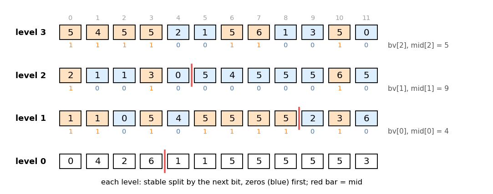
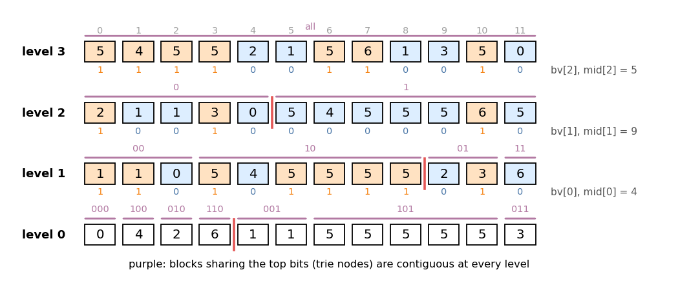
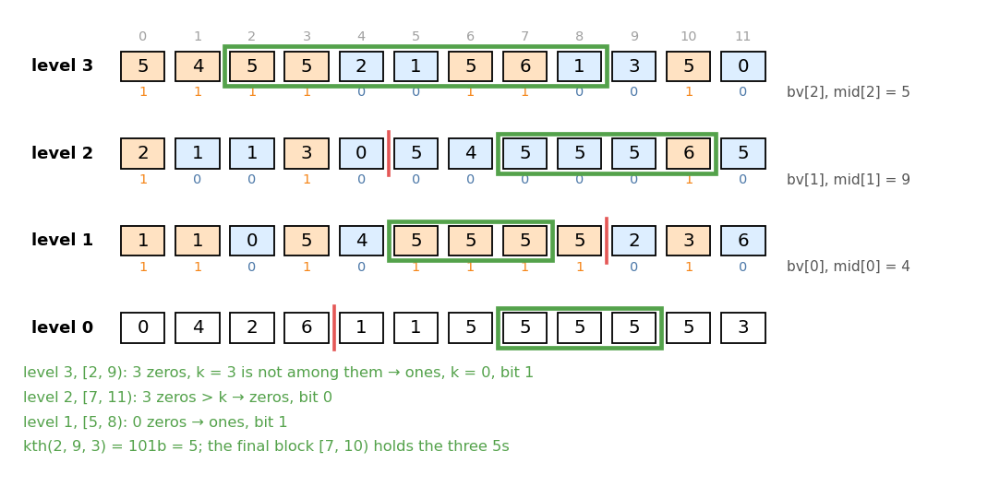
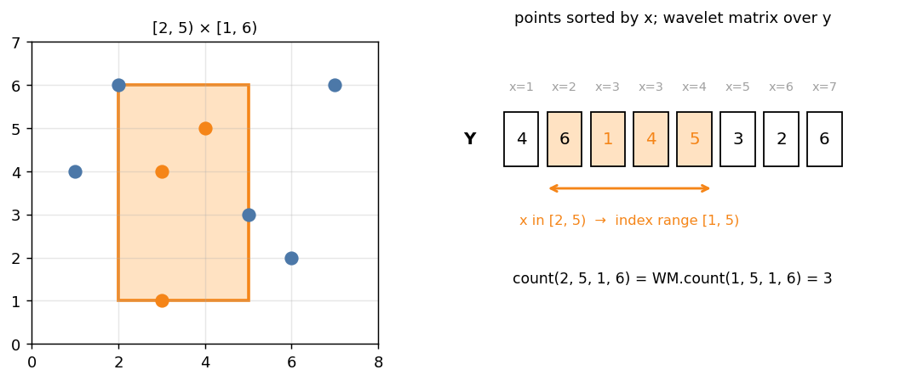

# Wavelet Matrix

Headers:

- [`datastructure/wavelet_matrix/wavelet_matrix.hpp`](../wavelet_matrix/wavelet_matrix.hpp) — §1–9
- [`datastructure/wavelet_matrix/wavelet_matrix_2d_range.hpp`](../wavelet_matrix/wavelet_matrix_2d_range.hpp) — §10
- [`datastructure/wavelet_matrix/wavelet_matrix_old.hpp`](../wavelet_matrix/wavelet_matrix_old.hpp) — §11
- [`graph/datastructure/tree_wavelet_matrix.hpp`](../../graph/datastructure/tree_wavelet_matrix.hpp) — §12

A wavelet matrix stores a static array `A[0..n)` and answers questions about
the points `(i, A[i])` inside a rectangle `[L, R) × [y1, y2)`: how many there
are, the `k`-th smallest value among `A[L..R)`, and a monoid product of
weights attached to them. Each query walks down `log` levels (one per bit of
the values).

Example used throughout (`log = 3`, weight of each element = its value):

```
i     0  1  2  3  4  5  6  7  8  9 10 11
A[i]  5  4  5  5  2  1  5  6  1  3  5  0
```

```cpp
Wavelet_Matrix<int, false, Static_Range_Product_Group<Monoid_Add<long long>>> WM(
    n, [&](int i) -> pair<int, long long> { return {A[i], A[i]}; });
WM.kth(2, 9, 3);          // 5   (A[2..9) sorted: 1 1 2 5 5 5 6)
WM.count(2, 9, 2, 6);     // 4   (values in [2, 6): 5 5 2 5)
WM.prod(2, 9, 2, 6);      // 17  (their weights)

Wavelet_Matrix<long long, true> C(B);   // any values, counting only
```

---

## 1. Levels: stable splits bit by bit

Start with level `log` = the array itself. To go from level `d + 1` to level
`d`, look at bit `d` of every element and **stably** move the elements with
bit `0` to the front, the ones with bit `1` after them:

* `bv[d]`: bit `d` of each element, in level-`d + 1` order (a `Bit_Vector`).
* `mid[d]`: the number of zeros in `bv[d]`, i.e. where the ones start at
  level `d`.



The levels themselves are never stored. Only `bv[d]` and `mid[d]` are kept,
plus, per level, a `SEGTREE` over the weights in that level's order
(`seg[log]` is in the original order).

**Rank in `O(1)`.** `Bit_Vector` stores the bits in 64-bit words, each
with the number of ones before it. `count_prefix(k)` = stored count of the
word + `popcount` of the word's low `k mod 64` bits. Building takes `O(n / 64)`
after the bits are set.

---

## 2. Following a range down one level

Let `[L, R)` be a range at level `d + 1`, and let `a` be the number of ones
in `bv[d]` before `L`, `b` the number before `R`. Because the split is
stable:

* the zeros of `[L, R)` go to positions `[L − a, R − b)` at level `d`
  (`L − a` zeros come before them);
* the ones go to `[mid[d] + a, mid[d] + b)`.

```cpp
auto [L0, R0, L1, R1] = WM.get_subtree(d + 1, L, R);   // two count_prefix calls
```

In the example, `[2, 9)` at level 3 has `a = 2`, `b = 6`, `mid[2] = 5`, so it
splits into the zeros `[0, 3)` (`2 1 1`) and the ones `[7, 11)` (`5 5 5 6`).

## 3. Trie nodes are contiguous

Apply section 2 from level `log` with `[L, R) = [0, n)`: at level `d`, the
elements whose top `log − d` bits equal a fixed prefix form **one contiguous
block**, and inside a block elements keep their original order. Starting from
`[L, R)` instead, the elements of `A[L..R)` with a given prefix also form one
contiguous block, which is what `get_subtree` tracks.



So the levels are the layers of a binary trie on the values, each node laid
out as an interval. Any condition "the top bits of `A[i]` are `p` and
`L ≤ i < R`" is one interval at one level, and a product of weights over it
is one `seg[d].prod`. The blocks appear in bit-reversed prefix order
(`00, 10, 01, 11` at level 1), which never matters because a query only
follows intervals.

---

## 4. `kth`: descend by counting zeros

```cpp
Y kth(int L, int R, int k);   // k-th smallest (0-indexed) of A[L..R), O(log)
```

At each level, the zeros of the current range are the smaller values. If
`k < (number of zeros)`, the answer's bit is `0` and the range becomes the
zero part. Otherwise the bit is `1`, `k −= (number of zeros)`, and the range
becomes the one part.



* `median<false>(L, R)` is `kth(L, R, (R − L − 1) / 2)` (lower median),
  `median<true>` uses `(R − L) / 2`.
* `kth_value_and_prod(L, R, k)` also multiplies `seg[d].prod` of every zero
  part it skips, then the first `k` remaining positions of the final block:
  `{k-th value, product of the k smallest}`. Equal values are taken in index
  order. `k = R − L` gives `{INF, prod_all(L, R)}`.
* `prod_index_range(L, R, k1, k2)`: product of the `[k1, k2)`-th smallest, as
  a quotient of two prefixes (needs `Mono::inverse`).

`kth_value_and_prod(2, 9, 3) = {5, 1 + 1 + 2 = 4}`.

## 5. Counting and products over a value range

**Prefix `[0, y)`.** Walk down along the bits of `y`. When bit `d` of `y` is
`1`, every element of the current range whose bit is `0` is `< y`: take the
zero part as a finished node, then follow the one part. When the bit is `0`,
follow the zero part. This is `work_prefix(f, L, R, y)`, which calls
`f(d, l, r)` on at most `log` disjoint nodes.

**Range `[y1, y2)`.** `work_range` splits like a segment tree on values: at
most two partially covered nodes per level, so `O(log)` nodes in total.

| Query | Result |
|---|---|
| `prefix_count(L, R, y)` / `count(L, R, y1, y2)` | number of points |
| `prefix_prod(L, R, y)` / `prod(L, R, y1, y2)` | product of the nodes' `seg[d].prod` |
| `prefix_count_and_prod` / `count_and_prod` | both |
| `prod_all(L, R)` | `seg[log].prod(L, R)` |

`prefix_count(2, 9, 5) = 3`. Values outside `[0, 2^log)` are clamped: `y ≤ 0`
counts nothing, `y ≥ 2^log` counts everything.

`Mono` must be **commutative**: the nodes are multiplied in trie order, not
index order.

**`next` / `prev`.** The smallest value `≥ y` in `[L, R)` is
`kth(L, R, c)` with `c = prefix_count(L, R, y)`, and `INF` if `c = R − L`.
The largest value `≤ y` is `kth(L, R, c − 1)` with
`c = prefix_count(L, R, y + 1)`, and `−INF` if `c = 0`. Here
`INF = numeric_limits<Y>::max() / 2`.
`next(2, 9, 3) = 5`, `prev(2, 9, 4) = 2`.

## 6. `max_right` / `min_left_many`: binary search on the value

```cpp
// largest y with check(y, #points < y, product of points < y) over [L, R)
tuple<Y, int, T> max_right(int L, int R, F check);
tuple<Y, int, T> max_right_many(vector<pair<int, int>> LR, F check);   // union of ranges
// smallest y with check(y, #points >= y, product of points >= y)
tuple<Y, int, T> min_left_many(vector<pair<int, int>> LR, F check);
```

`check` must be monotone in `y`, and true at the start (`y = 0` for
`max_right`, `y = 2^log` for `min_left_many`). The walk decides bit `d` of
`y`, high to low: it tries `y | 2^d`, which adds the zero part of every
current range, and keeps it if `check` still holds. Then every range moves
into its one part, or into its zero part if the bit was rejected. If `check`
holds for all points, `max_right` returns `{INF, total count, total product}`.

`max_right(2, 9, check = sum ≤ 10) = {5, 3, 4}`: the values `1, 1, 2` (sum
`4`) are below `5`, and adding the three `5`s would exceed `10`.

With several ranges (e.g. the `O(log n)` HLD segments of a tree path), every
range is moved down together, so the cost is
`O(log · |LR|)`.

`cnt` counts every point. When weights act as on/off switches (unit for
"inactive"), read the active count from the product instead.

## 7. Point updates on weights

`work_point(f, i)` follows element `i` down: at level `d + 1` it sits at
position `j`; at level `d` it is at `mid[d] + (ones before j)` if its bit is
`1`, else `j − (ones before j)`. `set(i, x)`, `multiply(i, x)`, `add(i, x)`
apply the same update to `seg[d]` at every level: `O(log)` SEGTREE updates.
The values `A[i]` themselves cannot change.

---

## 8. Compressed and uncompressed

```cpp
template <typename Y, bool compress, typename SEGTREE = Dummy_Data_Structure>
using Wavelet_Matrix = ...;
```

| `compress` | Struct | Values |
|---|---|---|
| `false` | `Uncompressed_Wavelet_Matrix<Y, SEGTREE>` | `Y = int / long long`, `0 ≤ A[i] < 2^log`; `log` is computed from the max, or passed |
| `true` | `Compressed_Wavelet_Matrix<Y, SEGTREE>` | any ordered `Y`; replaced by their rank among the distinct values `key` |

The compressed version builds an uncompressed one (`wm`) on ranks. A query
value `y` becomes `idx(y) = #keys < y` (`lower_bound`), and results map back
through `key`, so every query has the same meaning on the original values.
Example: `B = {-7, 300, 42, -7, 10^12, 42}` gives `key = {-7, 42, 300,
10^12}`, `kth(0, 6, 4) = 300`, `count(0, 6, 0, 500) = 3`.

The `log` argument of the uncompressed version fixes the height (all values
`< 2^log`), e.g. to make `max_right` / `min_left_many` range over a known
`[0, 2^log)`.

## 9. `SEGTREE`: the weights

`SEGTREE` is built once per level from the weights in that level's order.
It needs `MX` (a commutative monoid), `build(const vector<T>&)` and
`prod(l, r) const`. Point updates also need `set` / `multiply` / `add`.

| `SEGTREE` | Weights |
|---|---|
| `Dummy_Data_Structure` (default) | none: counts, `kth`, `next` / `prev` only; build from `vector<Y>` |
| `Static_Range_Product_Group<G>` | static, group (`O(1)` prod) |
| `FenwickTree<G>` | group, point `add` / `set` |
| `SegTree<M>` | any commutative monoid, point `set` / `multiply` |
| `Sparse_Table<M>` | static, idempotent (`min`, `max`) |

Build with weights through `f(i) = {A[i], weight}`:
`Wavelet_Matrix<Y, c, SEGTREE> WM(n, f)`.

---

## 10. `Wavelet_Matrix_2D_Range`: points in the plane

```cpp
template <typename XY, bool compress_X, bool compress_Y, typename SEGTREE = Dummy_Data_Structure>
struct Wavelet_Matrix_2D_Range;
Wavelet_Matrix_2D_Range<int, true, true, FenwickTree<Monoid_Add<long long>>> WM(
    n, [&](int i) -> tuple<int, int, long long> { return {X[i], Y[i], W[i]}; });
WM.prod(x1, x2, y1, y2);   // weights in [x1, x2) × [y1, y2)
```

Sort the points by `x` and build a wavelet matrix over their `y` in that
order. The points with `x1 ≤ x < x2` are then an index interval (found with
`lower_bound` on the sorted `x`), and the rectangle query is a wavelet matrix
query on that interval.



* `compress_X = false` compresses `x` with a dense table over `[min x, max x]`
  (needs `XY = int` and a small range); `compress_Y` is the wavelet matrix's
  `compress`.
* `set` / `multiply` / `add(i, x)` take the point's index **as given to
  build**; `new_idx[i]` is its position after sorting.
* Points that appear later (online insertions) are handled offline: build
  with every point that will ever exist, weight `unit`, and set the weight
  when the point appears (`point_add_rectangle_sum`).

Queries: `count`, `prefix_count`, `prod`, `prefix_prod`, `count_and_prod`,
`prefix_count_and_prod`, `prod_all(x1, x2)`, `max_right(x1, x2, check)`
(uncompressed `y`).

---

## 11. `Wavelet_Matrix_Old`: xor and lists of ranges

```cpp
template <typename T, bool COMPRESS, typename Monoid = Monoid_Add<T>>
struct Wavelet_Matrix_Old;
Wavelet_Matrix_Old<long long, false> WM(A, SUM_data = {}, log = -1);
```

The same levels with two extras and a simpler weight model:

* **`xor_val`.** Queries on the array `A[i] ^ v`. At level `d`, if bit `d`
  of `v` is `1`, then the elements with bit `1` are the smaller ones after the
  xor, so the zero and one parts swap roles. Pass `log` at build (all values
  `< 2^log`) and use `COMPRESS = false`.
* **Lists of ranges.** `count`, `kth`, `median`, `kth_value_and_sum`,
  `sum_all` also take `vector<pair<int, int>>`, the union of several ranges,
  moved down together as in section 6.
* **Weights.** `SUM_data` is kept as prefix sums per level (a group:
  `Monoid::inverse`), so there are no updates. Sums are by rank:
  `kth_value_and_sum(L, R, k)` = `{k-th value, sum of the k smallest}`,
  `sum(L, R, k1, k2)` = sum of the `[k1, k2)`-th smallest. Equal values are
  taken in range order, then index order.

| Member | Meaning |
|---|---|
| `count(L, R, a, b, xor_val = 0)` | `#{i : a ≤ A[i]^v < b}` (also on a range list) |
| `kth(L, R, k, xor_val)` / `median(UPPER, L, R, xor_val)` | as above (also on a range list) |
| `kth_value_and_sum`, `sum`, `sum_all` | weights by rank |
| `max_right(check, L, R, xor_val)` | largest `(cnt, sum)` of a smallest-first prefix with `check(cnt, sum)` |

## 12. `Tree_Wavelet_Matrix`: paths and subtrees

```cpp
template <typename TREE, bool edge, typename T, bool COMPRESS, typename Monoid = Monoid_Add<T>>
struct Tree_Wavelet_Matrix;
Tree_Wavelet_Matrix<decltype(tree), false, long long, false> TW(tree, A, SUM = {}, log = -1);
```

Put the value of vertex `v` at position `LID[v]` of a `Wavelet_Matrix_Old`
(for `edge = true`, the value of edge `e` at `LID` of its child endpoint).
In HLD order:

* the subtree of `u` is the range `[LID[u], RID[u])`, without `LID[u]` itself
  for edges;
* a path is `O(log n)` ranges (`tree.get_path_decomposition`), queried
  together as a range list.

| Member | Meaning |
|---|---|
| `count_path(s, t, a, b, xor_val)` / `count_subtree(u, ...)` | values in `[a, b)` |
| `kth_path`, `kth_subtree`, `median_path`, `median_subtree` | order statistics |
| `kth_value_and_sum_path` / `_subtree`, `sum_path(s, t, k1, k2)`, `sum_subtree`, `sum_all_path`, `sum_all_subtree` | weights by rank |
| `count_subtree_root(u, a, b, root, xor_val)` | `count_subtree` with the tree rerooted at `root` (vertex values) |

For `count_subtree_root`: if `root` is outside `u`'s subtree it is the
ordinary subtree, if `root = u` it is the whole tree, and otherwise it is
everything except the subtree of `u`'s child towards `root`: two ranges.

---

## 13. Reference: `Wavelet_Matrix`

| Member | Meaning |
|---|---|
| `Wavelet_Matrix<Y, compress> WM(A)` | counting only |
| `Wavelet_Matrix<Y, compress, SEGTREE> WM(n, f)` | `f(i) = {A[i], weight}`; uncompressed also takes `log` |
| `kth(L, R, k)`, `median<upper>(L, R)` | order statistics |
| `prefix_count`, `count` | points in `[L, R) × [−∞, y)` / `[y1, y2)` |
| `prefix_prod`, `prod`, `prod_all` | weight products |
| `prefix_count_and_prod`, `count_and_prod` | both at once |
| `kth_value_and_prod(L, R, k)`, `prod_index_range(L, R, k1, k2)` | weights by rank |
| `next(L, R, y)`, `prev(L, R, y)` | nearest value `≥ y` / `≤ y`, `±INF` if none |
| `set`, `multiply`, `add(i, x)` | weight updates |
| `max_right(L, R, check)`, `max_right_many(LR, check)`, `min_left_many(LR, check)` | binary search on `y` (uncompressed) |
| `key`, `wm` | compressed: sorted distinct values and the inner matrix on ranks |
| `n`, `log`, `mid`, `bv`, `seg`, `get_subtree`, `work_prefix`, `work_range`, `work_point` | uncompressed internals |

Build `O(n log)` plus `log + 1` SEGTREE builds; queries `O(log)` levels with
`O(1)` rank, plus one SEGTREE product per visited node.
