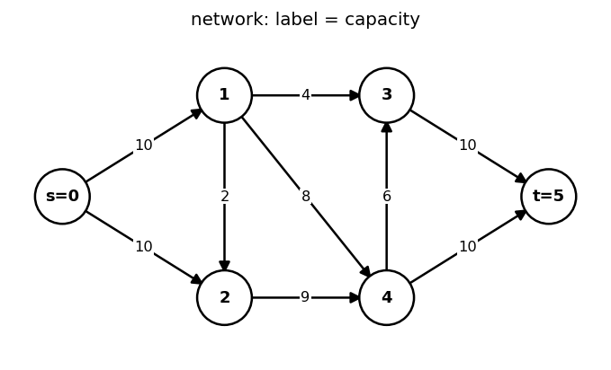
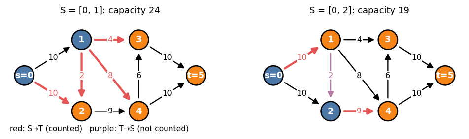
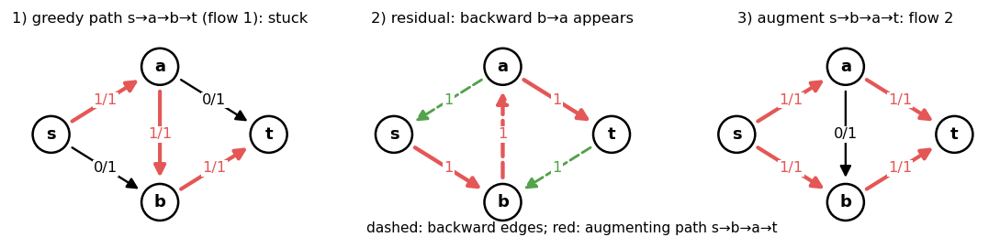
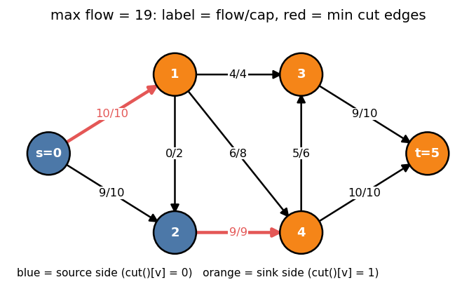
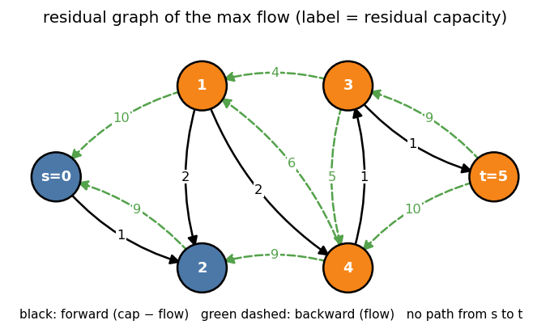
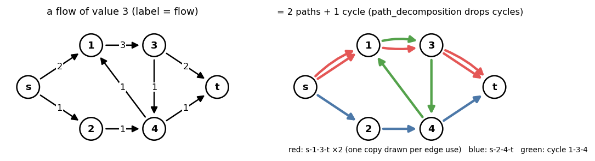

# 1. Flow Fundamentals

Example network for chapters 1–3 (`s = 0`, `t = 5`):



---

## 1. Networks and flows

A **network** is a directed graph `G = (V, E)` with

- a **capacity** `c(e) ≥ 0` on every edge,
- a **source** `s` and a **sink** `t`.

A **flow** is a function `f : E → ℝ` with

| Constraint | Meaning |
|---|---|
| capacity | `0 ≤ f(e) ≤ c(e)` for every edge |
| conservation | `Σ_{e into v} f(e) = Σ_{e out of v} f(e)` for every `v ∉ {s, t}` |

The **value** `|f|` = (flow out of `s`) − (flow into `s`) = (flow into `t`) − (flow out of `t`).
The **max flow problem**: maximize `|f|`.

Parallel edges and antiparallel pairs (`u → v` and `v → u`) are allowed; each is a
separate edge with its own capacity. An undirected edge of capacity `c` is two
directed edges `u → v`, `v → u` of capacity `c` (in the library: `add(u, v, c, c)`).

---

## 2. Cuts

An **s–t cut** is a partition `V = S ⊔ T` with `s ∈ S`, `t ∈ T`. Its capacity

  `cap(S, T) = Σ c(e)` over edges `e = (u → v)` with `u ∈ S`, `v ∈ T`.

Edges from `T` to `S` do **not** count.



**Flow across a cut.** For any flow `f` and any cut `(S, T)`:

  `|f| = f(S → T) − f(T → S)`

Proof: sum conservation over all `v ∈ S`; internal edges cancel, only edges
crossing the cut remain, and the `s` term is `|f|`.

**Weak duality.** `|f| = f(S → T) − f(T → S) ≤ f(S → T) ≤ cap(S, T)`.
So every flow value is at most every cut capacity.

---

## 3. Residual graph

Given a flow `f`, the **residual graph** `G_f` has, for every edge `e = u → v`:

| Residual edge | Capacity | Meaning |
|---|---|---|
| `u → v` (forward) | `c(e) − f(e)` | can still push this much |
| `v → u` (backward) | `f(e)` | can cancel this much |

Only edges with positive residual capacity are present.

An **augmenting path** is an `s → t` path in `G_f`. Pushing `δ` = (minimum
residual capacity on the path) along it increases `|f|` by `δ`: forward edges get
`+δ`, backward edges cancel `δ` of existing flow. Conservation still holds at
every inner vertex (one unit in, one unit out of the path).

Backward edges are essential. Without them a greedy choice cannot be undone:



---

## 4. Max-flow min-cut theorem

**Theorem.** For a flow `f` the following are equivalent:

1. `f` is a maximum flow.
2. `G_f` has no augmenting path.
3. `|f| = cap(S, T)` for some cut `(S, T)`.

Proof.

- (1 ⇒ 2): an augmenting path would increase `|f|`.
- (2 ⇒ 3): let `S` = vertices reachable from `s` in `G_f`; `t ∉ S`.
  Every edge `u → v` with `u ∈ S, v ∈ T` is saturated (`f = c`), otherwise `v` would be
  reachable. Every edge `v → u` from `T` to `S` has `f = 0`, otherwise the backward
  residual `u → v` would make `v` reachable. Then `|f| = f(S → T) − f(T → S) = cap(S, T)`.
- (3 ⇒ 1): by weak duality no flow exceeds `cap(S, T)`.

So **max flow = min cut**, and the proof gives the min cut directly: the vertices
reachable from `s` in the final residual graph. This is exactly what
`MaxFlow::cut()` returns.





In the example `S = {0, 2}`; the cut edges `0 → 1` (10) and `2 → 4` (9) are saturated,
and their capacities sum to the flow value 19.

---

## 5. Ford–Fulkerson and its variants

```
f = 0
while there is an s→t path P in G_f:
    δ = min residual capacity on P
    push δ along P
```

| Path choice | Bound | Remark |
|---|---|---|
| any path (DFS) | `O(F · M)` for integer capacities | `F` can be huge; may not terminate for irrational capacities |
| shortest path (BFS), **Edmonds–Karp** | `O(N M²)` | `dist(s, v)` never decreases; each edge is a bottleneck `O(N)` times |
| widest path | `O(M log U · (M + N log N))` | rarely used |
| **Dinic** (chapter 2) | `O(N² M)` | all shortest paths of one length per phase |
| capacity scaling | `O(M² log U)` | push only paths with residual `≥ Δ`, halve `Δ` |

---

## 6. Integrality

**Theorem.** If every capacity is an integer, there is an integral maximum flow,
and every augmenting-path algorithm finds one.

Every augmentation pushes an integer `δ` because all residual capacities stay
integers. This is what makes flow a combinatorial tool: matchings, disjoint paths
and covers are read directly off a 0/1 flow.

---

## 7. Flow decomposition

**Theorem.** Every flow decomposes into at most `M` weighted `s → t` paths and
cycles, with the paths' weights summing to `|f|`.

Repeatedly: start at `s` (or at any vertex with positive outflow) and follow edges
with positive flow; either reach `t` (a path) or revisit a vertex (a cycle).
Subtract the minimum flow on it. Each step zeroes at least one edge.



Cycles carry no value, so `path_decomposition()` in the library returns only the
`|f|` unit `s → t` paths (for an integral flow). It walks unit by unit, and when a
walk revisits a vertex it pops back to that vertex, so cycles are cut out on the
fly and every returned path is **simple**. Cost `O(F · (N + M))`.

---

## 8. Cheat sheet

```
|f| ≤ cap(S, T) for every flow and every cut              (weak duality)
max |f| = min cap(S, T)                                      (max-flow min-cut)
f is max ⇔ no s→t path in the residual graph
min cut S = reachable from s in the final residual graph     (MaxFlow::cut)
residual: forward c − f, backward f
integer capacities ⇒ integral max flow
flow = Σ paths + Σ cycles; paths carry the value
```
