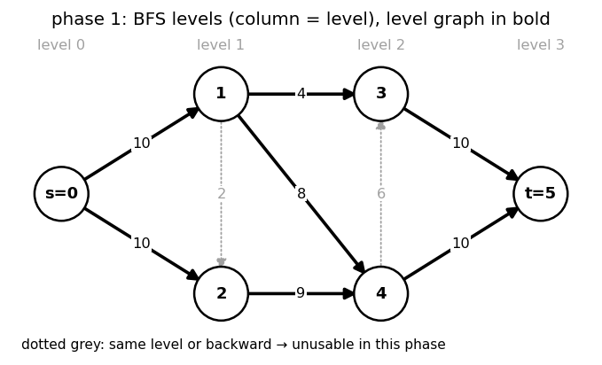
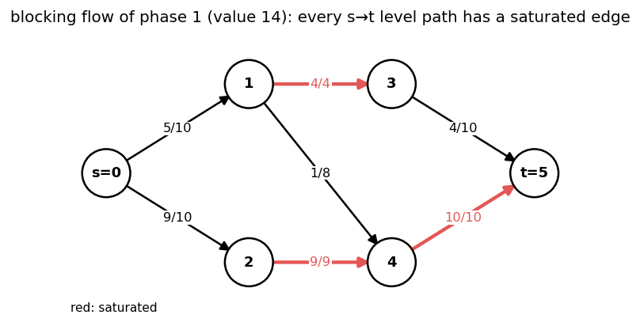
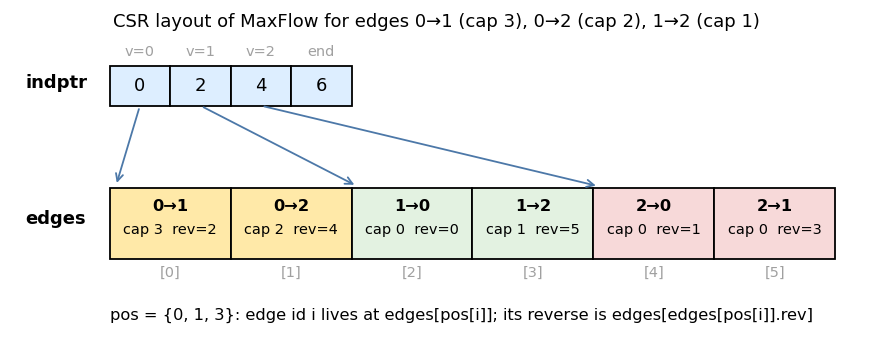

# 2. Dinic and `MaxFlow`

Headers: [`flow/maxflow.hpp`](../maxflow.hpp), [`flow/incremental_maxflow.hpp`](../incremental_maxflow.hpp).

---

## 1. The algorithm

```
repeat:
    BFS from s in G_f → level[v] = dist(s, v)          (stop if t unreachable)
    level graph L = residual edges u→v with level[v] = level[u] + 1
    find a BLOCKING flow in L: every s→t path in L has a saturated edge
    add it to f
```



The blocking flow is found by DFS with a **current-edge pointer** `prog[v]`:
an edge that fails (dead end or saturated) is never retried in this phase.



On the example:

| Phase | `dist(s, t)` | Pushed | Total |
|---|---|---|---|
| 1 | 3 | 14 (paths `s→·→·→t` of length 3) | 14 |
| 2 | 4 | 5 (paths through `4 → 3`, e.g. `s → 2 → 4 → 3 → t`) | 19 |

After phase 2, `t` is unreachable and 19 is the max flow. The edge `4 → 3` is not in
the phase-1 level graph (both endpoints are on level 2), so it can only be used once
the distance has grown to 4.

---

## 2. Complexity

**Lemma 1 (distance grows).** After each phase, `dist_f(s, t)` strictly increases.

New residual edges created by the phase are reversals of level edges, so they go from
level `k + 1` to level `k`. A path that uses any of them, or any non-level edge, is
longer than `level[t]`. A path of length exactly `level[t]` would use only level edges,
but the blocking flow saturated an edge on every such path. So the next phase sees a
strictly larger distance. Distances are at most `N − 1`, so there are **at most `N − 1`
phases**.

**Lemma 2 (one phase in `O(N M)`).** Each DFS step either advances along an edge
(at most `N` advances before reaching `t` or retreating) or discards an edge forever via
`prog`. Each successful path saturates at least one edge, so at most `M` paths, each
`O(N)`: `O(N M)` per phase.

| Network | Total |
|---|---|
| general | `O(N² M)` |
| unit capacities | `O(M · min(√M, N^{2/3}))` |
| unit capacities, every inner vertex has in-degree 1 or out-degree 1 (bipartite matching, vertex-split graphs) | `O(M √N)` |

Unit capacity bound: after `√M` phases `dist(s, t) ≥ √M`. The remaining flow decomposes
into edge-disjoint paths, each of length `≥ √M`, so at most `M / √M = √M` units remain,
and each further phase adds at least one. Hence `O(√M)` phases of `O(M)` each.

In practice Dinic is far faster than these bounds; `N = 10⁴, M = 10⁵` general graphs
run in milliseconds.

---

## 3. `MaxFlow<Cap>` implementation

### 3.1 Storage: CSR

Edges are collected in `edge_pool` by `add()` and laid out on the first `flow()`:



| Member | Meaning |
|---|---|
| `indptr[v] .. indptr[v+1]` | slots of the edges leaving `v` (forward and reverse halves) |
| `edges[i] = {to, rev, cap}` | `cap` = **residual** capacity; `rev` = slot of the paired edge |
| `init_cap[i]` | original capacity of slot `i`; flow on slot `i` = `init_cap[i] − cap` |
| `pos[id]` | slot of the forward half of edge `id` (ids are `add` call order) |

Only the residual graph is stored. A self-loop `a → a` takes two slots of `a`.

### 3.2 Phase loop

```cpp
while (1) {
    bfs();                                  // level[] from source, stops early at sink
    if (level[sink] == -1) break;
    copy(indptr) → prog;                    // current-edge pointers
    flow_ans += dfs(sink, INF);
}
```

The DFS runs **from the sink back to the source** (as in ACL): at `v` it looks at
edges `v → u` with `level[u] = level[v] − 1` and uses the capacity of the paired
edge `u → v`. Only vertices that can still reach `s` inside the level graph are
expanded, which is faster than the textbook source-side DFS when many vertices are
not on short `s–t` paths. A vertex that delivers less than requested is marked dead
(`level[v] = N`) for the rest of the phase.

### 3.3 Infinite capacities

Use `infty<Cap>` (`= max / 2`) for "infinite" edges. If the flow reaches `infty<Cap>`
the loop stops and `flow()` returns `infty<Cap>`, meaning **unbounded** (an
`s → t` path of infinite edges). Sums of a few `infty` values do not overflow
because `infty = max / 2`; still prefer `Cap = long long`.

---

## 4. API

```cpp
MaxFlow<long long> F(N, s, t);
int id = 0;
F.add(u, v, cap);              // edge id 0
F.add(a, b, c, c);             // edge id 1, undirected
long long f = F.flow();
```

| Method | Description | Cost |
|---|---|---|
| `MaxFlow(N, s, t)` | empty network | |
| `add(frm, to, cap, rev_cap = 0)` | edge `frm → to` (plus `to → frm` with `rev_cap`); ids `0, 1, ...` in call order; **only before the first `flow()`** | `O(1)` |
| `flow()` | max flow value; cached until a capacity changes | Dinic |
| `cut()` | `{value, side}`: `side[v] = 0` iff `v` is reachable from `s` in the residual graph | `O(N + M)` |
| `get_flow_edges()` | `(frm, to, flow)` for every slot with positive flow | `O(N + M)` |
| `path_decomposition()` | `|f|` simple `s → t` vertex lists (integral flows) | `O(F (N + M))` |
| `res_graph()` | `Graph<int, 1>`, edge `u → v` iff residual capacity `> 0` | `O(N + M)` |
| `change_capacity(i, c)` | set edge `i`'s capacity to `c`, keeping the flow maximum | `O((N + M) · |Δ|)` |
| `operator<<` | prints `frm to cap flow` per used slot | |

Example (the network of chapter 1):

```cpp
MaxFlow<int> F(6, 0, 5);
F.add(0, 1, 10), F.add(0, 2, 10), F.add(1, 2, 2), F.add(1, 3, 4), F.add(1, 4, 8);
F.add(2, 4, 9), F.add(4, 3, 6), F.add(3, 5, 10), F.add(4, 5, 10);
F.flow();          // 19
F.cut().second;    // {0, 1, 0, 1, 1, 1}
```

### 4.1 `change_capacity(i, after)`

Let `before` = old capacity and `f_i` the flow on edge `i`.

| Case | What happens |
|---|---|
| `after ≥ before` | residual grows by `after − before`. If the edge had residual left (`cap > 0`), it is not in any min cut and the flow stays maximum; otherwise `flow()` recomputes from the current residual |
| `f_i ≤ after < before` | residual shrinks; flow still valid and maximum |
| `after < f_i` | the excess `x = f_i − after` must be removed |

Removing excess on edge `a → b` (think of the path–cycle decomposition):

1. cancel cycles through `a → b`: find residual paths `a → b` and push along them
   (value unchanged);
2. whatever is left belongs to `s → a → b → t` paths: push `x'` along residual
   `a → s` and `t → b`, then reduce the edge; `flow_ans −= x'`.

Each unit costs one DFS, so `O((N + M) · |Δ|)`; then `flow()` may augment again.

---

## 5. `Incremental_MaxFlow<Cap>`

Same interface (`add`, `flow`, `cut`, `get_flow_edges`, `path_decomposition`), but
edges are stored in linked adjacency lists (`head`, `nxt`; slot `i` and its pair `i ^ 1`),
so `add()` is allowed at any time.

```cpp
Incremental_MaxFlow<int> F(N, s, t);
for (auto [a, b, c] : first) F.add(a, b, c);
int f1 = F.flow();
for (auto [a, b, c] : more) F.add(a, b, c);
int f2 = F.flow();          // continues from the residual of f1
```

- `flow()` runs Dinic from the **current** residual graph, so the flow only grows and
  the total number of augmentations over all calls is bounded by the final value.
- Typical use: answer "max flow after the first `k` edges" for every `k`, or binary
  search on time in a time-expanded network while adding layers.
- Self-loops are ignored.

| | `MaxFlow` | `Incremental_MaxFlow` |
|---|---|---|
| layout | CSR (cache friendly) | linked lists |
| add after `flow()` | no (asserts) | yes |
| `change_capacity`, `res_graph` | yes | no |

---

## 6. Pitfalls

- `Cap` must hold the **sum** of capacities: use `long long` when in doubt.
- `cut()` sides are `0` = source side, `1` = sink side.
- `path_decomposition()` needs an integral flow and is `O(F)`; for big `F` use
  `get_flow_edges()`.
- Recursion depth of the DFS is the level of the sink (`≤ N`).

---

## 7. Cheat sheet

```
phases ≤ N − 1 (dist(s,t) strictly grows); each phase O(NM)    → O(N²M)
unit caps: O(M√M); unit network (matching): O(M√N)
MaxFlow: add all edges → flow() → cut() / get_flow_edges() / path_decomposition()
edge id = add order; change_capacity(id, c) keeps the flow optimal
infinite capacity: infty<Cap>; flow() == infty<Cap> ⇒ unbounded
need add() after flow(): Incremental_MaxFlow
```
