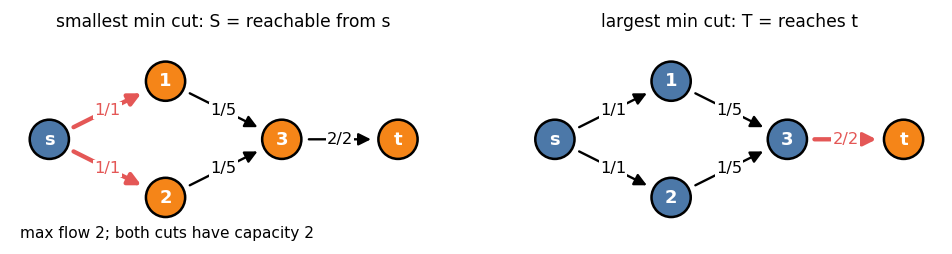
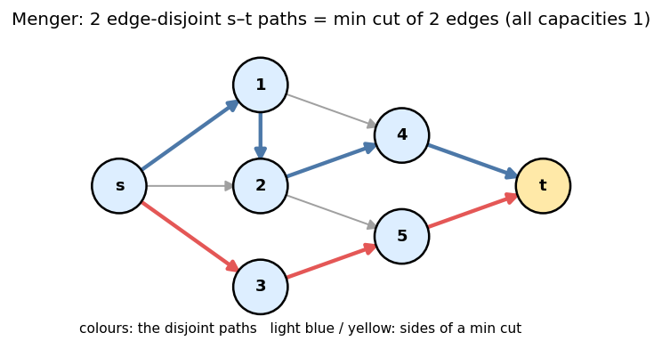
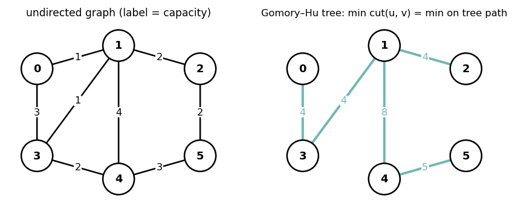

# 3. Min Cut

Headers: [`flow/maxflow.hpp`](../maxflow.hpp), [`flow/gomory_hu_tree.hpp`](../gomory_hu_tree.hpp),
[`graph/connectivity/strongly_connected_component.hpp`](../../graph/connectivity/strongly_connected_component.hpp).

---

## 1. Reading the min cut

```cpp
auto [val, side] = F.cut();            // side[v] = 0: source side, 1: sink side
vector<pair<int, int>> cut_edges;
for (auto [a, b, c] : original_edges)
    if (side[a] == 0 && side[b] == 1) cut_edges.push_back({a, b});
// Σ capacities of cut_edges == val
```

- `side` is the **smallest** source side: `S = {v : v reachable from s in G_f}`.
- Every cut edge is saturated; every edge from `T` to `S` carries 0 flow.
- The number of cut edges is not minimized, only their total capacity. For "fewest
  edges among min cuts", use capacities `c · (M + 1) + 1`.

---

## 2. All min cuts

Min cuts are not unique. In `G_f` (any max flow `f`):

- `S_min` = vertices reachable from `s` → smallest min cut.
- `T_min` = vertices that can reach `t` → `S_max = V ∖ T_min` is the largest min cut.



**Theorem (Picard–Queyranne).** The min cuts are exactly the sets `S` with
`S_min ⊆ S ⊆ S_max` that are **closed** in `G_f` (no residual edge leaves `S`).
Equivalently: contract the SCCs of `G_f`; a min cut is a downward-closed set of the
condensation containing `s`'s component and not `t`'s.

| Question about edge `u → v` (with positive capacity) | Test in `G_f` |
|---|---|
| in **some** min cut | saturated (`f = c`) and `u`, `v` in different SCCs of `G_f` |
| in **every** min cut | saturated, `u` reachable from `s`, and `v` reaches `t` |
| min cut is unique | `S_min = S_max` (every vertex reachable from `s` or reaching `t`) |

```cpp
F.flow();
auto R = F.res_graph();                              // residual edges u→v
auto [K, comp] = strongly_connected_component(R);
auto [val, side] = F.cut();                          // side = 1 − reach_from_s
// reach_to_t: BFS from t over reversed R
```

Increasing the capacity of an edge raises the max flow ⇔ the edge is in **every** min
cut. Decreasing it lowers the max flow ⇔ it is in **some** min cut and saturated.

---

## 3. Variants

| Want | Construction |
|---|---|
| min **vertex** cut separating `s` and `t` | split `v` into `v_in → v_out` with capacity `c(v)` (∞ for `s`, `t`); original edges get ∞ |
| min cut in an **undirected** graph | `add(u, v, c, c)` |
| min cut separating sets `A` and `B` | super source `→ A` (∞), `B →` super sink (∞) |
| global min cut (any `s`, `t`), undirected | min over `t ≠ 0` of `mincut(0, t)` (`N − 1` flows) or the min edge of a Gomory–Hu tree |
| cut must keep `u` and `v` together | edges `u → v` and `v → u` with ∞ |
| if `u ∈ S` then `v ∈ S` | edge `u → v` with ∞ (cutting it would cost ∞) |

The last row is the base of chapter 10: **infinite edges encode implications**.

---

## 4. Menger's theorems

| Theorem | Statement | Flow model |
|---|---|---|
| edge version | max number of edge-disjoint `s–t` paths = min number of edges whose removal separates `s` from `t` | every edge capacity 1 |
| vertex version | max number of internally vertex-disjoint `s–t` paths = min number of vertices (≠ `s`, `t`) separating them (`s`, `t` non-adjacent) | split every vertex, capacity 1 |



The paths themselves come from `path_decomposition()`. Edge connectivity of an
undirected graph: `λ(G) = min_t mincut(0, t)`. Vertex connectivity needs pairs
`(u, v)` over a small set of `u`; for CP limits, try `u` among `κ + 1` vertices.

---

## 5. Gomory–Hu tree

For an **undirected** graph with nonnegative capacities there is a weighted tree `T`
on the same vertex set such that for every pair `u, v`:

  `mincut_G(u, v) = min weight on the u–v path in T`,

and removing that minimum tree edge gives the two sides of a min `u–v` cut in `G`.



### 5.1 Construction (Gusfield)

```
par[v] = 0 for all v ≥ 1
for s = 1 .. N−1:
    t = par[s]
    (val, side) = mincut(s, t) in G            (one max flow on the whole graph)
    wt[s] = val
    for v ≠ s with par[v] == t and v on s's side: par[v] = s
    if par[t] is on s's side: swap roles (par[s] = par[t], par[t] = s, swap weights)
tree edges: (par[v], v, wt[v]) for v = 1..N−1
```

`N − 1` max flows on the original graph, no contraction needed. The tree is not unique
(the library's tree for the example differs from other valid trees) but all path minima
agree.

### 5.2 Usage

```cpp
Graph<long long, 0> G(N);
for (auto [u, v, c] : edges) G.add(u, v, c);     // undirected, cost = capacity
G.build();
Graph<long long, 0> T = gomory_hu_tree(G);        // N − 1 edges, cost = cut value
```

| Query | How |
|---|---|
| `mincut(u, v)` for one pair | path min on `T` (BFS / DFS) |
| many pairs | `Tree` + path-min (`graph/datastructure/tree_monoid`), or offline DSU |
| `Σ_{u<v} mincut(u, v)` | sort tree edges by weight **descending**, union with DSU; an edge of weight `w` joining components of sizes `a`, `b` contributes `w · a · b` |
| global min cut | minimum tree edge |
| number of distinct pair values | at most `N − 1` |

Example (figure): `mincut(0, 2)` = min on path `0 − 3 − 1 − 2` = `min(4, 4, 4)` = 4;
`mincut(1, 4)` = 8 = weighted degree of 1.

Assumes every cut is below `INF`.

---

## 6. Cheat sheet

```
cut().second: 0 = reachable from s in residual (smallest min cut)
largest min cut: complement of {v : v reaches t in residual}
edge in some min cut: saturated + endpoints in different SCCs of residual
edge in every min cut: saturated + s ⇝ u and v ⇝ t in residual
∞ edge u→v: "u on source side ⇒ v on source side"
vertex cut: split vertices; disjoint paths: unit capacities (Menger)
Gomory–Hu: N−1 flows; mincut(u,v) = path min; Σ over pairs via DSU on sorted edges
```
