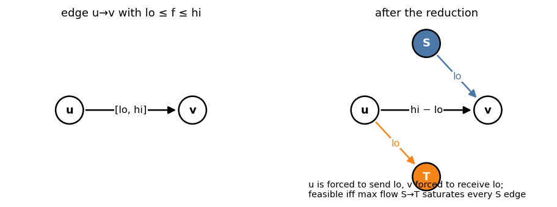

# 4. Lower Bounds and Circulations

Header: [`flow/maxflow_with_lowerbound.hpp`](../maxflow_with_lowerbound.hpp).

---

## 1. Problems

Each edge `e = u → v` has `lo(e) ≤ f(e) ≤ hi(e)`.

| Problem | Want |
|---|---|
| feasible circulation | conservation at **every** vertex (no `s`, `t`) |
| feasible s–t flow | conservation except at `s`, `t` |
| max s–t flow with lower bounds | feasible, maximize `|f|` |
| min s–t flow with lower bounds | feasible, minimize `|f|` |

Typical sources: "each road must be used at least once", "each worker does between
`a` and `b` jobs", grid problems with exact row / column sums given as ranges.

---

## 2. Reduction to ordinary max flow

Write `f(e) = lo(e) + g(e)` with `0 ≤ g(e) ≤ hi(e) − lo(e)`. Sending `lo(e)` on every
edge for free breaks conservation: vertex `v` gets an **excess**

  `ex(v) = Σ_{e into v} lo(e) − Σ_{e out of v} lo(e)`.

The remaining flow `g` must repair it: `g` has to bring `−ex(v)` more into `v` than out.
Add a super source `S` and super sink `T`:

| New edge | Capacity |
|---|---|
| `u → v` for each original edge | `hi − lo` |
| `S → v` | `lo` of each edge into `v` (total `Σ lo` in) |
| `u → T` | `lo` of each edge out of `u` |



**Feasible circulation ⇔ max flow `S → T` saturates every `S` edge**
(value = `Σ lo(e)`). Then `f(e) = lo(e) + g(e)`.

For an **s–t** flow, add `t → s` with capacity ∞ first: the s–t flow becomes a
circulation.

### 2.1 Max s–t flow with lower bounds

1. Add `t → s` (∞), check feasibility with `S → T` as above.
2. Remove `t → s` (its flow `x` is the current `|f|`) and run max flow `s → t` on the
   residual graph (ignoring `S`, `T`).
3. Answer = `x` + this extra flow.

### 2.2 Min s–t flow with lower bounds

Same, but in step 2 push as much as possible **back** from `t` to `s`:
answer = `x` − maxflow(`t → s`) in the residual graph.

---

## 3. `MaxFlow_With_LowerBound<Cap>`

```cpp
MaxFlow_With_LowerBound<long long> F(N, s, t);
F.add(u, v, lo, hi);                    // 0 ≤ lo ≤ hi
long long f = F.flow();                 // max s–t flow, −1 if infeasible
vector<long long> x = F.get_flow_result();   // flow per edge, in add order
```

| Method | Description |
|---|---|
| `add(frm, to, lo, hi)` | edge with bounds; before `flow()` |
| `flow()` | max s–t flow value; `−1` if no feasible flow exists |
| `get_flow_result()` | flow on each edge (asserts feasible) |
| `operator<<` | prints the edges with their bounds |

Implementation: each edge becomes up to 3 internal edges (`hi − lo`, `S → to`,
`frm → T`) on `N + 2` vertices in CSR form. Instead of an explicit `t → s` edge, four
Dinic runs are done in the order

  `S → T`, `S → t`, `s → T`, `s → t`

which routes flow exactly as if `t → s` had capacity ∞ (`S → t` then `s → T` is the
detour through the missing edge). Feasible iff every `S` edge is saturated; the answer is
the flow of the last two runs. Self-loops are accepted and get flow `lo`.

Example:

```cpp
MaxFlow_With_LowerBound<int> F(4, 0, 3);
F.add(0, 1, 0, 3); F.add(0, 2, 0, 2); F.add(1, 2, 1, 2);
F.add(1, 3, 0, 1); F.add(2, 3, 2, 4);
F.flow();               // 5
F.get_flow_result();    // {3, 2, 2, 1, 4}
// with 2 → 3 in [5, 6] instead: flow() == −1 (at most 4 can reach vertex 2)
```

For a pure circulation, pick any `s ≠ t` with no edges at all (or add two isolated
vertices) and check `flow() != −1`.

---

## 4. Cheat sheet

```
f = lo + g, 0 ≤ g ≤ hi − lo
excess(v) = Σ lo in − Σ lo out → S→v / v→T edges of the lo's
feasible ⇔ maxflow(S, T) = Σ lo
s–t version: add t→s ∞; max: then augment s→t; min: then push t→s back
MaxFlow_With_LowerBound: flow() = max s–t flow or −1
```
