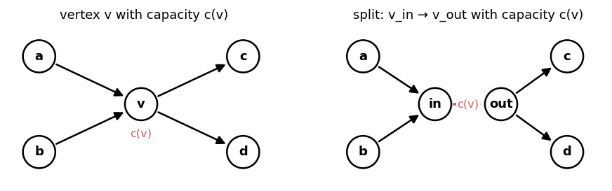
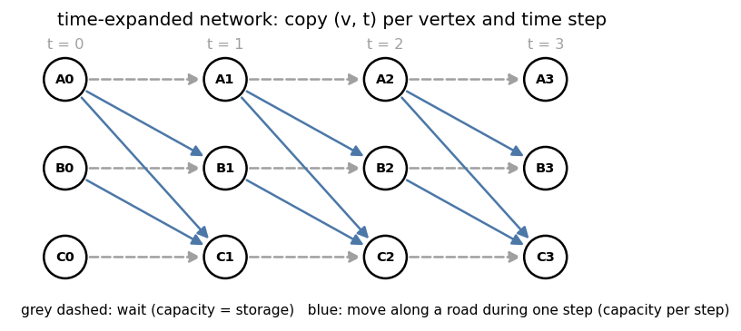
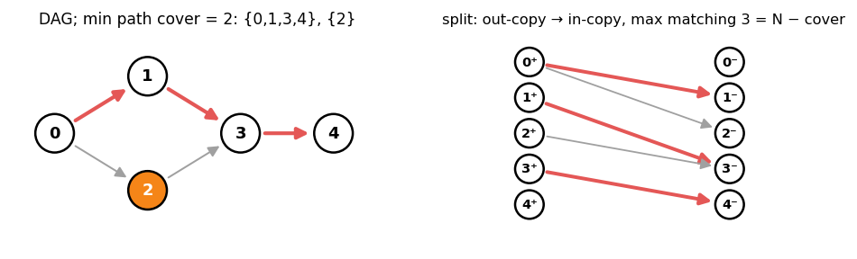

# 5. Modelling with Max Flow

Headers: [`flow/maxflow.hpp`](../maxflow.hpp), [`graph/dag_path_cover.hpp`](../../graph/dag_path_cover.hpp),
[`graph/maximum_antichain.hpp`](../../graph/maximum_antichain.hpp),
[`graph/maximum_weighted_antichain.hpp`](../../graph/maximum_weighted_antichain.hpp).

Recognize a flow problem: integral quantities move along edges or are assigned to
resources with **capacities**, and the objective is a count or a cut. Build the network,
then check that every integral flow ↔ a valid answer, in both directions.

---

## 1. Basic reductions

| Situation | Construction |
|---|---|
| several sources `s_i` with supplies `a_i` | super source `S → s_i` (capacity `a_i`) |
| several sinks `t_j` with demands `b_j` | `t_j → T` (capacity `b_j`); all demands met ⇔ flow = `Σ b_j` |
| vertex capacity `c(v)` | split `v_in → v_out` (capacity `c(v)`); edges into `v` go to `v_in`, out of `v` leave `v_out` |
| undirected edge | `add(u, v, c, c)` (one edge id, both directions) |
| edge used at most once in either direction | same as undirected |
| "at least" requirements | lower bounds (chapter 4) |
| resource used by several items, item needs `k` resources | bipartite: `S → item (k)`, `item → resource (1)`, `resource → T (cap)` |



Vertex numbering for split graphs: `v_in = 2v`, `v_out = 2v + 1`, `S = 2N`, `T = 2N + 1`.

---

## 2. Assignment-type problems

**Students and projects.** Student `i` may join projects in `A_i`, project `j` takes at
most `cap_j` students, each student joins at most one:

```cpp
MaxFlow<int> F(n + m + 2, S, T);
For(i, n) F.add(S, i, 1);
For(i, n) for (int j : A[i]) F.add(i, n + j, 1);
For(j, m) F.add(n + j, T, cap[j]);
// F.flow() = students placed; get_flow_edges() gives the assignment
```

**Degree-constrained subgraph (bipartite b-matching).** Each left vertex has degree
in `[0, a_u]`, right in `[0, b_v]`: same network with `a_u`, `b_v` capacities. Exact degrees
(`= a_u`) → check the flow saturates all `S` edges, or use lower bounds.

**Matrix with given row and column sums.** Rows `S → r_i` (row sum), columns
`c_j → T` (column sum), cell `r_i → c_j` with `[lo_ij, hi_ij]`. A 0/1 matrix with
prescribed sums exists iff the flow saturates.

---

## 3. Time-expanded networks

Movement over time with per-step capacities: make a copy `(v, t)` of every vertex for
every time `t = 0..T`.



| Edge | Meaning |
|---|---|
| `(v, t) → (v, t + 1)` | stay (capacity = room at `v`) |
| `(u, t) → (v, t + d)` | travel along `u – v` taking `d` steps (capacity per departure) |
| `S → (s, 0)`, `(t, k) → T` | start and finish |

"Minimum time to evacuate everyone": binary search on `T`, or add one time layer at a
time to an `Incremental_MaxFlow` and stop when the flow reaches the population.
Graph size is `(T + 1) · N`, so keep `T` small or exploit structure.

---

## 4. Grid problems

| Pattern | Model |
|---|---|
| dominoes / pairs of adjacent cells | color cells by `(x + y) % 2`, bipartite matching (chapter 6) |
| place items so that no two conflicting items coexist, conflicts bipartite | max independent set = cells − matching |
| paths through cells, each cell used at most once | split each cell |
| separate two regions by blocking cells | min vertex cut (split cells, block cost on `in → out`) |
| choose cells with neighbor penalties | cut optimization (chapter 10) |

---

## 5. Disjoint paths

| Want | Model |
|---|---|
| max edge-disjoint `s–t` paths | capacity 1 per edge, `path_decomposition()` |
| max vertex-disjoint `s–t` paths | split vertices with capacity 1 |
| `k` disjoint paths of min total length | min cost flow with `k` units (chapter 7) |
| a cycle / path through specified vertices | see `graph/find_path_through_specified.hpp` |

---

## 6. Path covers, chains and antichains (Dilworth)

Let `G` be a DAG.

### 6.1 Vertex-disjoint path cover

Cover all vertices with the fewest vertex-disjoint **paths** (consecutive vertices
joined by edges).

Build the split bipartite graph: left copy `v⁺` ("v continues"), right copy `v⁻`
("v is continued from"), edge `u⁺ – v⁻` for each `u → v`. A matching chooses for every
vertex at most one successor and one predecessor, i.e. a set of paths:

  `min path cover = N − max matching`.



### 6.2 Chain cover (paths may share vertices) and Dilworth

A **chain** is a set of pairwise **reachable** vertices; an **antichain** is a set of
pairwise unreachable vertices. **Dilworth's theorem**:

  min number of chains covering the poset = max antichain size (the **width**).

Min chain cover = path cover on the **transitive closure** (equivalently: allow paths to
pass through vertices already used).

| Header | Input | Returns |
|---|---|---|
| `dag_path_cover(G)` | DAG with `frm < to` for every edge (toposort and `rearrange` first) | `color[v]`: vertices of one color form a chain; #colors = width |
| `maximum_antichain(G)` | the **comparability** graph (`u → v` iff `u < v` in the order, i.e. transitively closed) | vertex list of a max antichain |
| `maximum_weighted_antichain(G, wt)` | comparability graph, weights `wt[v] ≥ 0` | `{max weight, vertex list}` |

`dag_path_cover` uses ∞ capacity "pass-through" edges `v⁻ → v⁺`, so the closure is
never built explicitly: a unit of flow may travel `u⁺ → v⁻ → v⁺ → w⁻`, which matches `u`
with `w` through `v`. Example: DAG `0→2, 1→2, 2→3, 2→4` has no 2 vertex-disjoint
paths covering it (needs 3), but the chains `{0, 2, 4}` and `{1, 3}` cover it, and
`{3, 4}` is an antichain of size 2:

```cpp
Graph<int, 1> G(5);
G.add(0, 2), G.add(1, 2), G.add(2, 3), G.add(2, 4), G.build();
auto color = dag_path_cover(G);       // {1, 0, 1, 0, 1}: chains {0,2,4}, {1,3}
```

`maximum_antichain` runs bipartite matching on the comparability graph and takes the
vertices whose both copies are outside the König cover. `maximum_weighted_antichain` is
the weighted form: min cut with `s → v⁺` and `v⁻ → t` of capacity `wt[v]`, answer
`Σ wt − mincut`, antichain = vertices with `v⁺` on the source side and `v⁻` on the sink side.

---

## 7. Checklist

1. Every valid answer gives an integral flow of the claimed value.
2. Every integral max flow gives a valid answer (watch for flow that splits where the
   answer cannot, e.g. a vertex used twice → split it).
3. Size: Dinic on `10⁵` edges is fast; time-expanded graphs grow by the number of layers.
4. Use ∞ (`infty<Cap>`) for edges that must never be cut, and `long long` capacities.

---

## 8. Cheat sheet

```
super source / sink for many terminals; vertex capacity → split in/out
assignment: S → items → resources → T
time-expanded: copy per time step, waiting edges + travel edges
DAG path cover (vertex-disjoint) = N − matching(u⁺ → v⁻)
chain cover = width = max antichain (Dilworth): dag_path_cover / maximum_antichain
```
