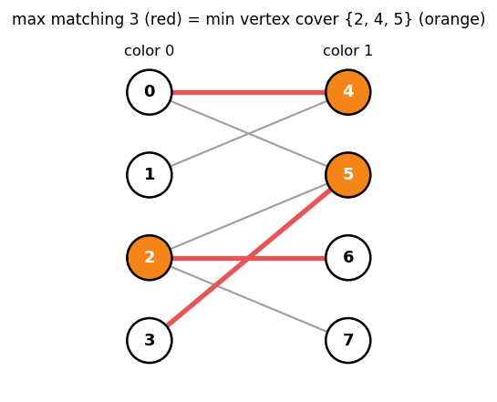
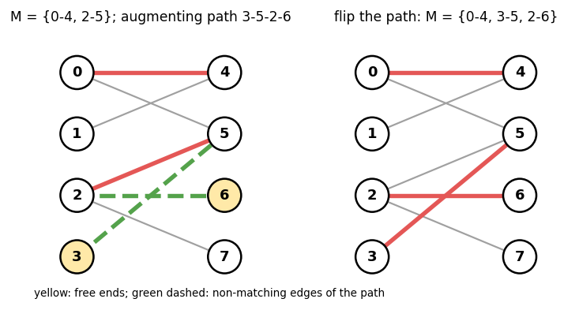
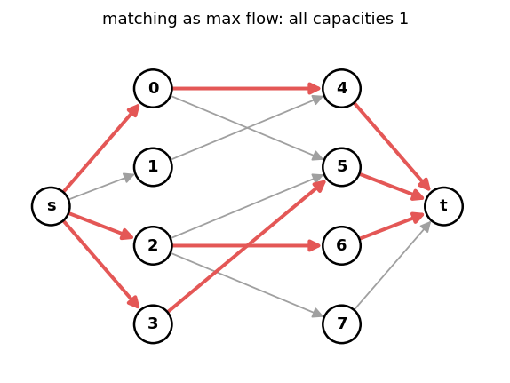
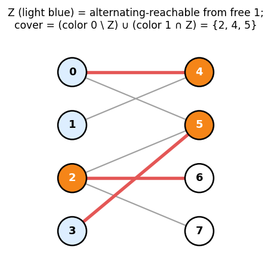
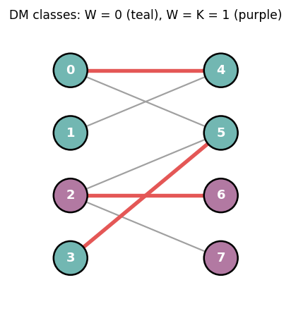

# 6. Bipartite Matching

Headers:

- [`flow/bipartite.hpp`](../bipartite.hpp) — `BipartiteMatching`
- [`flow/bipartite_matching.hpp`](../bipartite_matching.hpp) — `Bipartite_Matching`, same algorithm, maspy names
- [`flow/bipartite_matching_dense.hpp`](../bipartite_matching_dense.hpp)
- [`flow/rank_maximal_bipartite_matching.hpp`](../rank_maximal_bipartite_matching.hpp)
- [`graph/coloring/bipartite_edge_coloring.hpp`](../../graph/coloring/bipartite_edge_coloring.hpp)

Example used throughout: color 0 = `{0, 1, 2, 3}`, color 1 = `{4, 5, 6, 7}`,
edges `0-4 0-5 1-4 2-5 2-6 2-7 3-5`.



---

## 1. Definitions

| Object | Definition | Optimum here |
|---|---|---|
| matching `M` | edges, no shared endpoint | max `|M|` = 3 |
| vertex cover `C` | vertices touching every edge | min `|C|` = 3: `{2, 4, 5}` |
| independent set `I` | vertices with no edge inside | max `|I|` = 5: `{0, 1, 3, 6, 7}` |
| edge cover | edges touching every vertex (no isolated vertex) | min = 5 |

A vertex is **free** (exposed) if no matching edge touches it. A **perfect** matching
leaves no vertex free.

---

## 2. Augmenting paths

An **alternating path** alternates non-matching / matching edges. An **augmenting
path** is an alternating path between two free vertices. Flipping it (matching ↔
non-matching) increases `|M|` by 1.



**Berge's theorem.** `M` is maximum ⇔ there is no augmenting path.
(Proof: if `M'` is larger, the symmetric difference `M Δ M'` consists of alternating
paths and even cycles; some component has more `M'` edges, which is an augmenting path
for `M`.) This holds in general graphs; in bipartite graphs augmenting paths are found
by BFS/DFS because odd cycles cannot occur.

It is also exactly the max-flow picture: `S → color 0 → color 1 → T`, all capacities 1,
and an augmenting path in the residual graph is an alternating path.



---

## 3. Min-max theorems

| Theorem | Statement |
|---|---|
| **König** | max matching = min vertex cover (bipartite only) |
| complement | `I` independent ⇔ `V ∖ I` is a vertex cover, so max independent set = `N` − max matching |
| **Gallai** | min edge cover = `N` − max matching (no isolated vertex) |
| **Hall** | color 0 can be matched completely ⇔ `|N(X)| ≥ |X|` for every `X ⊆` color 0 |
| deficiency Hall | max matching = `|L| − max_{X ⊆ L} (|X| − |N(X)|)` |

König is max-flow min-cut on the matching network. Gallai: take a max matching, add one
arbitrary edge per free vertex. Hall's condition is necessary trivially and sufficient
because a violating `X` would give a cut smaller than `|L|`.

### 3.1 Building the König cover

After the last phase, let `Z` = vertices reachable from free color-0 vertices by alternating
paths (non-matching edge 0 → 1, matching edge 1 → 0).

  cover = (color 0 ∖ Z) ∪ (color 1 ∩ Z)



- An edge `u – v` (`u` color 0) is uncovered only if `u ∈ Z` and `v ∉ Z`. If `u – v` is
  not in `M`, `v` is reached from `u`, so `v ∈ Z`. If it is in `M`, `u` is matched, so it is
  not a starting vertex and was reached through its matching edge, i.e. from `v ∈ Z`.
  Either way a contradiction.
- Every vertex of the cover is matched (a free color-0 vertex is in `Z`; a free color-1
  vertex in `Z` would end an augmenting path), and no matching edge has both ends in the
  cover, so `|cover| = |M|`.

In the code: `v` is in the cover iff `color[v] ^ (dist[v] == -1)`, where `dist` is the last
BFS layer from free color-0 vertices.

---

## 4. Hopcroft–Karp

```
repeat:
    BFS from all free color-0 vertices along alternating edges → dist[]
    stop if no free color-1 vertex is reached
    DFS from each free color-0 vertex along dist + 1 edges; flip each path found
        (paths of one phase are vertex-disjoint and all have the shortest length)
```

Phases: after `√N` phases the shortest augmenting path is longer than `√N`; the
symmetric difference with a maximum matching has disjoint augmenting paths, at most
`N / √N` of them. So `O(√N)` phases, each `O(N + M)`: **`O(M √N)`**. It is Dinic on the
unit network of §2.

---

## 5. `BipartiteMatching<GT>`

```cpp
Graph<int, 0> G(N);  /* G.add(u, v) */  G.build();
BipartiteMatching<decltype(G)> BM(G);           // colors by bipartite_vertex_coloring (asserts bipartite)
BipartiteMatching<decltype(G)> BM2(G, color);   // or give color[v] ∈ {0, 1}
```

| Member / method | Returns |
|---|---|
| `match[v]` | partner of `v`, or `−1` |
| `matching()` | `(u, v)` pairs with `u < v` |
| `vertex_cover()` | min vertex cover (König) |
| `independent_set()` | max independent set (complement of the cover) |
| `edge_cover()` | edge ids of a min edge cover (asserts no isolated vertex) |
| `DM_decomposition()` | `{K, W}` (§6) |
| `operator<<` | matching, cover, edge cover |

The graph may be disconnected; each component is 2-colored. Example output on the
figure's graph:

```
matching()        {(0,4), (2,6), (3,5)}
vertex_cover()    {2, 4, 5}
independent_set() {0, 1, 3, 6, 7}
edge_cover()      5 edges: ids {0, 2, 4, 5, 6}
```

Cost `O(M √N)`.

---

## 6. Dulmage–Mendelsohn decomposition

`auto [K, W] = BM.DM_decomposition();` assigns every vertex a class `W[v] ∈ [0, K]`.

| Class | Vertices |
|---|---|
| `0` | reachable from a free color-0 vertex by alternating paths (`Z` of §3.1) |
| `K` | can reach a free color-1 vertex by alternating paths |
| `1 .. K−1` | the rest: strongly connected components of the "matched part", in topological order |



| Question | Answer |
|---|---|
| edge `u – v` is in **some** max matching | `W[u] == W[v]` |
| edge `u – v` is in **every** max matching | `W[u] == W[v]` and it is the only edge inside that class |
| edge `u – v` is in **no** max matching | `W[u] != W[v]` |
| color-0 vertex `v` matched in **every** max matching | `1 ≤ W[v] ≤ K` |
| color-1 vertex `v` matched in **every** max matching | `0 ≤ W[v] ≤ K − 1` |

In the example `K = 1`: class 0 = `{0, 1, 3, 4, 5}`, class 1 = `{2, 6, 7}`. Vertex `2`
(class 1, color 0) is matched in every max matching; `1` (class 0) is not.

Uses: "which edges can be used", "is the max matching unique", games where players
alternately pick matched vertices (a vertex wins iff it is in every max matching).

---

## 7. Dense graphs: `Bipartite_Matching_Dense<BS>`

For dense graphs (`N1 N2` large compared to `M`-based algorithms) store adjacency rows
as bitsets and run one BFS per left vertex, scanning `vis & adj[u]` word by word:
**`O(N1² N2 / w)`**.

```cpp
vector<bitset<5000>> adj(N1);                  // or vector<Bit_Array>(N1, Bit_Array(N2))
adj[i][j] = 1;                                  // i ∈ [0, N1), j ∈ [0, N2): separate index spaces
Bipartite_Matching_Dense<bitset<5000>> BM(adj, N1, N2);
auto M = BM.matching();                         // (i, j)
auto [C1, C2] = BM.vertex_cover();              // cover vertices on each side
// BM.match_1[i], BM.match_2[j]
```

| `BS` | When |
|---|---|
| `std::bitset<K>` | `N2 ≤ K` known at compile time; fastest for small sizes |
| `Bit_Array` (`datastructure/bit_array.hpp`) | runtime size |

`(5000, 5000)` runs in about 300 ms; shuffling row/column order helps on adversarial
inputs.

---

## 8. Rank-maximal matching

Edge ranks `cost ∈ [0, K)`. Find a matching whose vector
`(#rank K−1, #rank K−2, ..., #rank 0)` is lexicographically **maximum** (best-ranked
edges first, then size).

Algorithm (Irving et al.): process ranks from high to low.

1. Add the edges of rank `k` and augment to a maximum matching of the current graph.
2. Compute the DM classes. Delete edges that cannot be in any maximum matching of the
   current graph (both ends in the cover, or "inactive" edges touching the cover), so later
   ranks cannot destroy the optimum of earlier ranks.

```cpp
Graph<int, 0> G(N);  G.add(u, v, rank);  /* ... */  G.build();
Rank_Maximal_Bipartite_Matching<decltype(G)> R(G);
// R.match[v]: partner or −1
```

Example: `0-2` (rank 1), `0-3` (rank 0), `1-2` (rank 0). Max matching `{0-3, 1-2}` has
vector `(0, 2)`; rank-maximal is `{0-2}` with `(1, 0)`. `R.match = {2, −1, 0, −1}`.

---

## 9. Edge coloring of bipartite graphs

**König's line coloring theorem**: a bipartite graph with max degree `Δ` can be
edge-colored with exactly `Δ` colors (each color class is a matching).

```cpp
auto [C, color] = bipartite_edge_coloring(G);   // C == Δ, color[edge id] ∈ [0, C)
```

Used for scheduling (each round = one matching), Latin-square completion and
decomposing a regular bipartite multigraph into perfect matchings.

---

## 10. Beyond

| Need | Where |
|---|---|
| weighted matching / assignment | chapter 9 (`hungarian`), min cost flow (chapter 7) |
| matching in a general graph | `graph/matching/maximum_matching.hpp` |
| `b`-matching (vertex capacities) | max flow (chapter 5 §2) |

---

## 11. Cheat sheet

```
max matching = min vertex cover (König) = N − max independent set
min edge cover = N − max matching (no isolated vertices)
Hall: |N(X)| ≥ |X| ∀X ⇔ side fully matchable
Hopcroft–Karp O(M√N); dense bitset O(N1²N2/w)
cover = (L ∖ Z) ∪ (R ∩ Z), Z = alternating-reachable from free L
DM: same class ⇔ edge in some max matching
rank-maximal: process ranks high→low, prune by DM after each
Δ-edge-coloring of bipartite graphs always exists
```
