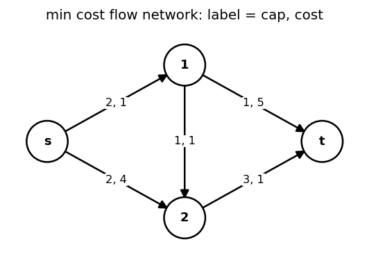
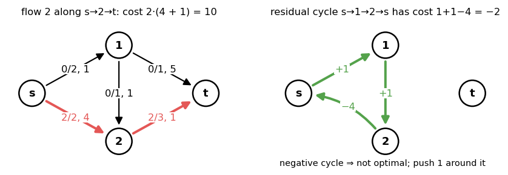
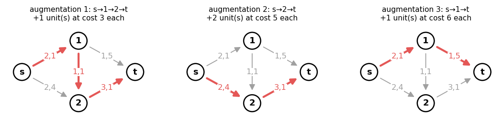
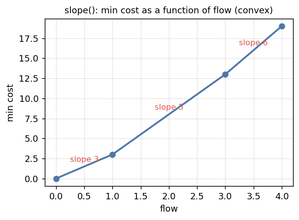

# 7. Min Cost Flow

Header:

- [`flow/mincostflow.hpp`](../mincostflow.hpp) — `Min_Cost_Flow<Cap, Cost, DAG>`

Example used throughout (`s = 0`, `t = 3`, label = capacity, cost):



---

## 1. Problem

Each edge has capacity `c(e)` and cost per unit `w(e)`. The cost of a flow is
`Σ w(e) f(e)`. **Min cost flow**: among flows of value `k` (or of maximum value), find
one of minimum cost.

In the residual graph a forward edge keeps cost `w`, a backward edge has cost `−w`
(cancelling a unit refunds its cost).

---

## 2. Optimality conditions

For a flow `f` of value `k`, the following are equivalent:

1. `f` has minimum cost among flows of value `k`.
2. **No negative cycle** in the residual graph `G_f` (Klein).
3. There are **potentials** `p(v)` with nonnegative **reduced costs**
   `w_p(u → v) = w(u → v) + p(u) − p(v) ≥ 0` on every residual edge.

(1 ⇒ 2): pushing around a negative residual cycle keeps the value and lowers the cost.
(2 ⇒ 3): with no negative cycle, shortest-path distances from a virtual root are well
defined; `p = −dist` (or `dist`, depending on sign convention) satisfies the triangle
inequality, which is (3).
(3 ⇒ 1): the difference of two flows of equal value is a circulation in `G_f`, i.e. a
sum of residual cycles; around a cycle reduced and real costs agree, and they are
`≥ 0`.



**Cycle canceling** applies (2) directly (find a negative cycle with Bellman–Ford, push,
repeat). It is simple but slow; the library uses successive shortest paths.

---

## 3. Successive shortest paths (SSP)

```
f = 0, p = 0
while flow < limit:
    find shortest s→t path P in G_f w.r.t. cost  (Dijkstra on reduced costs w_p)
    if none: stop
    push δ = min(residual on P, limit − flow) along P
    p(v) ← p(v) + dist_p(s, v)                    (keeps all reduced costs ≥ 0)
```



**Invariant.** After each augmentation the flow is min-cost for its value. Pushing along
a shortest path cannot create a negative cycle: new residual edges are reversals of
path edges, which have reduced cost 0 after the potential update.

**Potentials (Johnson).** Dijkstra needs nonnegative weights. Updating `p` by the last
distances keeps `w_p ≥ 0` on every residual edge, including the new backward ones (they
lie on a shortest path, reduced cost 0). The first round needs `w ≥ 0` (or the DAG mode
below).

**Complexity.** `O(F · (M + N) log N)` in general, `F` = flow value. In practice the
number of augmentations is the number of distinct shortest-path phases, which is small.

---

## 4. Cost as a function of flow: `slope()`

Let `cost(k)` = min cost of a flow of value `k`. SSP finds paths in nondecreasing
cost order, so

  `cost(k)` is **convex and piecewise linear** in `k`,

with slopes equal to the successive shortest path lengths. `slope()` returns the
breakpoints:

```
slope() = {(0, 0), (1, 3), (3, 13), (4, 19)}
```



| Augmentation | Path | Units | Cost per unit |
|---|---|---|---|
| 1 | `s → 1 → 2 → t` | 1 | 3 |
| 2 | `s → 2 → t` | 2 | 5 |
| 3 | `s → 1 → t` | 1 | 6 |

Uses of the convex curve:

| Want | From `slope()` |
|---|---|
| min cost for exactly `k` units | interpolate between breakpoints (`flow(k)` does it) |
| min cost for **any** amount (cost may go negative) | minimum `y` over breakpoints |
| max of `k · λ − cost(k)` (price `λ` per unit) | breakpoint where the slope crosses `λ` |
| Lagrangian / Aliens trick | the convexity is what makes it valid |

---

## 5. Negative costs

| Case | Handling |
|---|---|
| DAG, negative costs | `Min_Cost_Flow<Cap, Cost, true>`: first potentials by DP in topological order; requires `frm < to` for every edge, `source = 0`, `sink = n − 1` |
| negative edge `u → v` (cost `w < 0`) in a general graph | saturate it up front: send `c` units `u → v` (cost `c · w`), then the residual has `v → u` with cost `−w > 0`; this creates supplies at `v` and demands at `u` → b-flow (chapter 8) |
| maximize cost | negate costs; with a DAG use the DAG mode, otherwise saturate as above |
| negative cycles in the input | min cost **circulation** → `bflow.hpp` handles it |

---

## 6. `Min_Cost_Flow<Cap, Cost, DAG>`

```cpp
Min_Cost_Flow<int, long long> G(N, s, t);
int id = G.add(u, v, cap, cost);       // cost ≥ 0 unless DAG
auto [f, c] = G.flow();                // max flow, its min cost
```

| Method | Description |
|---|---|
| `Min_Cost_Flow(n, s, t)` | `s ≠ t` |
| `add(frm, to, cap, cost)` | returns edge id; `cap ≥ 0`, `cost ≥ 0` (or `frm < to` in DAG mode) |
| `flow()` | `{max flow, min cost}` |
| `flow(limit)` | `{min(limit, max flow), min cost}` |
| `slope()`, `slope(limit)` | breakpoints of `cost(k)` |
| `edges()`, `get_edge(i)` | `{frm, to, cap, flow, cost}` after solving |
| `path_decomposition()` | unit `s → t` paths of the current flow |
| `get_potentials()` | `p` with `cost + p[frm] − p[to] ≥ 0` on residual edges (vertices reachable from `s`) |
| `operator<<` | edge list |

Call `flow()` / `slope()` **once** per object; use `slope()` to answer several limits.

Example:

```cpp
Min_Cost_Flow<int, long long> G(4, 0, 3);
G.add(0, 1, 2, 1); G.add(0, 2, 2, 4); G.add(1, 2, 1, 1);
G.add(1, 3, 1, 5); G.add(2, 3, 3, 1);
G.slope();               // {(0,0), (1,3), (3,13), (4,19)}
G.get_potentials();      // {−6, −5, −1, 0}
G.path_decomposition();  // {0,2,3}, {0,2,3}, {0,1,3}, {0,1,2,3}
// a fresh object: flow(2) == {2, 8}
```

Implementation notes: CSR graph rebuilt from `edges()` for each solve; Dijkstra uses a
radix-like trick (`que_min` for vertices with zero reduced distance, heap otherwise);
`Cost` should be `long long` (products `flow · cost` accumulate).

---

## 7. Classic models

| Problem | Network |
|---|---|
| `k` edge-disjoint paths of min total length | capacity 1 per edge, cost = length, `flow(k)` |
| `k` vertex-disjoint paths of min total length | split vertices (capacity 1, cost 0) |
| assignment / weighted bipartite matching | `S → L (1, 0)`, `L → R (1, w)`, `R → T (1, 0)`; or `hungarian` (chapter 9) |
| max weight matching of **any** size | as above, take the min `y` over `slope()` with costs `−w` (DAG mode: `S < L < R < T` numbering) |
| transportation (supplies, demands, unit costs) | `S → supplier (a_i, 0)`, `supplier → client (∞, w)`, `client → T (b_j, 0)` |
| choose intervals of max total weight, every point covered at most `k` times | points `0..X` on a line, edge `i → i+1 (k, 0)`, interval `[l, r)` as `l → r (1, −w)`; `flow(k)` in DAG mode |
| convex cost per edge | parallel unit edges with increasing costs, or `Convex_Min_Cost_Flow` (chapter 9) |

---

## 8. Cheat sheet

```
residual: forward (c − f, w), backward (f, −w)
optimal ⇔ no negative residual cycle ⇔ ∃ p: w + p(u) − p(v) ≥ 0 on residual edges
SSP: Dijkstra on reduced costs, p += dist; O(F (M + N) log N)
cost(k) convex piecewise linear; slope() = breakpoints
negative costs: DAG mode, or saturate negative edges → b-flow
call flow()/slope() once per object
```
