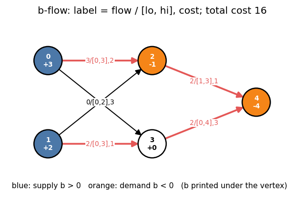

# 8. b-Flow and Duality

Headers: [`flow/bflow.hpp`](../bflow.hpp) (`MinCostFlow<Flow, Cost>`), [`flow/dual_mcf.hpp`](../dual_mcf.hpp) (`Dual_MCF`),
[`flow/longest_shortest_path.hpp`](../longest_shortest_path.hpp) (`Longest_Shortest_Path`).

---

## 1. Min cost b-flow

Each vertex has a **balance** `b(v)` (`> 0` supply, `< 0` demand, `Σ b = 0`), each edge
`lo ≤ f ≤ hi` and a cost `w` of **any sign**. Find `f` with

  `out(v) − in(v) = b(v)` for every `v`, minimizing `Σ w(e) f(e)`.

This single model contains:

| Special case | Setting |
|---|---|
| s–t flow of value `k` | `b(s) = k`, `b(t) = −k` |
| min cost circulation (negative cycles allowed) | `b ≡ 0` |
| lower bounds | `lo > 0` directly |
| transportation | suppliers `b > 0`, clients `b < 0` |
| negative costs in general graphs | allowed |



In the example the optimum costs 16: vertex 0 ships 3 units to 2, vertex 1 ships 2 to 3,
vertex 2 keeps its demanded unit and forwards 2 (edge `2 → 4` must carry at least 1),
and 3 forwards 2 to 4.

---

## 2. Algorithm in `bflow.hpp`: primal–dual with capacity scaling

```
saturate every edge with lo > 0 below its lower bound; adjust b
Δ = largest power of 2 ≤ max residual capacity
while Δ ≥ 1:
    saturate residual edges with negative reduced cost and residual ≥ Δ   (fix b)
    repeat:
        dual(Δ):   Dijkstra from all vertices with b ≥ Δ over edges with residual ≥ Δ,
                   reduced costs; update potentials; stop when all deficits are reached
        primal(Δ): push Δ-multiples along the shortest-path tree into deficits ≤ −Δ
    until no deficit is reachable
    Δ /= 2
```

- Reduced costs `w + p(u) − p(v)` stay `≥ 0` on all residual edges with residual `≥ Δ`.
- Each scaling phase moves `O(M)` multiples of `Δ`.
- Total `O(M log U · (M + N) log N)`, `U` = max capacity. Independent of the flow value,
  so huge capacities are fine.

Feasible iff every excess is routed at the end.

---

## 3. `MinCostFlow<Flow, Cost>` API

```cpp
MinCostFlow<long long, long long> B(N);
B.add_source(v, x);            // b[v] += x
B.add_sink(v, x);              // b[v] −= x
B.add(u, v, lo, hi, cost);     // lo ≤ hi, cost any sign; edge index = call order
auto [ok, val] = B.solve();    // ok = feasible, val = min cost (__int128)
```

| Method | Description |
|---|---|
| `MinCostFlow(n)` | `n` vertices, all balances 0 |
| `add_vertex()`, `add_vertices(k)` | new vertex ids |
| `add(frm, to, lo, hi, cost)` | bounded edge |
| `add_source(v, a)`, `add_sink(v, a)` | change `b[v]` by `±a` |
| `solve()` | `{feasible, cost}`; call once (it consumes `b`) |
| `get_result_value<T>()` | cost as `T` |
| `get_potential()` | dual potentials (after `solve()`) |
| `get_edges()` | `EdgePtr` per edge: `frm()`, `to()`, `flow()`, `lower()`, `upper()`, `cost()`, `gain() = −cost` |

Example (the figure):

```cpp
MinCostFlow<long long, long long> B(5);
B.add_source(0, 3); B.add_source(1, 2); B.add_sink(2, 1); B.add_sink(4, 4);
B.add(0, 2, 0, 3, 2); B.add(0, 3, 0, 2, 1); B.add(1, 3, 0, 3, 1);
B.add(2, 4, 1, 3, 1); B.add(3, 4, 0, 4, 3); B.add(1, 2, 0, 2, 3);
B.solve();                                   // {true, 16}
// flows by edge: 3 0 2 2 2 0
```

Choosing between the two min cost flow headers:

| | `Min_Cost_Flow` (ch. 7) | `MinCostFlow` (`bflow.hpp`) |
|---|---|---|
| model | s–t, `cost ≥ 0` (or DAG) | balances, lower bounds, any cost |
| algorithm | SSP, `O(F · M log N)` | capacity scaling, `O(M log U · M log N)` |
| cost curve | `slope()` | no |
| best for | small `F`, need `cost(k)` | big capacities, negative costs, circulations |

---

## 4. LP duality

Primal (one variable per edge, capacities `c`, costs `w`, balances `b`):

```
minimize   Σ_e w_e f_e
subject to out(v) − in(v) = b_v       for all v
           0 ≤ f_e ≤ c_e
```

Dual (one potential `p_v` per vertex):

```
maximize   −Σ_v b_v p_v − Σ_{e=u→v} c_e · max(0, p_v − p_u − w_e)
```

so **min cost = −min over p of [ Σ b_v p_v + Σ c_e max(0, p_v − p_u − w_e) ]**.

**Complementary slackness** (for optimal `f`, `p`), with reduced cost `r_e = w_e + p_u − p_v`:

| `r_e` | edge `e` must be |
|---|---|
| `> 0` | empty (`f_e = 0`) |
| `< 0` | saturated (`f_e = c_e`) |
| `= 0` | anything in `[0, c_e]` |

Duality turns problems about **numbers on vertices** with piecewise-linear convex
penalties on differences into min cost flow. That is `Dual_MCF`.

---

## 5. `Dual_MCF`: optimize potentials

Solve over integers `p_0, ..., p_{N−1}`:

  `minimize Σ_v b_v p_v + Σ c_uv · max(0, p_v − p_u − w_uv)`   with `Σ b_v = 0`, `c ≥ 0`.

```cpp
Dual_MCF D(N);
D.add_b(v, b);                       // + b · p[v]
D.add_c(u, v, w, c);                 // + c · max(0, p[v] − p[u] − w)
D.add_constraint(u, v, w);           // p[v] − p[u] ≤ w   (c = "infinity")
auto [val, p] = D.solve();           // {min value, optimal p}; infeasible: {infty<__int128>, {}}
```

Each `add_c` is one b-flow edge `u → v` with capacity `c` and cost `w`; `add_b` is a
balance; `solve()` returns `−(min cost)` and the b-flow potentials.

| Term you want | Encoding |
|---|---|
| `p_v − p_u ≤ w` (difference constraint) | `add_constraint(u, v, w)` |
| `c · max(0, p_v − p_u − w)` | `add_c(u, v, w, c)` |
| `c · |p_v − p_u − w|` | `add_c(u, v, w, c)` and `add_c(v, u, −w, c)` |
| `c · max(0, p_v − a)` against a constant | root vertex `z` (the zero level): `add_c(z, v, a, c)`; read `p_v − p_z` |
| `b_v · p_v` with `Σ b ≠ 0` | put `−Σ b` on the root `z` |
| maximize `p_t − p_s` subject to difference constraints | `add_b(s, 1)`, `add_b(t, −1)`; value = `−(max)` |

Example: maximize `p_2 − p_0` subject to `p_1 − p_0 ≤ 3`, `p_2 − p_1 ≤ 2`, `p_2 − p_0 ≤ 4`
(the dual of a shortest path):

```cpp
Dual_MCF D(3);
D.add_b(0, 1); D.add_b(2, −1);
D.add_constraint(0, 1, 3); D.add_constraint(1, 2, 2); D.add_constraint(0, 2, 4);
D.solve();     // {−4, {−4, −1, 0}}: max p_2 − p_0 = 4 = dist(0, 2)
```

Only differences of `p` are meaningful.

---

## 6. `Longest_Shortest_Path`: lengthen edges at min cost

Edge `e` has length `ℓ_e` and costs `c_e` per unit of extension. Make
`dist(s, t) ≥ L` at minimum total cost.

Derivation: `dist ≥ L` ⇔ there are potentials with `p_t − p_s ≥ L` and
`p_v − p_u ≤ ℓ_e + x_e`. The cheapest extension is `x_e = max(0, p_v − p_u − ℓ_e)`, so

  `cost(L) = min_p Σ c_e max(0, p_v − p_u − ℓ_e)` subject to `p_t − p_s ≥ L`,

whose dual is an s–t min cost flow with capacities `c_e` and costs `ℓ_e`:

  `cost(L) = max_F (F · L − mincost(F))`.

With the breakpoints `(x_i, y_i)` of `slope()` (chapter 7), `cost(L) = max_i (x_i L − y_i)`,
convex and piecewise linear in `L`.

```cpp
Longest_Shortest_Path<long long> X(N, s, t);
X.add(u, v, length, cost_per_unit);
X.init_dist();                       // current dist(s, t)
X.solve_by_target_length(L);         // min cost so that dist ≥ L   (L ≥ init_dist)
X.get_edges();                       // new lengths, in add order
// or, on a fresh object:
X.solve_by_cost(K);                  // max reachable dist with total cost ≤ K (infty if unbounded)
```

| Method | Description |
|---|---|
| `init_dist()` | Dijkstra `dist(s, t)` |
| `solve_by_target_length(L)` | min cost; one solve per object |
| `solve_by_cost(K)` | max `L` with `cost(L) ≤ K` = `min_{x_i > 0} ⌊(K + y_i) / x_i⌋` |
| `get_potentials()` | optimal potentials `p` after solving (the new length of `u → v` is `max(ℓ_e, p_v − p_u)`) |
| `get_edges()` | extended lengths `max(ℓ_e, p_v − p_u)` |

`DAG = true` allows the `frm < to` DAG mode of the underlying `Min_Cost_Flow`.

Example: `0 → 1` (length 1, cost 1), `1 → 2` (1, 2), `0 → 2` (3, 1); `dist = 2`.

```cpp
solve_by_target_length(4) == 3     // extend 0→1 by 2 (cost 2) and 0→2 by 1 (cost 1)
get_edges() == {3, 1, 4}
solve_by_cost(5) == 5              // cost(L) = 2L − 5 here
```

---

## 7. Cheat sheet

```
b-flow: out − in = b, lo ≤ f ≤ hi, any cost sign; MinCostFlow::solve() = {feasible, cost}
capacity scaling: O(M log U · M log N), independent of the flow value
dual: min cost = −min_p [Σ b p + Σ c·max(0, p_v − p_u − w)]
complementary slackness: r > 0 ⇒ f = 0, r < 0 ⇒ f = c
Dual_MCF: convex piecewise linear penalties on differences of integers
Longest_Shortest_Path: cost(L) = max_i (x_i L − y_i) over slope() breakpoints
```
