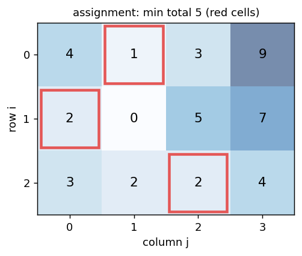
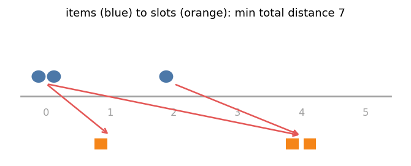

# 9. Assignment, Transportation and Special Structures

Headers:

- [`flow/hungarian.hpp`](../hungarian.hpp)
- [`flow/unbalanced_transportation.hpp`](../unbalanced_transportation.hpp)
- [`flow/convex_min_cost_flow.hpp`](../convex_min_cost_flow.hpp)
- [`flow/cyclic_b_flow.hpp`](../cyclic_b_flow.hpp)
- [`flow/min_cost_matching_on_line.hpp`](../min_cost_matching_on_line.hpp)
- [`flow/dynamic_mcf_on_line.hpp`](../dynamic_mcf_on_line.hpp)

General min cost flow (chapters 7–8) solves all of these; the structures below are
faster or simpler when the input has a special shape.

---

## 1. Assignment: Hungarian algorithm

`N ≤ M`. Assign each row `i` a distinct column `match[i]`, minimizing
`Σ C[i][match[i]]`.



### 1.1 Duality

```
primal:  min Σ C_ij x_ij,  each row exactly one, each column at most one, x ≥ 0
dual:    max Σ X_i + Σ Y_j  subject to  X_i + Y_j ≤ C_ij  (Y_j ≤ 0 for unmatched columns)
```

An assignment is optimal iff there are `X`, `Y` with `X_i + Y_j ≤ C_ij` everywhere and
equality on every chosen cell (**tight** cells).

### 1.2 Algorithm (Kuhn–Munkres, `O(N² M)`)

Rows are inserted one at a time. For the new row, grow a tree of alternating paths
through tight cells (Dijkstra on reduced costs `C_ij − X_i − Y_j`, `minV[j]` = best
reduced cost to column `j`). When no tight cell leads to a free column, shift the
potentials by `δ = min minV` over unvisited columns (keeps every reduced cost ≥ 0 and
makes at least one new cell tight). When a free column is reached, flip the path.

After inserting rows `0..k−1`, the matching is an optimal assignment **of those rows**.
(It is not the best matching of size `k` among all rows.)

### 1.3 API

```cpp
vector<vector<long long>> C = {{4, 1, 3, 9}, {2, 0, 5, 7}, {3, 2, 2, 4}};
auto [ans, match, X, Y] = hungarian<long long, true>(C);    // MINIMIZE = true
// ans = 5, match = {1, 0, 2}, X = {3, 2, 2}, Y = {0, −2, 0, 0}
```

| Item | Meaning |
|---|---|
| `hungarian<T, MINIMIZE>(C)` | `C` is `N × M` with `N ≤ M` (transpose otherwise) |
| `ans` | optimal total (max if `MINIMIZE = false`) |
| `match[i]` | column of row `i` |
| `X`, `Y` | dual potentials: `X_i + Y_j ≤ C_ij`, `Σ X + Σ Y = ans` |
| forbidden cells | a big cost `B` with `N · B` not overflowing; if `ans ≥ B`, every assignment uses a forbidden cell |

Hungarian vs min cost flow: `O(N² M)` with tiny constants, best for dense matrices up to
a few thousand rows. For sparse graphs, or when not every row must be matched, use min
cost flow.

---

## 2. Unbalanced transportation (`K ≪ N`)

`K` sources with supplies `supply[a]`, `N` sinks of demand 1, cost `cost[a][b]`.
`calc()` returns `res[f]` = min cost to serve `f` sinks, for `f = 0..N`.

**Idea.** Successive shortest paths, but a shortest path never needs to visit a sink
twice; it only re-routes sinks between sources. Moving sink `x` from source `a` to
source `b` costs `cost[b][x] − cost[a][x]`. Keep, for every pair `(a, b)`, a priority
queue of the best such move, and for every source the best unused sink. Each
augmentation is a shortest path on a graph with only `K` vertices:
**`O((K² log N + K³) · N)`**.

```cpp
vector<int> supply = {2, 1};
Unbalanced_Transportation_Problem<long long> U(2, 3, supply);   // K = 2, N = 3
U.add(0, 0, 1); U.add(0, 1, 5); U.add(0, 2, 3);
U.add(1, 0, 4); U.add(1, 1, 2); U.add(1, 2, 6);
U.calc();      // {0, 1, 3, 6}
```

Missing pairs keep cost `INF` (not allowed). Requires `Σ supply ≥ N`. `res` is
convex in `f`.

---

## 3. Convex costs

Edge cost `g_e(x)` for flow `x`, `g_e(0) = 0`, `g_e` convex (marginal costs
nondecreasing). Model: split into unit edges with costs `g(1) − g(0), g(2) − g(1), ...`;
convexity makes SSP use them in order, so the split is exact.

`Convex_Min_Cost_Flow` stores runs of equal marginal cost as **blocks** instead of
separate edges, so a linear edge stays one block.

```cpp
Convex_Min_Cost_Flow<int, long long> G(N, s, t);
G.add(u, v, cap, cost);                                        // linear
G.add_convex(u, v, cap, [](int x) -> long long { return 1LL * x * x; });
auto [f, c] = G.flow(limit);
```

| Method | Description |
|---|---|
| `add(frm, to, cap, cost)` | linear edge, returns id |
| `add_convex(frm, to, cap, g)` | `g(0) = 0`, convex (asserted); evaluated at `0..cap` |
| `flow()`, `flow(limit)`, `slope()`, `slope(limit)` | as `Min_Cost_Flow`; one solve per object |
| `edges()`, `get_edge(i)` | `{frm, to, cap, flow}` |
| `path_decomposition()`, `get_potentials()` | as `Min_Cost_Flow` |

Example: `0 → 1` with `x²` (cap 3) and a parallel linear edge cost 3 (cap 2). Marginal
costs `1, 3, 5` and `3, 3`; 3 units take `1 + 3 + 3`: `flow(3) == {3, 7}`.

Typical: "load balancing with quadratic penalty", "the `k`-th use of a road costs `k`".

---

## 4. Flow on a cycle: `cyclic_b_flow`

Vertices `0..N−1` on a cycle, `supply[i]` (sum 0), cost `cost[i]` per unit on the edge
`i — i+1` in either direction, no capacities.

Fix `x` = flow on edge `N−1 → 0`. Conservation then determines every other edge:
the flow leaving `i` to the right is `x + supply[0] + ... + supply[i]`. The cost

  `F(x) = |x| · cost[N−1] + Σ_i |x + prefix_i| · cost[i]`

is convex in `x`, so binary search on `F(x) ≤ F(x + 1)`: **`O(N log Σ|supply|)`**.

```cpp
cyclic_b_flow<long long, long long>({3, −1, −2, 0}, {1, 1, 1, 1});   // 5
```

The minimizer is a weighted median of the prefix sums.

---

## 5. Matching on a line: `min_cost_matching_on_line`

`A[i]` items at position `i`, position `i` accepts up to `B[i]` items
(`Σ A ≤ Σ B`), moving one unit costs 1 per step.



Slope trick: `f_i(x)` = min cost so far when `x` units cross from `i` to `i + 1`
(negative = leftward). Each position shifts by `A[i] − B[i]`, clears the right side
(surplus may stay), and adds `|x|` for crossing the next edge: **`O(N log N)`**.

```cpp
min_cost_matching_on_line({2, 0, 1, 0, 0, 0}, {0, 1, 0, 0, 2, 0});   // 7
```

---

## 6. Dynamic min cost flow on a line: `Dynamic_MCF_on_Line`

Path `0 − 1 − ... − N−1`, edge `i → i+1` capacity `right_cap[i]`, `i+1 → i` capacity
`left_cap[i]`, cost 0. Sources and sinks with costs are added and removed online; `ANS`
is the min cost over flows of **any** amount (a source–sink pair is used iff
`cost_source + cost_sink < 0`).

```cpp
Dynamic_MCF_on_Line<long long> D(3, {1, 1}, {1, 1});
D.add_source(0, −5);   D.add_sink(2, 2);    // D.ANS == −3
D.add_sink(0, 1);                            // D.ANS == −4 (re-routed to the closer sink)
D.rm_sink(0, 1);                             // D.ANS == −3
```

| Method | Description |
|---|---|
| `add_source(v, cost, cap = 1)`, `add_sink(v, cost, cap = 1)` | insert, then augment greedily |
| `rm_source(v, cost, cap = 1)`, `rm_sink(v, cost, cap = 1)` | remove (re-route if it was used) |
| `ANS` | current min cost |

Inside: all terminals hang off a virtual hub; a lazy segment tree over the line edges
keeps residual capacities, so "which interval can `v` reach" is a `max_right` /
`min_left` query, and a segment tree over vertices gives the cheapest terminal in that
interval. **`O(cap · log N)`** per operation.

---

## 7. Choosing

| Shape | Use |
|---|---|
| dense `N × M` cost matrix, all rows matched | `hungarian` |
| few sources, many unit sinks, answers for every amount | `Unbalanced_Transportation_Problem` |
| convex per-edge cost | `Convex_Min_Cost_Flow` |
| cycle | `cyclic_b_flow` |
| line, static | `min_cost_matching_on_line` |
| line, online insertions / deletions | `Dynamic_MCF_on_Line` |
| anything else | `Min_Cost_Flow` / `MinCostFlow` (chapters 7–8) |

---

## 8. Cheat sheet

```
Hungarian: X_i + Y_j ≤ C_ij, tight on chosen cells; O(N²M); match[i] = column
transportation K ≪ N: shortest paths on K vertices; res[f] for all f
convex edge = unit edges with increasing marginal costs (blocks)
cycle: one free parameter, convex → binary search
line: slope trick O(N log N); online: Dynamic_MCF_on_Line
```
