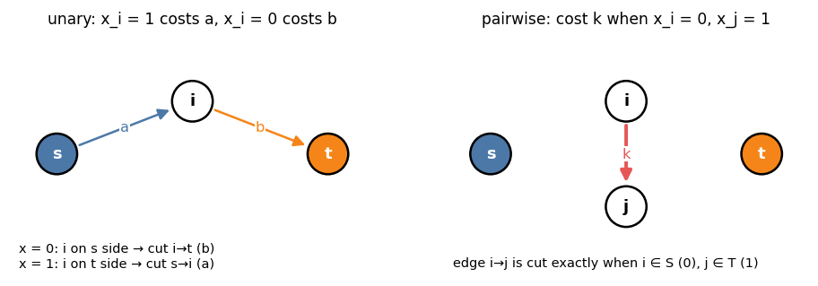
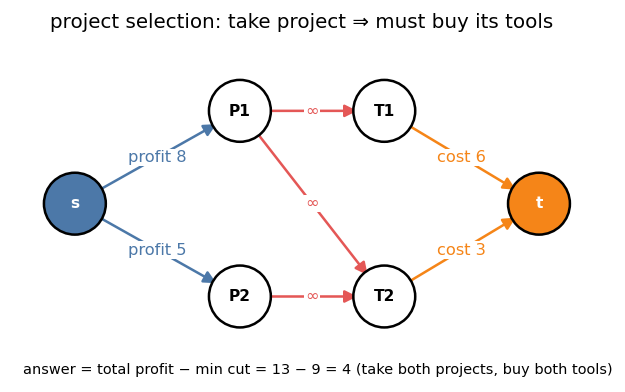
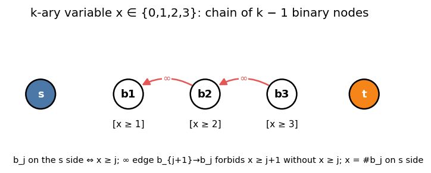

# 10. Cut Optimization

Headers: [`flow/binary_optimization.hpp`](../binary_optimization.hpp) (`Binary_Optimization<T, MINIMIZE>`),
[`flow/k_ary_optimization.hpp`](../k_ary_optimization.hpp) (`K_ary_Optimization<T, MINIMIZE>`).

Choose `x_i ∈ {0, 1}` (or `{0..k−1}`) to minimize

  `E(x) = const + Σ θ_i(x_i) + Σ θ_ij(x_i, x_j) + Σ θ_ijk(x_i, x_j, x_k)`.

One min cut solves it exactly when every term is **submodular** (the project-selection
technique).

---

## 1. Convention

Vertex `i` per variable, plus `s` and `t`.

  `x_i = 0` ⇔ `i` on the **source** side,   `x_i = 1` ⇔ `i` on the **sink** side

(`MaxFlow::cut()` side). An edge `u → v` of capacity `c` is cut, and costs `c`, exactly
when `u` is on the source side and `v` on the sink side, i.e. `x_u = 0, x_v = 1`.

---

## 2. Unary terms

`θ(0) = a₀`, `θ(1) = a₁`. Add the constant `min(a₀, a₁)` and one edge:

| Case | Edge | Paid when |
|---|---|---|
| `a₁ > a₀` | `s → i`, capacity `a₁ − a₀` | `x_i = 1` (`i` on the sink side) |
| `a₀ > a₁` | `i → t`, capacity `a₀ − a₁` | `x_i = 0` |



---

## 3. Pairwise terms

Any table `θ(x_i, x_j)` decomposes as

```
θ(x_i, x_j) = x00 + (x10 − x00)·[x_i = 1] + (x11 − x10)·[x_j = 1]
            + (x01 + x10 − x00 − x11)·[x_i = 0, x_j = 1]
```

(check the four cases). The first three parts are unary; the last is an edge `i → j`
with capacity `x01 + x10 − x00 − x11`, which must be `≥ 0`:

  **submodular:** `x00 + x11 ≤ x01 + x10`.

| Term | Table `(x00, x01, x10, x11)` | Submodular? |
|---|---|---|
| penalty `c` if `x_i ≠ x_j` (Potts) | `(0, c, c, 0)` | yes |
| `x_i = 1 ⇒ x_j = 1` (implication) | `(0, 0, ∞, 0)` | yes: an ∞ edge `j → i` |
| bonus `b` if both 1 | `(0, 0, 0, −b)` | yes |
| bonus `b` if both 0 | `(−b, 0, 0, 0)` | yes |
| penalty `c` if both 1 | `(0, 0, 0, c)` | **no** |
| bonus if different | `(0, −b, −b, 0)` | **no** |

An ∞ edge `j → i` is cut exactly when `x_j = 0, x_i = 1`, so it forbids that pattern.
Through `add_2`, use a large finite value instead of ∞ (the decomposition subtracts it
from itself in the unary parts).

### 3.1 Making terms submodular by flipping

If the "bad" terms connect a **bipartite** set of variables, redefine `x'_i = 1 − x_i` for
one side. "Penalty if both 1" between the sides becomes "penalty if `x_i = 1, x'_j = 0`",
which is submodular. (Typical: grid problems with checkerboard parity.)

### 3.2 Maximization

`MINIMIZE = false` negates every cost: maximize `Σ` gains when every pairwise gain is
**supermodular**: `x00 + x11 ≥ x01 + x10`.

---

## 4. Triple terms

A function of three binary variables is representable iff it is submodular in every
pair. Let

  `p = x000 − x100 − x010 − x001 + x110 + x101 + x011 − x111`.

| `p` | Construction |
|---|---|
| `p > 0` | unary and pairwise terms measured from `000`, plus the constant `−p` and "pay `p` unless `x = 111`": auxiliary `w` with edges `i → w`, `j → w`, `k → w`, `w → t` of capacity `p` |
| `p ≤ 0` | symmetric, measured from `111`: constant `p` and "pay `−p` unless `x = 000`": edges `w → i`, `w → j`, `w → k`, `s → w` of capacity `−p` |

`add_3` checks this decomposition and adds one auxiliary vertex per call.

---

## 5. `Binary_Optimization<T, MINIMIZE>`

```cpp
Binary_Optimization<long long, true> B(n);
B.add_1(i, cost_if_0, cost_if_1);
B.add_2(i, j, x00, x01, x10, x11);                 // x01: x_i = 0, x_j = 1
B.add_3(i, j, k, x000, x001, x010, x011, x100, x101, x110, x111);
auto [val, x] = B.calc();                          // optimum and an optimal assignment
```

| Method | Requirement |
|---|---|
| `add_1(i, x0, x1)` | none |
| `add_2(i, j, x00, x01, x10, x11)` | `i ≠ j`; `x00 + x11 ≤ x01 + x10` after negation for `MINIMIZE = false` |
| `add_3(i, j, k, ...)` | distinct; submodular in every pair |
| `calc()` | `{value, x}`; builds a `MaxFlow` on `n + 2 + #aux` vertices |

Edges between the same pair are merged (`map<pair<int, int>, T>`). Use a large finite
value (e.g. `10⁹`, not `infty<T>`) for "forbidden" so sums stay in range; the result is
`≥` that value iff every assignment is forbidden.

---

## 6. Project selection (max weight closure)

Projects with profit, tools with cost; a project needs some tools. Maximize
`Σ profits of chosen projects − Σ costs of bought tools`.



Classic network: `s → project (profit)`, `tool → t (cost)`, `project → tool (∞)`;
answer = `Σ profit − mincut`. The same thing with `Binary_Optimization` (`x = 1` means
chosen):

```cpp
Binary_Optimization<long long, false> B(4);        // maximize; P1, P2, T1, T2 = 0..3
B.add_1(0, 0, 8); B.add_1(1, 0, 5);                 // profits
B.add_1(2, 0, −6); B.add_1(3, 0, −3);               // tool costs
long long NG = −1000000000;                         // forbidden
B.add_2(0, 2, 0, 0, NG, 0);                         // P1 chosen, T1 not: forbidden
B.add_2(0, 3, 0, 0, NG, 0);
B.add_2(1, 3, 0, 0, NG, 0);
B.calc();                                           // {4, {1, 1, 1, 1}}
```

Generalization: **max weight closure** of a directed graph (a set closed under
successors) = `Σ positive weights − mincut` with `s → v (w_v)` for `w_v > 0`,
`v → t (−w_v)` for `w_v < 0`, ∞ on the graph's edges.

---

## 7. k-valued variables (Ishikawa)

`x_i ∈ {0, ..., k_i − 1}`. Represent `x_i` by binary nodes `b_{i,1..k_i−1}` with

  `b_{i,j}` on the **source** side ⇔ `x_i ≥ j`,

and ∞ edges `b_{i,j+1} → b_{i,j}`, so `x_i ≥ j + 1` forces `x_i ≥ j` (a chain cut exactly
once). Then `x_i` = number of `b_{i,j}` on the source side.



| Term | Construction |
|---|---|
| unary `θ_i(a)` | differences `θ(j) − θ(j − 1)` on `b_{i,j}` ("cost of `x ≥ j`") |
| pairwise `θ(a, b)` | representable iff **Monge**: `θ(a, b) + θ(a+1, b+1) ≤ θ(a, b+1) + θ(a+1, b)` |

Monge includes every `θ(a, b) = g(a − b)` with `g` convex, e.g. `c·|a − b|`, `c·(a − b)²`,
`max(0, a − b − d)`.

```cpp
K_ary_Optimization<long long, true> K({3, 3});      // k_0 = k_1 = 3
K.add_1(0, {3, 1, 4});
K.add_1(1, {0, 2, 1});
vector<vector<long long>> c(3, vector<long long>(3));
For(a, 3) For(b, 3) c[a][b] = 2 * abs(a - b);
K.add_2(0, 1, c);
K.calc();                                            // {3, {0, 0}}
```

| Method | Description |
|---|---|
| `K_ary_Optimization(ks)` | `ks[i]` = number of values of `x_i` |
| `add_1(i, cost)` | `cost.size() == ks[i]` |
| `add_2(i, j, cost)` | `ks[i] × ks[j]` Monge matrix (asserted) |
| `calc()` | `{value, x}` |

---

## 8. Recognizing the technique

- Every item makes a binary (or ordered small) choice.
- Costs depend on single items and on **pairs**, and pair costs penalize disagreement
  (or reward agreement), possibly after flipping one side.
- Hard constraints are implications `x_i = 1 ⇒ x_j = 1`.

Size: one max flow on `n + 2 (+ #triples)` vertices (`Σ (k_i − 1) + 2` for k-ary).

---

## 9. Cheat sheet

```
x = 0: source side, x = 1: sink side; edge u→v cut iff x_u = 0, x_v = 1
unary: s→i (a1 − a0) or i→t (a0 − a1) + constant
pairwise: θ = x00 + (x10−x00)[x_i] + (x11−x10)[x_j] + (x01+x10−x00−x11)[x_i=0,x_j=1]
submodular: x00 + x11 ≤ x01 + x10   (max: ≥); flip one side of a bipartite structure
implication x_i ⇒ x_j: ∞ edge
closure / project selection: Σ positive − mincut
k-ary: chain b_j = [x ≥ j], ∞ back edges; pairwise must be Monge
```
