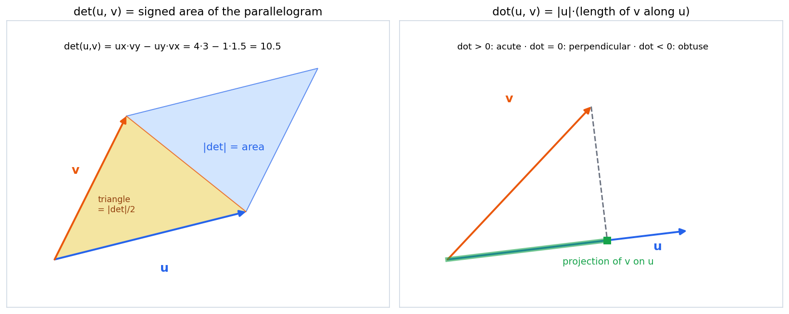
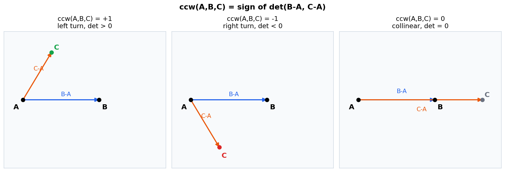
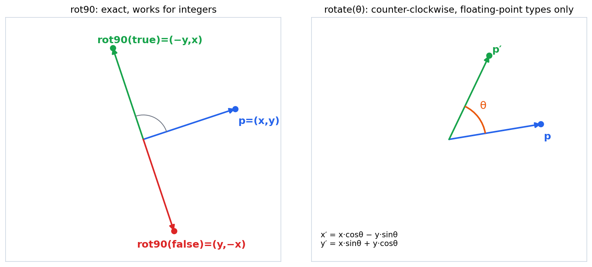
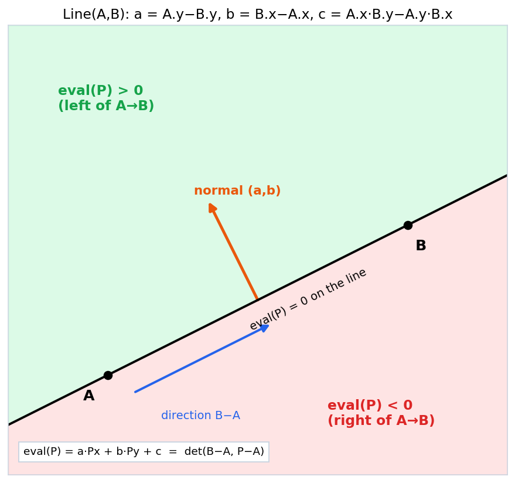
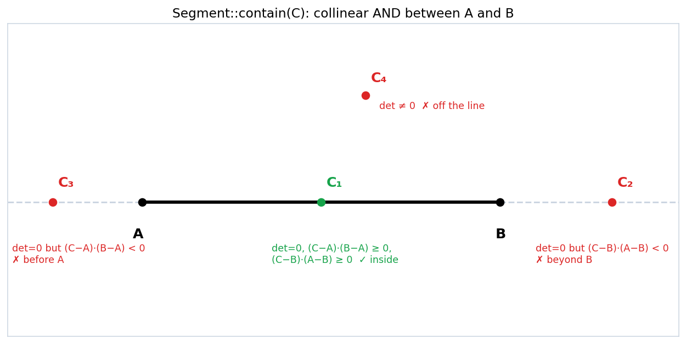
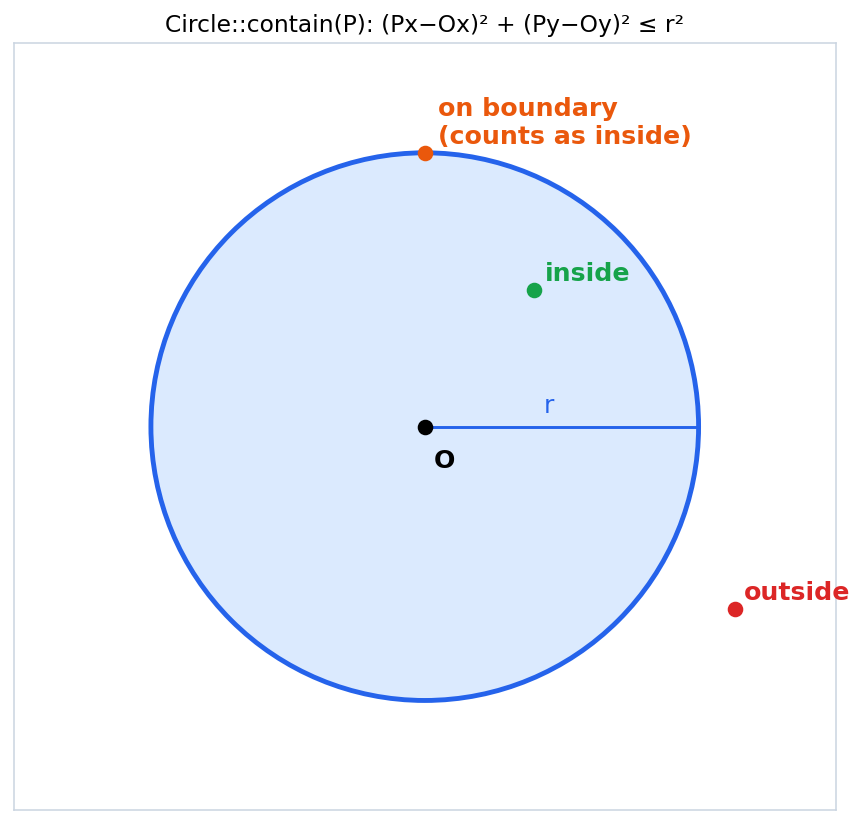

# Geometry Basics: Point, Line, Segment, Circle

Header:

- [`geo/base.hpp`](../base.hpp)

Notation: `u = (ux, uy)`, `v = (vx, vy)` are vectors, `P - Q` is the vector
from `Q` to `P`, `|u|` is the length of `u`, `θ` is the angle from `u` to `v`
(counter-clockwise positive).

---

## 1. Point as a vector

`Point<T>` stores `(x, y)` and behaves as a 2D vector: `+`, `-`, unary `-`,
scalar `*` and `/`, `==`, and lexicographic `<` (by `x`, then `y`, which is the
order convex hull and sweep-line code wants).

Two products matter more than everything else in 2D geometry.

### 1.1 Dot product (`dot`)

```
u · v = ux·vx + uy·vy = |u|·|v|·cos θ
```

- `> 0` means the angle between them is acute, `= 0` perpendicular, `< 0` obtuse.
- `(u · v) / |u|` is the signed length of `v` projected onto `u`.
- `u · u = |u|²` (squared length, exact for integers).

### 1.2 Determinant / cross product (`det`)

```
det(u, v) = ux·vy − uy·vx = |u|·|v|·sin θ
```

- `|det(u, v)|` is the **area of the parallelogram** spanned by `u` and `v`;
  the triangle on them has area `|det| / 2`.
- The **sign** says which way you turn from `u` to `v`: positive means
  counter-clockwise (left), negative clockwise (right), zero means parallel
  (collinear).
- `det(u, v) = −det(v, u)`, and `det` is linear in each argument.



Identity worth remembering (Lagrange):

```
det(u, v)² + (u · v)² = |u|² · |v|²
```

So with integers you can get `|u|²·|v|²` without any square roots, and
`tan θ = det / dot`, i.e. `θ = atan2(det, dot)` is the full signed angle.

---

## 2. Orientation: `ccw(A, B, C)`

```cpp
int ccw(Point<T> A, Point<T> B, Point<T> C):  sign of det(B − A, C − A)
```

Walking `A → B → C`: `+1` left turn, `−1` right turn, `0` collinear.



This one function is the backbone of:

| Task | How `ccw` is used |
|---|---|
| Convex hull | keep a turn only if it is a left turn (strict or non-strict by `≥ 0` / `> 0`) |
| Point left/right of a directed line | `ccw(A, B, P)` |
| Point inside a triangle `ABC` | three `ccw` of the same sign |
| Segment intersection | `ccw(A,B,C) ≠ ccw(A,B,D)` and `ccw(C,D,A) ≠ ccw(C,D,B)` (plus the collinear overlap case) |
| Polygon area / orientation | sum of `det` over edges (shoelace) |

Shoelace formula for a polygon `P₀ … P_{n−1}`:
`2·Area = Σ det(P_i, P_{i+1})`, positive when the vertices go counter-clockwise.

---

## 3. Length, angle, rotation

### 3.1 Norm and angle

```
|u|   = sqrt(x² + y²)         (norm())
angle = atan2(y, x)            (angle(), in (−π, π], counter-clockwise from +x)
```

### 3.2 Rotation by 90 degrees (`rot90`)

```
rot90 counter-clockwise: (x, y) → (−y,  x)
rot90 clockwise:         (x, y) → ( y, −x)
```

Exact for integers, so prefer it to `rotate` whenever the angle is a multiple of
90°. Note `rot90(p)` is the normal direction: `p · rot90(p) = 0`.

### 3.3 Rotation by any angle (`rotate(θ)`)

```
x' = x·cos θ − y·sin θ
y' = x·sin θ + y·cos θ
```

Only for floating-point `T` (the header has a `static_assert`).



---

## 4. Distance

```
dist(A, B) = sqrt((Ax − Bx)² + (Ay − By)²)
```

`dist<REAL>` computes the differences in `REAL` (convert first, then subtract),
which avoids overflow in integer `T`. `distance<REAL>` is the same with default
template arguments.

Rule: **compare squared distances in integers, take the square root only at the
end.** `d(A,B) ≤ d(A,C)` ⇔ `|A−B|² ≤ |A−C|²`.

---

## 5. Line: `a·x + b·y + c = 0`

`Line(A, B)` builds the line through two points:

```
a = A.y − B.y
b = B.x − A.x
c = A.x·B.y − A.y·B.x
```

### 5.1 Why these coefficients

Let `d = B − A = (dx, dy)`. Then `(a, b) = (−dy, dx) = rot90(d)`, which is a
**normal** (perpendicular) vector to the line, pointing to the left of `A → B`.
And

```
eval(P) = a·Px + b·Py + c = det(B − A, P − A)
```

(Expand: `dx·(Py − Ay) − dy·(Px − Ax)`.) So `eval` is exactly the `ccw`
determinant: it is `0` on the line, **positive on the left of `A → B`**,
negative on the right.



### 5.2 Formulas built on `(a, b, c)`

```
distance from P to the line   = |a·Px + b·Py + c| / sqrt(a² + b²)
parallel:      a1·b2 − a2·b1 = 0
perpendicular: a1·a2 + b1·b2 = 0
same line:     (a1,b1,c1) ∝ (a2,b2,c2)   (all three 2×2 minors vanish)
intersection (D = a1·b2 − a2·b1 ≠ 0):
    x = (b1·c2 − b2·c1) / D
    y = (a2·c1 − a1·c2) / D
```

`is_parallel`, `is_orthogonal`, `is_same_line` in the header are exactly these
tests.

### 5.3 Canonical form (`normalize`)

Two descriptions of the same line differ by a scalar factor. `normalize()` for
integer lines divides by `g = gcd(|a|, |b|, |c|)` and fixes the sign so that
`b > 0`, or `b = 0` and `a > 0`. Afterwards equal lines have equal `(a, b, c)`,
so you can use `Line` as a `map` key or in a `set` (this is what `operator<`
is for): e.g. "count distinct lines through pairs of points".

---

## 6. Segment

`Segment(A, B)` and `contain(C)` for integer points.

A point `C` lies on segment `AB` iff:

1. `C` is on the line `AB`: `det(C − A, B − A) = 0`, and
2. `C` is not before `A` and not beyond `B`:
   `(C − A) · (B − A) ≥ 0` and `(C − B) · (A − B) ≥ 0`.



Condition 2 says the projection of `C` on the line falls between `A` and `B`.
(If you only care about collinear points, a bounding-box test
`min(Ax,Bx) ≤ Cx ≤ max(Ax,Bx)`, same for y, is equivalent.)

A degenerate segment (`A == B`) contains only `A`.

`to_line()` converts to the `Line` through the endpoints.

---

## 7. Circle

`Circle(O, r)`; `contain(P)` tests

```
(Px − Ox)² + (Py − Oy)² ≤ r²
```

Boundary points count as inside (`≤`). The squared form avoids a square root.



For floating `REAL` the boundary comparison needs an epsilon; for integer
centres and radius, everything stays exact.

Useful facts that other headers in `library/geo` build on:

```
circle through 3 points: centre is the intersection of two perpendicular bisectors
point-circle power:      pow(P) = |P − O|² − r²   (< 0 inside, = 0 on, > 0 outside)
```

---

## 8. Overflow and precision

For integer coordinates with `|x|, |y| ≤ M`:

| Quantity | Magnitude bound | Fits `long long` when |
|---|---|---|
| differences `B − A` | `2M` | always |
| `det`, `dot` of two differences | `2·(2M)² = 8M²` | `M ≤ 1.0·10⁹` (8·10¹⁸ < 9.22·10¹⁸) |
| `norm²` of a difference | `8M²` | same |
| `Line.c = Ax·By − Ay·Bx` | `2M²` | `M ≤ 2·10⁹` |
| products of line coefficients, e.g. `a·c'` | `≈ 4M · 2M²` | **overflows** for `M = 10⁹`, use `__int128` |

Rules of thumb:

- Keep everything in integers when possible (`ccw`, `dot`, squared distances,
  `rot90`, `contain`).
- For `int` points use a wider type for products. `norm()` computes in
  `long double`, so it is safe for any coordinates.
- For floating point, compare with an epsilon (`1e-9` is typical for coordinates
  around 1e3 to 1e6), and never test floating `ccw == 0` exactly.

---

## 9. Cheat sheet

```
dot(u,v)  = ux·vx + uy·vy = |u||v| cos θ
det(u,v)  = ux·vy − uy·vx = |u||v| sin θ        triangle area = |det|/2
det² + dot² = |u|²|v|²                          θ = atan2(det, dot)

ccw(A,B,C) = sign det(B−A, C−A):  +1 left, −1 right, 0 collinear

rot90 ccw (x,y)→(−y,x)      rot90 cw (x,y)→(y,−x)
rotate θ: x' = x cosθ − y sinθ,  y' = x sinθ + y cosθ

Line(A,B): a = Ay−By, b = Bx−Ax, c = Ax·By − Ay·Bx
           eval(P) = det(B−A, P−A)   > 0 left, < 0 right
           normal = (a,b),  dist(P) = |eval|/√(a²+b²)
           parallel a1b2−a2b1=0,  perpendicular a1a2+b1b2=0
           intersection x=(b1c2−b2c1)/D, y=(a2c1−a1c2)/D, D=a1b2−a2b1

Segment AB contains C: det(C−A,B−A)=0 and (C−A)·(B−A)≥0 and (C−B)·(A−B)≥0
Circle(O,r) contains P: |P−O|² ≤ r²

Overflow: det/dot safe in long long for |coord| ≤ 1e9; line products need __int128
Compare squared lengths, take sqrt last.
```
