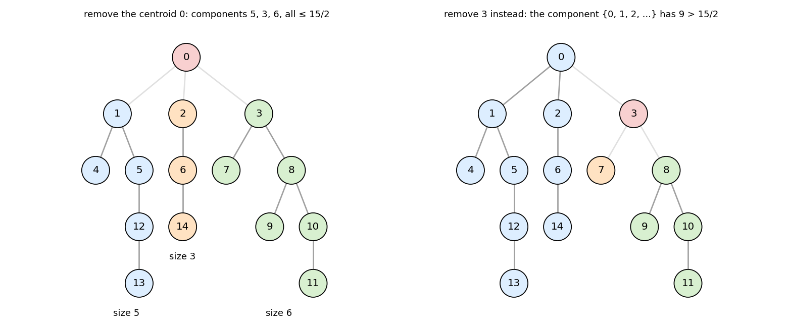
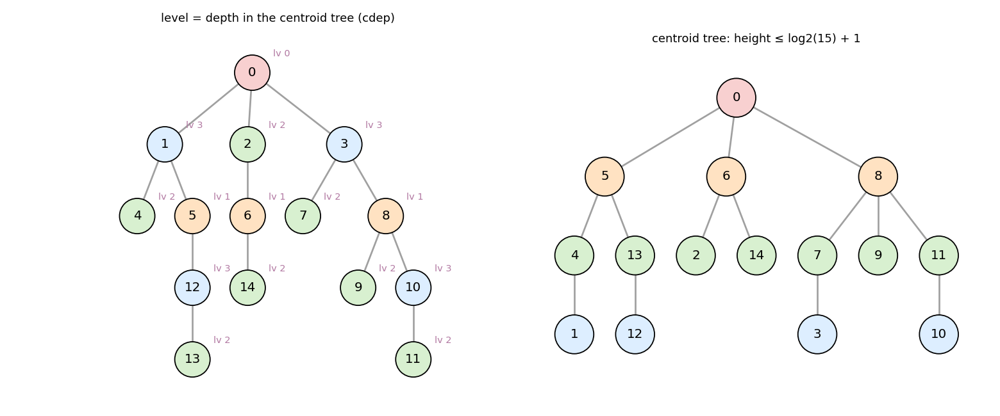
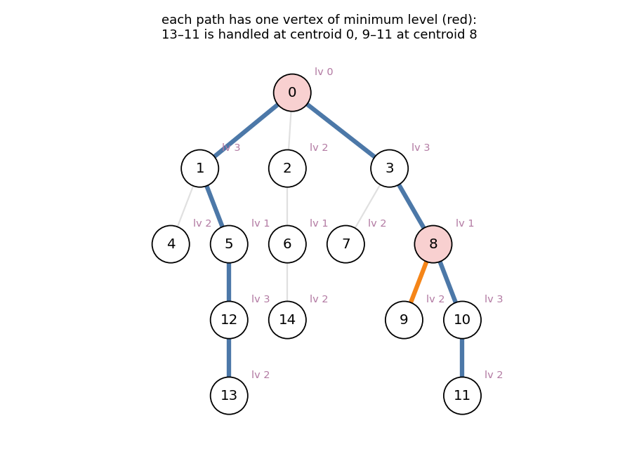
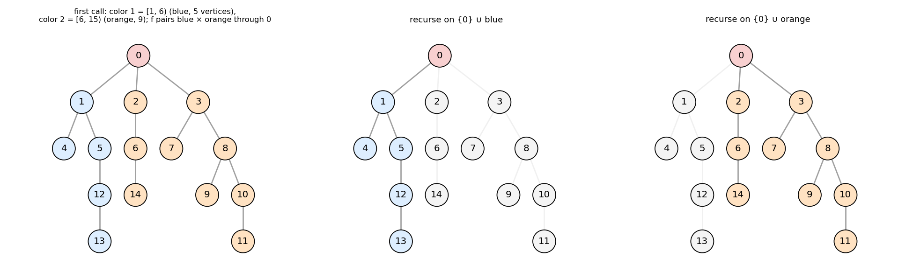
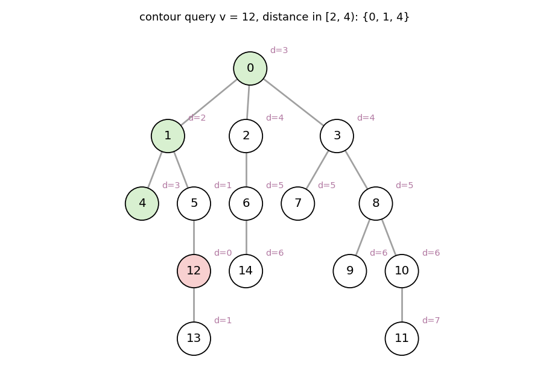

# Centroid Decomposition

Headers:

- [`graph/tree/find_centroid.hpp`](../tree/find_centroid.hpp) — §1
- [`graph/tree/centroid_decomposition.hpp`](../tree/centroid_decomposition.hpp) — §2–6
- [`graph/tree/tree_all_distances.hpp`](../tree/tree_all_distances.hpp) — §7
- [`graph/datastructure/contour_query_range.hpp`](../datastructure/contour_query_range.hpp) — §8
- [`graph/tree/centroid_decomposition_old.hpp`](../tree/centroid_decomposition_old.hpp) — §9
- [`graph/datastructure/incremental_centroid.hpp`](../datastructure/incremental_centroid.hpp) — §10

---

## 1. The centroid

A **centroid** of a tree is a vertex `c` such that every component of
`T − c` has at most `N / 2` vertices.



* **It always exists.** Start anywhere. While some component of `T − v`
  has more than `N/2` vertices, step into it. The component behind you then
  has fewer than `N/2` vertices, so you never step back, and the walk ends.
* **There are at most two**, and two centroids are adjacent. That happens
  exactly when an edge splits the tree into halves of `N/2` each.
* **Finding it**: root the tree anywhere and compute subtree sizes `sz`.
  `v` is a centroid iff `N − sz[v] ≤ N/2` and `sz[w] ≤ N/2` for every child
  `w`. This is `O(N)`.

`find_centroids(G, weight = {})` returns `(c, −1)` or `(c1, c2)`. With vertex
weights, "size" means total weight, and the condition is
`max component weight ≤ ⌊W/2⌋`. Zero-weight vertices can make more than two
vertices qualify; then two of them are returned.

```
find_centroids(G) = (0, −1)      components of T − 0: 5, 3, 6
```

---

## 2. Decomposition and the centroid tree

Remove a centroid `c`, then decompose every component recursively. Each
removed vertex becomes a node of the **centroid tree**. Its parent is the
centroid removed just before, whose component contained it.



* Each step at least halves the component size, so the centroid tree has
  height at most `⌊log₂ N⌋ + 1`, and every vertex lies in at most
  `⌊log₂ N⌋ + 1` components over the whole run.
* Doing `O(size)` work per component costs `O(N log N)` in total.
* The **level** `cdep[v]` is the depth of `v` in the centroid tree.

---

## 3. Why it works: every path has one top centroid

For a path `u … v`, take the vertex `t` on it with the **smallest level**. It
is unique: `t` was removed while the whole path still lay in one component,
which split the path. So the path is "handled" exactly once, at centroid `t`,
as two half-paths `t … u` and `t … v` that lie in **different** components of
`(component of t) − t`. (Or one of them is empty, when `u = t` or `v = t`.)



`13 … 11` passes through `0` (level 0). `9 … 11` (orange edge, then the shared
blue edges `8–10–11`) never meets `0`, and its top vertex is `8` (level 1).

So a question about **all paths** becomes, for each centroid `c`:

> combine the paths that start at `c`, taking pairs from **different** child
> components (plus the paths that end at `c` itself).

The usual ways to exclude same-component pairs:

* process the child components one at a time, combining each with the data
  of the components already seen;
* or count all pairs at `c`, then subtract the pairs inside each child
  component (inclusion–exclusion).

---

## 4. The library interface

`centroid_decomposition<MODE>(G, f)` calls `f` once per component (MODE 0)
or once per split (MODE 1, 2). Each call gets a **local copy** of the
component:

| argument | meaning |
|---|---|
| `par` | local tree, `par[i] < i`, `par[0] = −1`: vertex `0` is the centroid, and the order is a BFS order from it |
| `V` | `V[i]` = original vertex of local vertex `i` |

Because `par[i] < i`, one forward pass gives the distances from the centroid:

```cpp
vector<int> dist(n);
For(i, 1, n) dist[i] = dist[par[i]] + 1;
```

Edge weights are not passed; look them up from `V` if needed. The total size
of all calls is `O(N log N)`, measured at most about `1.35 · N log₂ N` for
every mode on random, path, star, binary and caterpillar trees.

---

## 5. MODE 0: one call per centroid, `f(par, V, indptr)`

The direct form of §2–3. Local vertices are grouped by child component:
block `k` is `[indptr[k], indptr[k+1])`, and block 0 is the centroid alone.

```
first call:  V      = 0 | 1 4 5 12 13 | 2 6 14 | 3 7 8 9 10 11
             indptr = 0  1             6        9               15
```

Paths through `V[0]` are the pairs of local vertices in **different** blocks.
Each vertex is the centroid of exactly one call.

---

## 6. Two colors per call: MODE 1 and MODE 2

Combining many blocks is awkward when the combination is a convolution, since
pairs inside one block must be excluded. MODE 1 and MODE 2 instead split the
child components of `c` into **two** groups (colors). The greedy split adds
child components to color 1 while its size stays `≤ ⌊(N−1)/2⌋`, and the rest
become color 2. Every pair `color 1 × color 2` passes through `c`. Then

* recurse on `{c} ∪ color 1` and on `{c} ∪ color 2`.
  **`c` is kept in both halves**, so the paths from `c` to each side are
  handled further down.



### MODE 1: `f(par, V, L1, R1, L2, R2)`

The local vertices `[L1, R1)` have color 1 and `[L2, R2)` color 2. Each call
handles the paths color 1 – `V[0]` – color 2. A component of exactly two
vertices (one edge) is a call with color 1 = `{V[0]}` and color 2 = `{V[1]}`.
Hence **every unordered pair at distance `≥ 1` is handled in exactly one call**.
Pairs `(c, x)` reach a two-vertex base case, or a call where `c` is no longer
the centroid.

```
first call:  V = 0 | 1 4 5 12 13 | 2 3 6 7 8 14 9 10 11
             [L1, R1) = [1, 6),  [L2, R2) = [6, 15)
```

With two colors, "pairs at distance `d` through `V[0]`" is a single
convolution of the two depth histograms (§7).

### MODE 2: `f(par, V, color)`

Like MODE 1, but the colors are passed as an array, and the centroid is
handled in the same call instead of in base cases:

| `color[i]` | meaning |
|---|---|
| `0`, `1` | real vertex of either side |
| `2` | `V[0]` itself, when it is a real vertex |
| `−1` | virtual: a centroid of an earlier level, copied in only to keep the local tree connected |

A centroid, once used as color 2, is marked virtual in both halves, so it is
never paired again. **Every pair of distinct real vertices meets exactly once**,
as two real vertices of different colors in some call. Distances are
`dist[i] + dist[j]` from the local tree. `Contour_Query_Range` (§8) is built
on this.

---

## 7. Distance frequency table

`tree_all_distances(G)`: `ANS[d]` is the number of unordered pairs at distance
`d`. Then `ANS[0] = 0` and `Σ ANS = binom(N, 2)`.

Per MODE 1 call: histogram the depths of color 1 and of color 2, convolve,
and add. A call of size `n` costs `O(n log n)`, so the total is
`O(N log² N)`.

```
d       1   2   3   4   5   6   7   8
ANS    14  17  20  20  17  11   5   1         (sum 105 = binom(15, 2))
```

---

## 8. Contour queries: `Contour_Query_Range<GT, false>`

Queries of the form "sum of `A[w]` over all `w` with
`l ≤ dist(v, w) < r`", with point updates.



For each MODE 2 call and each color class, list the real vertices **by
depth**. Vertices of the same depth share one slot, so a class with maximum
depth `D` occupies `D + 1` consecutive indices. Classes come in pairs, at
component ids `p` and `p ^ 1`: `A` = color `c`, `B` = all colors `> c`, for
`c = 0, 1`. So color 2, the centroid, is in `B`. A vertex `u`
at depth `du` in class `A` sees the vertices of `B` at distance
`du + depth`. So "distance in `[l, r)`" is the **contiguous** slot range
`[l − du, r − du)` of `B`.

* `get_indices(v)`: the slots of `v`, one per call where `v` is real and
  colored (`O(log N)` of them). A point update adds to each.
* `get_contour_range(v, l, r)`: `O(log N)` disjoint slot ranges whose sum is
  the answer, **excluding `v` itself** (distance 0). Add `A[v]` separately
  when `l ≤ 0 < r`.
* `size()`: total number of slots, `O(N log N)`.

With a Fenwick tree over the slots, both update and query take
`O(log² N)`:

```cpp
Contour_Query_Range<decltype(G), false> CQ(G);
vector<long long> dat(CQ.size());
For(v, N) for (auto& p: CQ.get_indices(v)) dat[p] += A[v];
FenwickTree<Monoid_Add<long long>> bit(dat);
// add x at v:            for (auto& p: CQ.get_indices(v)) bit.add(p, x);
// sum over dist in [l,r): A[v] if l <= 0 < r, plus bit.sum(a, b) for each range
```

The reverse problem ("add `x` to every `w` at distance in `[l, r)` from `v`,
get the value of one vertex") uses the same slots with range-add / point-get.

---

## 9. `Centroid_Decomposition` (struct)

`Centroid_Decomposition<GT> CD(G)` stores `cdep[v]`, the level of §2. Then
for each centroid `root`:

* `collect_path_data(root, root_val, f)` returns `(V, dp, indptr)`. A BFS
  from `root` inside its component (vertices of level `≥ cdep[root]`), where
  `dp` is accumulated along edges by `f(parent value, edge)`. Vertices are
  grouped per child component exactly as in MODE 0 (`indptr`, block 0 =
  `root`).
* `collect_dist(root)`: the same, with `dp` = edge count.
* `get_subgraph(root)`: the component as a new graph `H`, with `V[i]` = the
  original vertex of `i`, so tree algorithms can run on it directly.

Useful when the per-centroid work needs edge weights or a real subgraph.
Otherwise MODE 0 does the same with less overhead.

---

## 10. Moving centroid: `Incremental_Centroid<TREE>`

A fixed tree with vertex weights, all `0` at first. `add(v)` increases
`w(v)` by one, and `cent` stays a **weighted centroid**: every component of
`T − cent` has weight at most `W/2`.

After `w(v)` grows, only the component of `T − cent` containing `v` can
become too heavy. It has weight `k` with total `2k − 1`, and the centroid
must move into it. On the way from `cent` into that component, every vertex
before the **branching point** `t` of the weighted vertices there has all `k`
of the weight still in front of it. At `t` the weight splits, and every part
is at most `k − 1`. So `t` is the new centroid. `t` is the `lca` of the
extreme weighted vertices of that side, in Euler-tour order:

* subtree weights come from a Fenwick tree over the Euler tour
  (`Tree_AbelGroup`);
* the weighted positions are kept in a `FastSet`, whose `next` / `prev`
  find the extreme ones;
* `jump` / `meet` / `lca` come from the HLD `Tree`.

Each `add` does `O(1)` operations on these structures, `O(log N)` in total.
