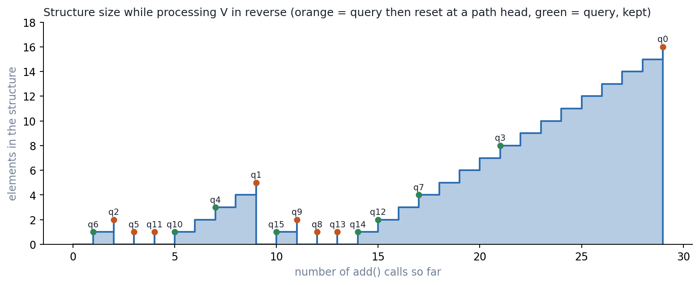
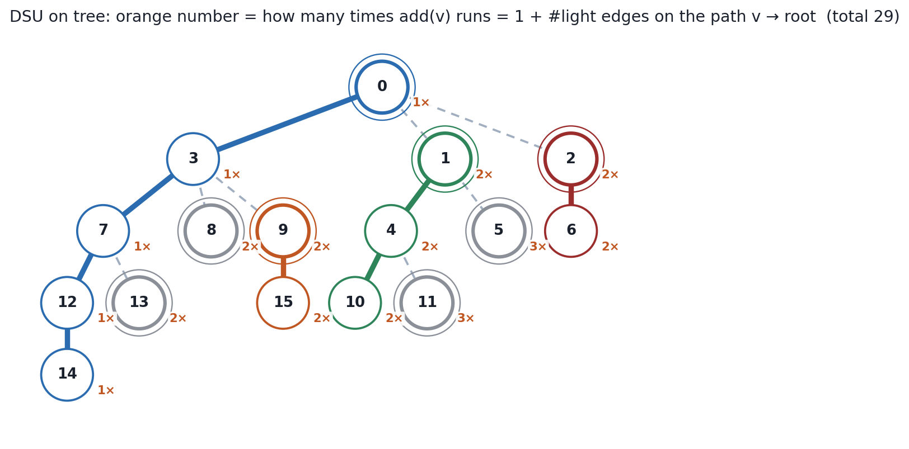

# DSU on Tree / Sack (`library/graph/dsu_on_tree.hpp`)

Answer a query for **every subtree** with a structure that only supports
*insert* and *clear*, using `O(N log N)` inserts. Built on the HLD order of
`Tree` ([`tree.md`](tree.md)). No union-find is involved: the name (also
*sack*, *small-to-large on trees*) comes from the same "keep the big part,
re-insert the small parts" idea as union by size.

---

## 1. The problem

For each vertex `v`, answer a question about the multiset of values in
`subtree(v)`: number of distinct colours, most frequent colour, how many colours
appear at least `k` times, number of vertices at depth `d`, and so on.

- Recomputing per vertex: `O(N²)`.
- Merging child sets explicitly works but needs a mergeable structure.
- DSU on tree needs only a structure with `add(x)`, `query`, and `reset`.

---

## 2. Interface

```cpp
template <typename TREE, typename F1, typename F2, typename F3>
void DSU_on_Tree(TREE& tree, F1& add, F2& query, F3& reset);
```

| Callback | Called | Must do |
|---|---|---|
| `add(v)` | `O(N log N)` times in total | insert vertex `v`'s data |
| `query(v)` | once per vertex | read the answer for `subtree(v)`; the structure holds exactly `subtree(v)` at this moment |
| `reset()` | once per heavy path | make the structure empty |

Example, distinct colours in every subtree:

```cpp
Graph<int, 0> G(N);  /* read edges */  G.build();
Tree<decltype(G)> T(G);

vector<int> cnt(C), hist, ans(N);
int distinct = 0;
auto add   = [&](int v) { if (cnt[col[v]]++ == 0) ++distinct; hist.push_back(col[v]); };
auto query = [&](int v) { ans[v] = distinct; };
auto reset = [&]() { for (int c : hist) --cnt[c]; hist.clear(); distinct = 0; };
DSU_on_Tree(T, add, query, reset);
```

- The callbacks are taken by non-const reference, so they must be **named
  variables**; lambdas written inline in the call do not compile.
- Answers are for the root the `Tree` was built with.

---

## 3. The algorithm

```cpp
Frr(vid, N) {                                  // positions N−1, ..., 0
    int v = tree.V[vid];
    add(v);
    for (child c of v with head[c] == c)       // light children
        For(idx, LID[c], RID[c]) add(V[idx]);  // the whole light subtree
    query(v);
    if (tree.head[v] == v) reset();            // v is the top of its heavy path
}
```

Vertices are processed in **reverse HLD preorder**, so every child (and its whole
subtree) is finished before its parent. Light subtrees are walked as one `LID`
range each, which is why the code needs no recursion.

### 3.1 Why the structure holds exactly `subtree(v)` at `query(v)`

**Invariant:** right before `v` is processed, the structure contains exactly
`subtree(h)` where `h` is `v`'s heavy child (empty if `v` is a leaf).

- `h = V[LID[v] + 1]` is processed immediately before `v` (reverse order).
- `h` is not a head (it continues `v`'s heavy path), so no `reset` happens after
  `query(h)`, and by induction at that moment the structure held `subtree(h)`.
- Then `v` adds itself and every light child's subtree:
  `{v} ∪ subtree(h) ∪ light subtrees = subtree(v)`. ✓

**Base / emptiness:** the vertex processed just before the subtree of `h`
starts is `V[RID[h]]` (or nothing, if `RID[h] = N`). In preorder, the vertex
right after a whole subtree is a later child of some ancestor, i.e. a light
child, i.e. a head, so `reset()` ran when it finished. The structure is empty
when the subtree of `h` starts being processed.

When `v` is a head, its parent does not want `subtree(v)` kept (it is a light
subtree there and will be re-added), so it is cleared.



On the example tree from `tree.md`, queries at path heads (orange) are followed
by a drop to 0; queries at non-heads (green) keep their contents for the parent.
`q3` sees 8 elements = `|subtree(3)|`, `q0` sees all 16.

### 3.2 Excluding `v` itself

If `query(v)` must see `subtree(v) \ {v}`, move `add(v)` after `query(v)` (the
header comment says the same). The invariant is unchanged, since `v` is added
before the parent's query.

---

## 4. Complexity

A vertex `u` is added once when it is processed itself, plus once for every
ancestor `a` such that `u` lies in a light child's subtree of `a`, i.e. once
per **light edge** on the path from `u` to the root:

```
#add(u) = 1 + #light edges on path(u, root) ≤ 1 + log2 N
total adds ≤ N (1 + log2 N)
```

(see [`tree.md` §2.1](tree.md) for why there are at most `log2 N` light
edges).



Measured:

| Tree | N | `add` calls | `N·log2 N` |
|---|---|---|---|
| example above | 16 | 29 | 64 |
| complete binary | 1 000 | 4 938 | 9 966 |
| complete binary | 100 000 | 815 030 | 1 660 964 |

Total time is `O(N log N · cost(add) + N · cost(query) + total cost(reset))`.

### 4.1 `reset` must be proportional to what was added

`reset()` runs once per heavy path, and that can be `Θ(N)` times: a star with
`N = 1000` calls it **999** times. If `reset` clears a size-`N` array, the total
is `O(N²)`. Undo only what was inserted since the last reset, e.g. keep a
history stack (as in the example) or iterate the vertices just added. Then the
total reset cost is at most the total add cost.

---

## 5. When to use what

| Technique | Needs | Time | Notes |
|---|---|---|---|
| DSU on tree (this) | `add`, `reset` | `O(N log N)` adds | offline, one answer per vertex, no deletions |
| Small-to-large merge of child sets | mergeable container (`map`, `set`) | `O(N log² N)` with `std::map` | gives an actual set per vertex; more memory |
| Euler tour + Mo's algorithm | `add` and `remove` | `O(N √Q)` | arbitrary subtree queries, many per vertex |
| Euler tour + segment tree / BIT | invertible or monoid aggregate | `O(N log N)` | when the answer is a range aggregate (sum, min) |

Typical DSU-on-tree problems: number of distinct colours per subtree, dominant
colour (CF 600E), number of colours with frequency `≥ k` (CF 375D), counts per
depth inside a subtree, palindromic rearrangement checks with a parity mask.

---

## 6. Cheat sheet

```
for v in V reversed (children before parents):
    add(v); add every vertex of every light child's subtree (one LID range each)
    query(v)                       // structure == subtree(v)
    if head[v] == v: reset()       // v is a light child of its parent (or the root)

invariant: before v, structure == subtree(heavy child of v)
adds(u) = 1 + #light edges above u ≤ 1 + log2 N      total O(N log N)
reset() runs once per heavy path → must cost O(#items added since last reset)
exclude v from its own query: call add(v) after query(v)
callbacks must be named variables
```
