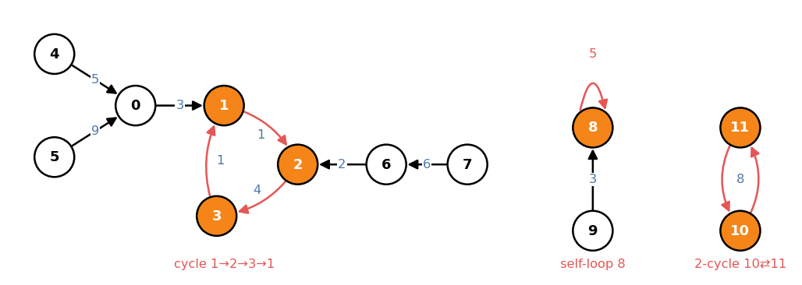
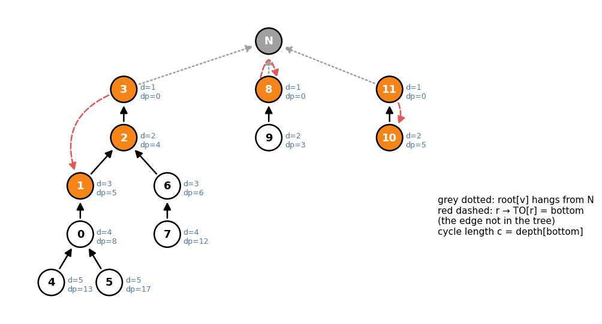
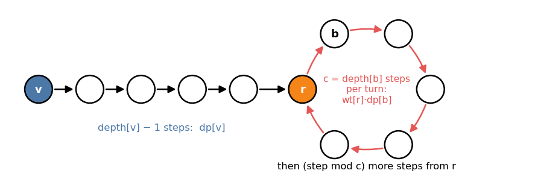

# Functional Graph (`library/graph/cycle/functional.hpp`)

A **functional graph** is the graph of a map `f : {0..N−1} → {0..N−1}`: one
edge `v → f(v)` per vertex, so every vertex has out-degree exactly 1. Walking
along edges means iterating `f`; the questions are about `f^k(v)` for huge `k`,
the weights collected on the way, and where walks meet.

Example used throughout (`TO[v] = f(v)`, edge weight `wt[v]` on `v → TO[v]`):

```
v      0  1  2  3  4  5  6  7  8  9 10 11
TO[v]  1  2  3  1  0  0  2  6  8  8 11 10
wt[v]  3  1  4  1  5  9  2  6  5  3  5  8
```



```cpp
FunctionalGraph<> FG(N);                 // weights in Monoid_Add<int>
For(v, N) FG.add(v, TO[v], wt[v]);       // wt optional: FG.add(v, TO[v])
FG.build();                              // every vertex must have its edge
auto [x, s] = FG.jump(7, 10);            // x = f^10(7) = 1, s = 25
```

---

## 1. Shape: cycles with in-trees

**Every weakly connected component contains exactly one cycle**, and every
other vertex of the component lies on a tree path leading into it.

* *At least one cycle:* walk `v, f(v), f²(v), …`. There are only `N` vertices,
  so some vertex repeats; the part between the repeats is a cycle.
* *At most one:* a component with `n` vertices has exactly `n` edges (one per
  vertex), so as an undirected graph it is a tree plus one edge, which has
  exactly one cycle.

So the walk from `v` has the **rho shape**: a *tail* of `t(v)` steps leading
into the cycle, then going round a cycle of length `c` forever:

```
f^k(v) = f^(k+c)(v)   for all k ≥ t(v)
```

Self-loops (`8 → 8`, `c = 1`) and 2-cycles (`10 ⇄ 11`) are ordinary cases.
Vertices on cycles are exactly the ones that appear in `f^N(V)`, the vertices
`f` keeps reaching forever; the others are reached only finitely often.

---

## 2. Representation: one tree rooted at a virtual vertex `N`

`build()` turns the whole graph into a single rooted tree, kept in the members
`FG.G` (the `N + 1`-vertex graph) and `FG.tree`:

1. Run union-find over the edges `v − TO[v]` in order of `v`. In each
   component exactly one edge closes the cycle; its tail becomes the
   component's **root** `r` (`root[r] == r`, and `root[v]` names the root of
   `v`'s component).
2. Delete the edge `r → TO[r]`. What remains of the component is an in-tree
   pointing at `r`: parent of `v` is `TO[v]`.
3. Hang every root under an extra vertex `N`. `FG.tree` is built on these
   `N + 1` vertices with root `N` (HLD on).



| Quantity | Meaning |
|---|---|
| `tree.parent[v]` | `TO[v]`, or `N` when `v` is a root |
| `tree.depth[v]` | `≥ 1`; `depth[r] = 1` for a root, `depth[N] = 0` |
| `bottom = TO[r]` | where the deleted edge points: the cycle's deepest vertex |
| `c = depth[bottom]` | cycle length: `bottom → … → r` is `depth[bottom] − 1` tree edges plus `r → bottom` |
| `in_cycle(v)` | `v` is an ancestor of `bottom`: `tree.in_subtree(bottom, v)` |
| `depth[v] − 1` | steps from `v` up to its root `r` |

| v | 0 | 1 | 2 | 3 | 4 | 5 | 6 | 7 | 8 | 9 | 10 | 11 |
|---|---|---|---|---|---|---|---|---|---|---|---|---|
| `root` | 3 | 3 | 3 | 3 | 3 | 3 | 3 | 3 | 8 | 8 | 11 | 11 |
| `depth` | 4 | 3 | 2 | 1 | 5 | 5 | 3 | 4 | 1 | 2 | 2 | 1 |
| `dp` | 8 | 5 | 4 | 0 | 13 | 17 | 6 | 12 | 0 | 3 | 5 | 0 |

Component of `3`: `bottom = TO[3] = 1`, `c = depth[1] = 3`, cycle `1 → 2 → 3`.
For the self-loop, `bottom = r = 8` and `c = depth[8] = 1`.

Every "go `k` steps forward" question becomes "go up `k` levels" in this tree
until the root, plus whole laps of the cycle. Going up is `tree.jump` /
`tree.la` (`O(log N)` with HLD).

`collect_cycle(r)` lists the cycle of a root in walking order, ending at `r`:
`collect_cycle(3) = {1, 2, 3}`, `collect_cycle(8) = {8}`,
`collect_cycle(11) = {10, 11}`.

---

## 3. Weights must form a group

Template parameter `Monoid` gives the weight type (`value_type`, `op`,
`unit`) and must also have **`inverse`**. `op(x, y)` means "`x` first, then
`y`", so the order matters for non-commutative groups.

`build()` computes, for each vertex, the product of the walk up to its root:

```
dp[v] = wt[v] · wt[TO[v]] · … · (last edge before r)      dp[r] = unit
dp[v] = op(wt[v], dp[TO[v]])                               (v not a root)
```

The product of the first `k ≤ depth[v] − 1` steps from `v` ends at the `k`-th
ancestor `w` and is a *quotient*:

```
dp[v] = (walk v → w) · dp[w]     ⇒     walk v → w = dp[v] · dp[w]⁻¹
```

That is why an inverse is needed. One lap of the cycle starting at `r` is
`wt[r] · dp[bottom]`.

| Weights | `Monoid` |
|---|---|
| none (only positions matter) | default `Monoid_Add<int>`, omit the weight in `add` |
| sums | `Monoid_Add<long long>` |
| xor | `Monoid_Xor<T>` |
| permutations, invertible matrices, `ax + b` with `a ≠ 0` | a struct with `inverse` |

---

## 4. `jump`: `f^k(v)` and the product of the walk

```cpp
pair<int, X> jump(v, k);   // {f^k(v), product of the first k weights}, O(log N)
```

With `d = depth[v]`, the walk splits along the rho:



1. `k ≤ d − 1`: the answer is the `k`-th ancestor `w`, product `dp[v]·dp[w]⁻¹`.
2. Otherwise: `d − 1` steps reach `r` (product `dp[v]`). With `k' = k − (d − 1)`:
   `⌊k'/c⌋` laps (product `(wt[r]·dp[bottom])^⌊k'/c⌋` via `monoid_pow`, so a
   `power` member is used when the monoid has one), then `k' mod c` steps from
   `r`: if `0` stay at `r`; else one step to `bottom` and `k' mod c − 1` up.

Example `jump(7, 10)`:

```
7 → 6 → 2 → 3                    d − 1 = 3 steps, product dp[7] = 12
k' = 7, c = 3: 2 laps            product 2 · (wt[3] + dp[1]) = 2 · 6 = 12
k' mod 3 = 1: 3 → 1              product wt[3] = 1
                                 total 12 + 12 + 1 = 25, at vertex 1
```

## 5. `jump_all`: `f^k(v)` for all `v` at once

```cpp
vector<int> jump_all(k);   // res[v] = f^k(v), O(N)
```

Each `v` turns into one query "the `j`-th ancestor of `u`": either `u = v`
(still in the tail) or `u = bottom` after the laps are removed. One DFS from
`N` keeps the current root path in a stack; a query at `u` reads
`path[len(path) − 1 − j]`. No `log` factor, so it beats `N` calls of `jump`
inside a binary search (yukicoder 1211 below).

`jump_all(5)` on the example: `{2, 3, 1, 2, 1, 1, 3, 2, 8, 8, 11, 10}`.

## 6. `dist`: steps from `a` to `b`

```cpp
int dist(a, b);   // min k with f^k(a) = b, iinf if never, O(1)
```

* `b` is an ancestor of `a` (`tree.in_subtree(a, b)`): `depth[a] − depth[b]`.
* Else `b` must be on the cycle *below* `r`, i.e. an ancestor of `bottom`:
  go `a → r` (`depth[a] − depth[r]`), one step `r → bottom`, then up to `b`
  (`depth[bottom] − depth[b]`).
* Otherwise `b` is in a tail or in another component: `iinf`.

`dist(5, 3) = 4` (`5 → 0 → 1 → 2 → 3`), `dist(7, 1) = 4`
(`7 → 6 → 2 → 3 → 1`), `dist(3, 5) = iinf`.

## 7. `meet_time`: when two walks collide

```cpp
int meet_time(i, j);   // min k with f^k(i) = f^k(j), or -1
```

Once on the cycle, the vertex reached after `k` steps from `v` depends only on
`(depth[v] − k) mod c`, its *phase*. Hence:

* Different components: never (`−1`).
* `depth[i] ≢ depth[j] (mod c)`: the phases never agree, `−1`.
* `depth[i] = depth[j]`: both climb in lockstep and meet first at
  `lca(i, j)`: answer `depth[i] − depth[lca]`.
* Otherwise they cannot meet in a tail (they would need equal depths there),
  and once both are on the cycle their phases agree, so they meet exactly when
  the later one enters the cycle. Entry time of `v` is
  `depth[v] − depth[lca(bottom, v)]`; answer `max(t_i, t_j)`.

`meet_time(5, 4) = 1` (both go to `0`), `meet_time(9, 8) = 1`,
`meet_time(4, 7) = −1` (depths `5, 4`, `c = 3`).

## 8. `max_jump`: the longest walk satisfying a predicate

```cpp
// check(x, s): x = f^k(v), s = product of the first k weights
long long max_jump(check, v);   // largest k with check true, linf if all k
```

`check` must be **monotone along the walk** (true, …, true, false, …) and true
for `k = 0`. Typical: non-negative weights with `check = sum ≤ B`. Steps:

1. If `check(r, dp[v])`: the whole tail passes. Then count laps by doubling
   (`pw[i]` = product of `2^i` laps, tried from large to small), returning
   `linf` once the count would reach it. Then try the step `r → bottom`, and
   continue from `bottom` with the product so far.
2. Climb from the current vertex towards `r` over the HLD path decomposition:
   a whole heavy segment if its top passes, otherwise binary search inside it.

`O(log² N)` checks plus the doubling. Example: `max_jump([](int, int s)
{ return s <= 20; }, 7) = 8` (weights from `7`: `6, 2, 4, 1, 1, 4, 1, 1 | 4`,
sum `20` after 8 steps).

---

## 9. Reference

| Member | Meaning |
|---|---|
| `FunctionalGraph<Monoid = Monoid_Add<int>> FG(N)` | `N` vertices, no edges yet |
| `add(a, b, x = unit)` | `f(a) = b` with weight `x`; once per vertex |
| `build()` | builds `G`, `tree`, `root`, `dp` |
| `TO`, `wt`, `root`, `dp` | arrays as above |
| `G`, `tree` | the `N + 1`-vertex graph (edge `TO[v] → v`, root `N`) and its `Tree` |
| `jump(v, k)` | `{f^k(v), product}`, `O(log N)` |
| `jump_all(k)` | `f^k(v)` for all `v`, `O(N)` |
| `dist(a, b)` | steps `a → b` or `iinf`, `O(1)` |
| `in_cycle(v)` | `v` lies on a cycle |
| `collect_cycle(r)` | cycle of root `r`: `TO[r], …, r` |
| `meet_time(i, j)` | first `k` with `f^k(i) = f^k(j)`, or `−1` |
| `max_jump(check, v)` | longest walk with monotone `check`, capped at `linf` |

`tree` refers to the member `G`, so a `FunctionalGraph` cannot be copied
(a copy's `tree` would still point at the original's graph).

---

## 10. Usage

**Huge iteration of a map** (yukicoder 2122): the map on 4-digit numbers is
fixed, so build it once and jump `L` steps.

```cpp
FunctionalGraph<> X(10000);
For(n, 10000) X.add(n, next(n));
X.build();
print(X.jump(a, L).first);
```

**Automaton on bit states** (yukicoder 1242): the state is the last 6 bits;
between "special" positions the state evolves deterministically, so each gap
is one `jump`, and the special position modifies the state by hand.

```cpp
FunctionalGraph<> FG(64);
For(s, 64) FG.add(s, step(s));
FG.build();
Frr(k, K) {
    s = FG.jump(s, x - A[k]).first;
    s &= 62, x = A[k];
}
```

**Greedy cuts on a circle** (yukicoder 1211, split a cyclic array into `K`
pieces each of sum `≥ S`): double the array, let `f(i)` be the end of the
shortest piece starting at `i`. `S` works iff some start `i < N` has
`f^K(i) ≤ i + N`. Binary search on `S`, with one `jump_all` per check.

```cpp
FunctionalGraph<> FG(2 * N + 1);
For(i, 2 * N + 1) FG.add(i, first_end(i));
FG.build();
auto TO = FG.jump_all(K);
For(i, N) if (TO[i] <= i + N) return true;
```

**Weighted walks**: "start at `v`, take `K` steps, sum the values" is
`jump` with `Monoid_Add<long long>`; "how many steps until the total exceeds
`B`" is `max_jump` with `check = s <= B`.
