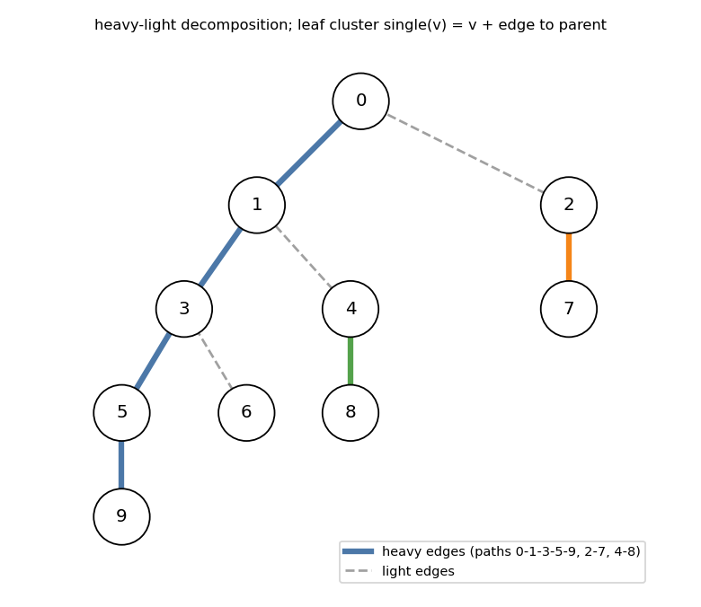
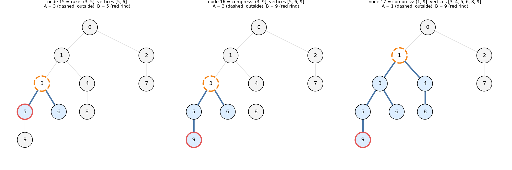
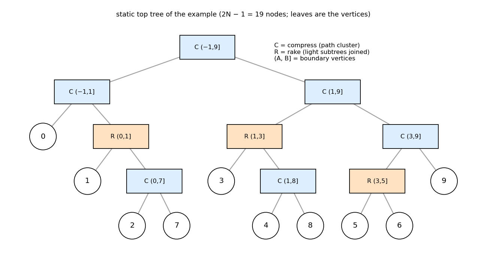
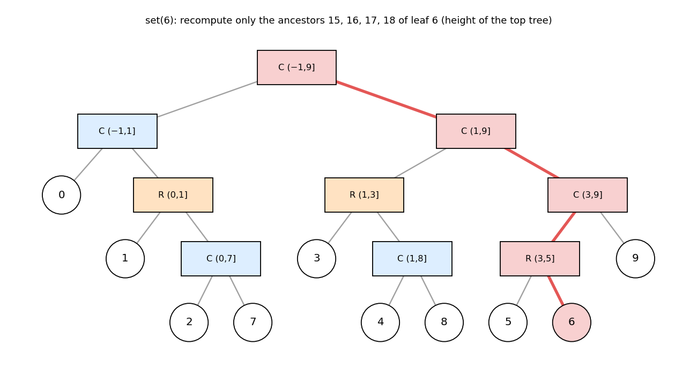
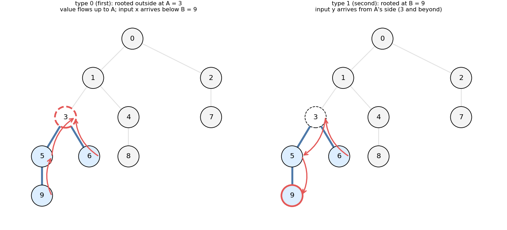

# Static Top Tree and Dynamic Tree DP

Headers:

- [`graph/datastructure/static_toptree.hpp`](../datastructure/static_toptree.hpp) — §1–4, §8
- [`graph/datastructure/dynamic_tree_dp.hpp`](../datastructure/dynamic_tree_dp.hpp) — §5
- [`graph/datastructure/dynamic_rerooting_tree_dp.hpp`](../datastructure/dynamic_rerooting_tree_dp.hpp) — §6
- [`graph/datastructure/distance_sum.hpp`](../datastructure/distance_sum.hpp) — §7

---

## 1. The problem

A tree DP is recomputed after **point updates**: change one vertex (or edge),
ask for the DP value of the whole tree. This is the tree analogue of
"point update, whole-array query" on a segment tree.

* Recomputing the updated vertex and its ancestors is `O(depth · degree)`,
  which is `O(N)` on a path or a star.
* A **static top tree** reorganises the DP into a binary tree of
  **clusters** of height `O(log N)`. Each internal node merges two clusters
  in `O(1)`, so an update recomputes only the `O(log N)` ancestors of one
  leaf, exactly like a segment tree.

Typical CP uses:

* tree DP with point updates: [ABC351 G "Hash on Tree"](https://atcoder.jp/contests/abc351/tasks/abc351_g),
  dynamic maximum independent set or matching, path-composite sums;
* rerooting DP with point updates (the answer for **any** root):
  [ABC460 G "Vertex Flip Query"](https://atcoder.jp/contests/abc460/tasks/abc460_g);
* sums of distances in a weighted vertex set (`Distance_Sum`);
* descending the top tree like a segment tree, e.g. weighted-centroid
  search (§8).

Example tree used below (root 0, heavy paths `0-1-3-5-9`, `2-7`, `4-8`, `6`):



---

## 2. Clusters

In this library every cluster is a **connected vertex set `S` together with the
edge above it**. It has two boundary vertices:

* `A` — the **top boundary**, **outside** `S`. Every vertex of `S` has its
  parent in `S` or equal to `A`. ("virtual" root)
* `B` — the **bottom boundary**, inside `S`. The heavy path continues below
  `B`; everything else below `S` is already inside `S`.

Written `(A, B]`. The leaves are `single(v) = (parent(v), v]`: the vertex `v`
with the edge to its parent.

Two merges:

| merge | shape | result |
|---|---|---|
| `compress(L, R)` | `L = (a, b]`, `R = (b, c]` — stack along a heavy path, `L` on top | `(a, c]` |
| `rake(L, R)` | `L = (a, b]`, `R = (a, ·]` — both hang from the same `a`; `R` is **closed** (a set of complete light subtrees) | `(a, b]` (keeps `L`'s `B`) |



Node 15 is `rake(single(5), single(6))`. It has `5` (heavy child of `3`,
open below) and `6` (light child of `3`, a closed subtree), both hanging
from `A = 3`. Node 16 is `compress(node 15, single(9))` `= (3, 9]`. Node 17
stacks `(1, 3]` (vertex 3 with the light subtree `4-8`) on top of it.

**Relation to the editorial's five operations.** ABC351 G's editorial uses
path clusters and point clusters with `vertex`, `compress`, `add_vertex`,
`rake`, `add_edge`. Here a cluster always includes its edge to `A`, so
`add_edge` is built in. A closed cluster plays the role of a point cluster,
and `add_vertex(t, v)` is "rake `t` next to `single(v)`". Only `compress`
and `rake` remain, plus the leaf `single`.

---

## 3. Building the top tree

`Static_TopTree<TREE> STT(tree)` builds `2N − 1` nodes: `0..N−1` are the
leaves `single(v)`, `N..2N−2` are merges, and `2N − 2` is the root (the whole
tree, `A = −1`). Arrays `par`, `lch`, `rch`, `A`, `B`, `is_compress`
describe it.

`build_dfs(head)` handles one heavy path `p_0, p_1, …` (root first):

1. For each `i ≥ 1`, rake `single(p_i)` with the top trees of the light
   children of `p_{i−1}` (built recursively). These all hang from `p_{i−1}`.
   The clusters are merged smallest-height first (a min-heap, like Huffman
   coding), and the one containing `p_i` stays on the left, so the
   result is `(p_{i−1}, p_i]`.
2. Compress the resulting pieces `(p_{−1}, p_0], (p_0, p_1], …` left to right
   with a stack of `(height, node)`. After each push, merge neighbouring
   pieces while an earlier piece is not taller than a later one (the third
   from the top is `≤` the top, or equal to the second). This rule keeps the
   compress tree of each heavy path balanced by height, like merging runs in
   a skew-binary way.



**Height.** The editorial balances by **vertex count**, which gives height
`O(log N)` (Nachia, "mergetech and logn"). This implementation balances by
**height** and does not optimise the choice of heavy paths. Measured height
of the top tree:

| tree | `N = 10^3` | `N = 10^5` | `N = 5·10^5` |
|---|---|---|---|
| random parent | 1.71 log₂N | 1.63 log₂N | 1.64 log₂N |
| path | 1.00 log₂N | 1.02 log₂N | 1.00 log₂N |
| star | 1.10 log₂N | 1.08 log₂N | 1.06 log₂N |
| complete binary | 2.31 log₂N | 2.65 log₂N | 2.64 log₂N |
| caterpillar | 1.20 log₂N | 1.14 log₂N | 1.11 log₂N |

`STT.tree_dp<TREE_DP>(single)` evaluates a DP once over this tree, with no
updates.

---

## 4. Designing the cluster data

For a rooted DP, store for each cluster `(A, B]`:

> **the value that `S` sends up to `A`, as a function of the input that
> arrives at `B` from below.**

The function class must be closed under:

* **compress**: composition, `F_{(a,c]}(x) = F_{(a,b]}(F_{(b,c]}(x))`;
* **rake**: combining with a closed cluster's value at `a`. The closed one
  is evaluated with the neutral input below.

The answer is the root cluster evaluated with the neutral input. Typical
classes are affine maps `x ↦ ax + b`, `(max, +)` maps, or small matrices
(the DP state at `B` → the state sent to `A`).

---

## 5. `Dynamic_Tree_DP<TREE, TREE_DP>`

```cpp
struct TREE_DP {
    using value_type = X;
    static X rake(const X& L, const X& R);      // R closed, both hang from L's A
    static X compress(const X& L, const X& R);  // L on top
};
Dynamic_Tree_DP<decltype(tree), TREE_DP> DP(tree, single);  // single(v) -> X
DP.set(v, single(v));   // after changing v's data or its parent edge: O(height)
DP.prod_all();          // root cluster
```

`set(v, x)` replaces leaf `v` and recomputes its ancestors in the top tree:



### Example: ABC351 G "Hash on Tree"

`f(v) = A_v` for a leaf, otherwise `f(v) = A_v + ∏_{children c} f(c)`, under
updates `A_v ← x`. The answer is `f(root)`.

Input `x` at `B` is "the product of the children of `B`", where `x = 0`
means none (leaf convention). Then everything is an affine map
`x ↦ a x + b`:

| | formula | meaning |
|---|---|---|
| `single(v)` | `(1, A_v)` | `f(v) = A_v + x` |
| `compress(L, R)` | `(L.a·R.a, L.a·R.b + L.b)` | `F_L ∘ F_R` |
| `rake(L, R)` | `(L.a·R.b, L.b·R.b)` | siblings multiply: `F_L(x) · F_R(0)` |
| answer | `prod_all().b` | root evaluated at `x = 0` |

```
sample: tree 1-2, 1-3, A = (3, 5, 1); A_3 ← 4 → 23 (= 3 + 5·4); A_2 ← 1 → 7
```

The editorial writes the same thing with path clusters `(a, b)` and point
clusters (a single product). With this library's clusters, `rake` carries the
product inside `a, b`.

Library Checker `point_set_tree_path_composite_sum_fixed_root` is the same
pattern with `(a, b, cnt, ans)`. `(a, b)` is the composite of the edge maps
from `B` up to `A`, `cnt` is the number of vertices, and `ans` is the sum over
`S` of the composite from the vertex up to `A`.

---

## 6. `Dynamic_Rerooting_Tree_DP<TREE, TREE_DP>`: any root

For the DP value with root `v` (for any `v`, under updates), each cluster
stores **two views**:

* `first` — **type 0**: rooted outside at `A`, as in §4;
* `second` — **type 1**: rooted at `B`; `A` is virtual and stands for
  "the rest of the tree beyond `A`". It is the value at `B` as a function of
  what arrives from `A`'s side.



Every `X` carries `type, s, t`: `s` is the root side and `t` the other
boundary. type 0 is `(s, t) = (A, B)`, type 1 is `(s, t) = (B, A)`. Five
operations:

| op | inputs | result | used for |
|---|---|---|---|
| `rake(L, R)` | type 0, type 0, `L.s == R.s` | type 0 | rake node, view 0 |
| `compress(L, R)` | type 0 `(a, b]`, type 0 `(b, c]` | type 0 `(a, c]` | compress node, view 0 |
| `compress2(L, R)` | type 1 `(s=c, t=b)`, type 1 `(s=b, t=a)` | type 1 `(c, a)` | compress node, view 1: `compress2(R.second, L.second)` |
| `compress3(L, R)` | type 1 `(s, t=a)`, type 0 hanging from `a` | type 1 `(s, a)` | rake node, view 1: `R` is attached to the **virtual** `a` |
| `rake2(L, R)` | type 1 rooted at `s`, type 0 hanging from `s` | type 1 | answer: subtrees hanging from the new root |

`single(v)` returns the pair `(type 0 (parent, v), type 1 (v, parent))`. The
constructor asserts these fields, and `tree.V[0] == 0` (root 0).
`prod_all(v)` walks from leaf `v` to the top-tree root. On the way it combines
the sibling clusters on the correct side, giving the whole tree rooted at `v`
in `O(height)`.

**The pending part.** In `compress3`, `R` hangs from `a`, which is
virtual in the type-1 view. `R`'s contribution must enter `a`'s own sum,
which only a later `compress2` can do, when `a` becomes a real vertex. So a
type-1 value usually carries a separate "pending for `t`" component.

### Example: ABC460 G "Vertex Flip Query"

Vertices have weights `W_v` and colors `C_v ∈ {0, 1}`. Queries: flip `C_v`;
`W_v += x`; output the total weight of the component of `v` among the
vertices of `v`'s color. With root `v` and color `c = C_v`:

```
g(u) = [C_u = c] · (W_u + Σ_{children w} g(w)),        answer = g(v)
```

Store both colors `c = 0, 1` in every cluster. Let `k = [C = c]` be a 0/1
gate.

* **type 0**, `x ↦ a x + b`: `single(v) = (k_v, k_v W_v)`;
  `compress = (L.a R.a, L.a R.b + L.b)`; `rake = (L.a, L.b + R.b)`.
* **type 1**: `g(s) = p·y + q`, plus the gate `k = [C_s = c]` of the root
  `s` and the pending sum `r` for `t`. `single(v) = (p, q, k, r) = (k_v, k_v W_v, k_v, 0)`.
  * `compress2(L, R)` (`L` below): `L`'s pending `r` enters `R`'s root sum
    through `R.k`.
    `p = L.p R.p`, `q = L.p (R.q + R.k · L.r) + L.q`, `k = L.k`, `r = R.r`.
  * `compress3(L, R)`: `r = L.r + R.b`.
  * `rake2(L, R)`: `q = L.q + L.k · R.b`.
* answer: `prod_all(v).q[C_v]`.

```
sample 1: W = 1 10 100 1000 10000, edges 1-2 2-3 3-4 2-5, all color 0
→ 11111, 1, 10, 1100, 10012
```

Each update or query is `O(log N)`. Both examples are checked against brute
force in `test/mytest/static_toptree_stress.test.cpp`.

---

## 7. `Distance_Sum<TREE, T>`

A weighted multiset of vertices (`cnt[v]`) on a tree with edge lengths:

* `set(v, x)` / `add(v, x)`
* `all_pairs_sum()` = `Σ_{u<w} cnt_u cnt_w dist(u, w)`
* `query(v)` = `Σ_u cnt_u dist(u, v)`

All are `O(log N)`. Cluster data `(ans, cnt, a, b, c)`:

| field | meaning |
|---|---|
| `ans` | `Σ` over pairs inside `S` |
| `cnt` | `Σ cnt` in `S` |
| `a` | `Σ cnt_u · dist(u, A)` |
| `b` | `Σ cnt_u · dist(u, B)` |
| `c` | `dist(A, B)` |

* `compress`: a pair `x ∈ L`, `y ∈ R` meets at `B_L`, so
  `ans += L.cnt·R.a + R.cnt·L.b`, `a = L.a + R.a + R.cnt·L.c`,
  `b = L.b + R.b + L.cnt·R.c`, `c = L.c + R.c`.
* `rake`: a pair meets at `A`, so `ans += L.cnt·R.a + R.cnt·L.a`,
  `a = L.a + R.a`, `b = L.b + R.a + R.cnt·L.c` (from `R` go up to `A`, then
  down to `B`), `c = L.c`.

`query(v)` adds `v` once on a copy of its root path and returns the
increase of `ans`. Applications: [CF 1458F](https://codeforces.com/contest/1458/problem/F).

---

## 8. Using the top tree directly

The structure is a balanced binary tree over the vertices, so it can be
descended like a segment tree, with each node standing for a cluster. Store
per node whatever the search needs. Yukicoder 2258 stores each cluster's
sorted vertex list (a merge-sort tree over the top tree) and finds a weighted
centroid of an index range by walking down. At each node it moves to the
child cluster that still holds more than half of the weight: for `compress`,
comparing the two sides along the path; for `rake`, comparing the two
hanging parts. That is `O(log N)` nodes, each with an `O(1)` lookup.
