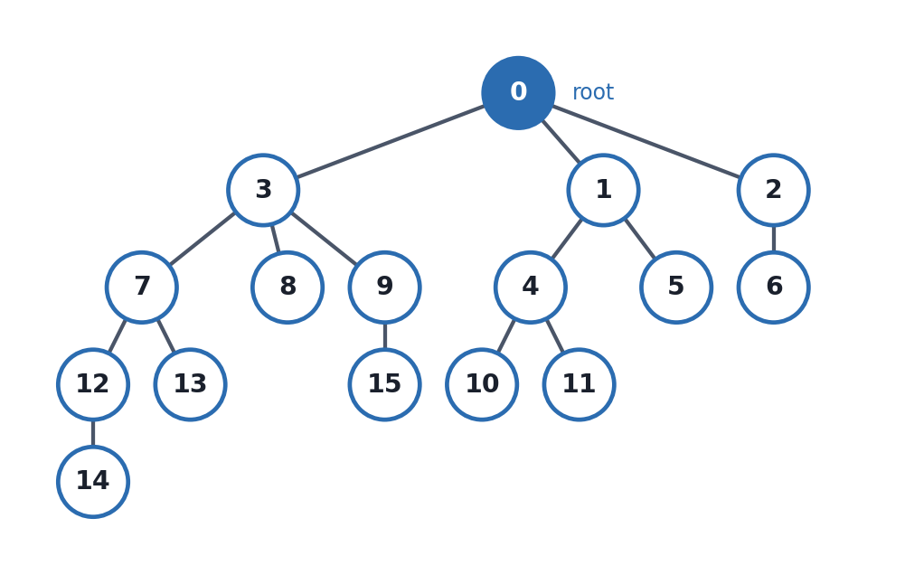
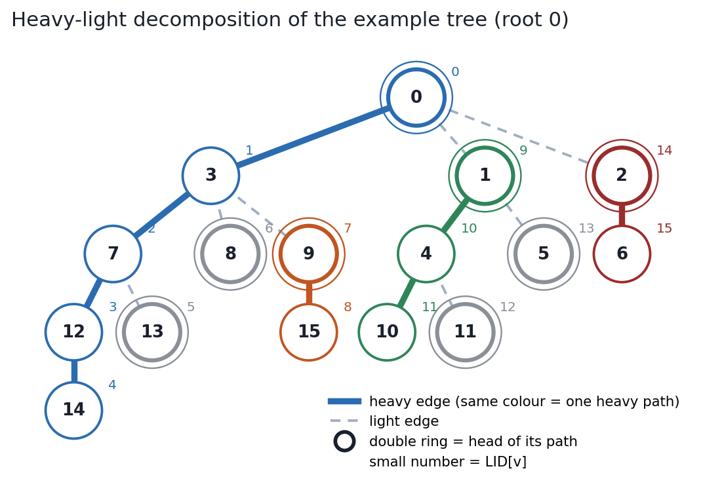
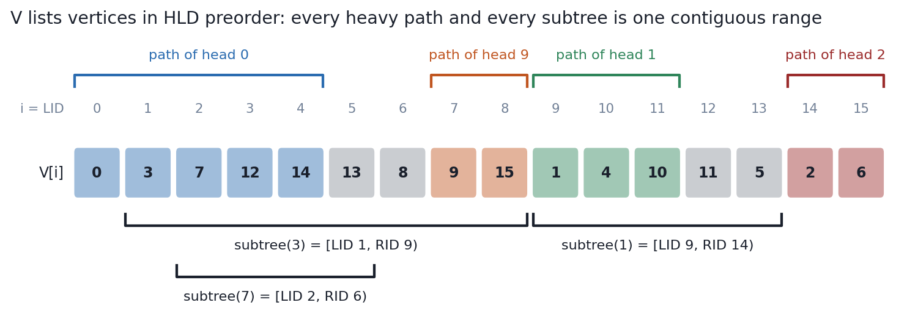
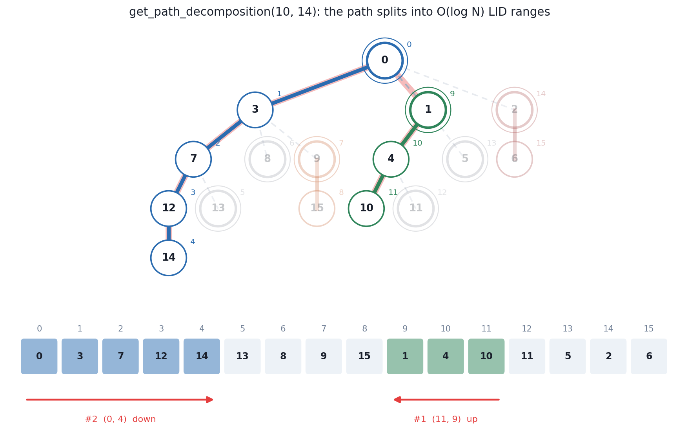
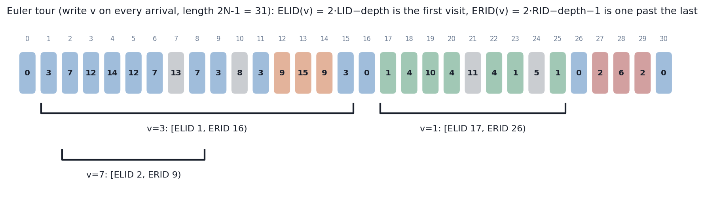

# Rooted Tree and Heavy-Light Decomposition

Header:

- [`graph/tree.hpp`](../tree.hpp)

Example tree used throughout:



```cpp
Graph<int, 0> G(N);  /* add edges */  G.build();
Tree<decltype(G)> T(G);  // root 0; T(G, r) for another root
```

---

## 1. Arrays

| Array | Meaning |
|---|---|
| `parent[v]` | parent of `v` (`-1` for the root) |
| `depth[v]` | edges from the root to `v` |
| `depth_weighted[v]` | sum of edge costs from the root to `v` |
| `VtoE[v]` | id of edge `parent[v] − v` (`-1` for the root) |
| `EtoV[e]` | child endpoint of tree edge `e` |
| `LID[v]` | position of `v` in HLD preorder (0 .. N−1) |
| `RID[v]` | one past the end of `v`'s subtree: `subtree(v) = [LID[v], RID[v])` |
| `V[i]` | vertex at position `i` (`V[LID[v]] == v`) |
| `head[v]` | top vertex of the heavy path containing `v` |

| v | 0 | 1 | 2 | 3 | 4 | 5 | 6 | 7 | 8 | 9 | 10 | 11 | 12 | 13 | 14 | 15 |
|---|---|---|---|---|---|---|---|---|---|---|---|---|---|---|---|---|
| `parent` | −1 | 0 | 0 | 0 | 1 | 1 | 2 | 3 | 3 | 3 | 4 | 4 | 7 | 7 | 12 | 9 |
| `depth` | 0 | 1 | 1 | 1 | 2 | 2 | 2 | 2 | 2 | 2 | 3 | 3 | 3 | 3 | 4 | 3 |
| `LID` | 0 | 9 | 14 | 1 | 10 | 13 | 15 | 2 | 6 | 7 | 11 | 12 | 3 | 5 | 4 | 8 |
| `RID` | 16 | 14 | 16 | 9 | 13 | 14 | 16 | 6 | 7 | 9 | 12 | 13 | 5 | 6 | 5 | 9 |
| `head` | 0 | 1 | 2 | 0 | 1 | 5 | 2 | 0 | 8 | 9 | 1 | 11 | 0 | 13 | 0 | 9 |
| `heavy_child` | 3 | 4 | 6 | 7 | 10 | −1 | −1 | 12 | −1 | 15 | −1 | −1 | 14 | −1 | −1 | −1 |

| i | 0 | 1 | 2 | 3 | 4 | 5 | 6 | 7 | 8 | 9 | 10 | 11 | 12 | 13 | 14 | 15 |
|---|---|---|---|---|---|---|---|---|---|---|---|---|---|---|---|---|
| `V[i]` | 0 | 3 | 7 | 12 | 14 | 13 | 8 | 9 | 15 | 1 | 4 | 10 | 11 | 5 | 2 | 6 |

---

## 2. Heavy-light decomposition

For every non-leaf `v`, the child with the **largest subtree** is its *heavy
child* (ties: first in edge order); that edge is *heavy*, every other child
edge is *light*. Heavy edges form vertex-disjoint downward chains, the *heavy
paths*. `head[v]` is the top of `v`'s path; a vertex is a head exactly when it
is the root or a light child.



`0`'s children have subtree sizes `5, 2, 8` (`1, 2, 3`), so `3` is heavy.

**Why `O(log N)`.** A light child `c` of `v` has `size(c) ≤ size(v) / 2`
(otherwise it would beat the heavy child). Going up, every light edge at least
doubles the subtree size:

```
#light edges on any root path ≤ log2 N
⇒ any path u–v crosses at most 2·log2 N + 1 heavy paths
```

---

## 3. The order: `LID`, `RID`, `V`

Vertices are numbered in preorder, **heavy child first**. Two invariants:

1. **Subtree = range** `[LID[v], RID[v])`; size `RID[v] − LID[v]`.
2. **Heavy path = range**: `LID[heavy_child(v)] = LID[v] + 1`, so a path with
   head `h` and length `k` is `[LID[h], LID[h] + k)`, top to bottom.



```
in_subtree(a, b)  ⇔  LID[b] ≤ LID[a] < RID[b]        a is in subtree(b)
heavy_child(v)    =  V[LID[v] + 1]  (−1 if v is a leaf)
k-th ancestor on v's own heavy path = V[LID[v] − k]
```

A segment tree indexed by `LID` answers subtree queries with **one range** and
path queries with **`O(log N)` ranges**.

Building also reorders `G`'s adjacency lists so that `G[v][0]` is the heavy
child. With `hld = false` the order is plain preorder in edge order, and
`head` follows the first child instead of the heavy one (`lca` and path
queries still work, in `O(depth)`).

---

## 4. Queries

### 4.1 `lca(u, v)` — `O(log N)`

```cpp
for (;; v = parent[head[v]]) {
    if (LID[u] > LID[v]) swap(u, v);
    if (head[u] == head[v]) return u;
}
```

Keep `v` as the larger-`LID` vertex. On the same heavy path, the smaller `LID`
is higher, so it is the LCA. Otherwise jumping `v` to `parent[head[v]]` is
safe: if the LCA `w` were on `v`'s path below `head[v]`, then `v` is in the
subtree of `w`'s heavy child while `u` is in a light child's subtree, and
preorder numbers light subtrees after the heavy one, giving `LID[u] > LID[v]`.

`lca(10, 14) = 0`, `lca(14, 15) = 3`.

### 4.2 `la(v, k)` — `k`-th ancestor, `O(log N)`

```
u = head[v]
if LID[v] − k ≥ LID[u]: return V[LID[v] − k]
else: k −= LID[v] − LID[u] + 1, v = parent[u], repeat
```

Requires `k ≤ depth[v]`. `la(14, 2) = 7`.

### 4.3 `jump(a, b, k)` — `k`-th vertex on the path `a → b`

`k = 0` is `a`; `-1` when `k > dist(a, b)`. With `c = lca(a, b)`: `la(a, k)`
if `k ≤ depth[a] − depth[c]`, else `la(b, dist − k)`. `jump(a, b, 1)` is the
neighbour of `a` towards `b`. `jump(10, 14, 3) = 0`.

### 4.4 Distances

```
dist(a, b)          = depth[a] + depth[b] − 2·depth[lca]
dist_weighted(a, b) = depth_weighted[a] + depth_weighted[b] − 2·depth_weighted[lca]
```

`dist(10, 14) = 7`.

### 4.5 `meet`, `lca_root`

Of the three pairwise LCAs of any three vertices, two are equal; XOR leaves the
third.

```
meet(a, b, c)      = lca(a,b) ^ lca(a,c) ^ lca(b,c)     median of a, b, c
lca_root(u, v, r)  = lca(u,v) ^ lca(u,r) ^ lca(v,r)     LCA when rooted at r
```

### 4.6 `subtree_size(v, root = -1)`

Without `root`: `RID[v] − LID[v]`. Rooted at `r`, with `x = jump(v, r, 1)`:
if `x = parent[v]` the size is unchanged, otherwise (`r` is below `v`) it is
`N − (RID[x] − LID[x])`.

### 4.7 `get_path_decomposition(u, v, edge)`

The path `u → v` as closed `LID` ranges `(a, b)` **in walking order**:
`a > b` walks up (`a, a−1, …, b`), `a < b` walks down, `a == b` is one vertex.
Whichever endpoint has the larger `LID` jumps to `parent[head]` until both
share a path; `u`'s pieces go first, `v`'s pieces are reversed and appended.



`(10, 14)` gives `(11,9) (0,4)`: vertices `10 4 1 | 0 3 7 12 14`.

`edge = true` drops the LCA, for **edge** queries: store edge `parent[v] − v`
at `LID[v]`; the path's edges are then exactly its non-LCA vertices.
`(10, 14, true)` gives `(11,9) (1,4)`.

`get_path_decomposition_detail(u, v)` returns the same path as edge runs
`(frm, to, kind)` with kind `heavy_up`, `heavy_down`, `light_up`,
`light_down`. `restore_path(u, v)` expands the ranges into the vertex list.

### 4.8 `max_path(check, u, v)`

Last vertex `x` on `u → v` with `check(x)` true, for `check` monotone along the
path (true then false). `-1` if `check(u)` is false. Walks the ranges and binary
searches inside the first range where `check` turns false: `O(log² N)` calls.

### 4.9 With a segment tree

```cpp
// vertex values: seg[LID[v]] = a[v]
for (auto [a, b] : T.get_path_decomposition(u, v, edge)) {
    X x = (a <= b) ? seg.prod(a, b + 1)        // down: left → right
                   : seg_r.prod(b, a + 1);     // up: right → left
    res = op(res, x);
}
X sub = seg.prod(T.LID[v] + edge, T.RID[v]);  // subtree of v
```

`seg_r` is a segment tree over the reversed monoid (needed only for
non-commutative monoids). This is `datastructure/tree_monoid.hpp`.

### 4.10 Edge ids

| Method | Meaning |
|---|---|
| `v_to_e(v)` | id of edge `parent[v] − v` |
| `e_to_v(eid)` | child endpoint of edge `eid` |
| `get_eid(u, v)` | id of the edge between adjacent `u`, `v` |

Store edge data at `LID[e_to_v(eid)]`.

### 4.11 Euler tour: `ELID`, `ERID`

Write the current vertex on **every arrival** in a heavy-first DFS. The tour has
length `2N − 1` and

```
ELID(v) = 2·LID[v] − depth[v]        first occurrence of v
ERID(v) = 2·RID[v] − depth[v] − 1    one past the last occurrence
```

so `subtree(v)` is the tour range `[ELID(v), ERID(v))`. Before first reaching
`v` the DFS has gone down `LID[v]` edges and up `LID[v] − depth[v]` edges (each
earlier non-ancestor has been left).



Used for LCA by RMQ on depths, or when entry and exit events must share one
array.

### 4.12 Children, subtrees, heavy paths

| Method | Returns |
|---|---|
| `collect_child(v)` / `collect_child(v, buf)` | children, walking `LID` ranges (`O(#children)`) |
| `for_each_child(v, f)` | calls `f(c)` for each child |
| `collect_light(v)` | children except the heavy one |
| `collect_subtree(v)` | vertices of `subtree(v)` in `LID` order |
| `heavy_child(v)` | heavy child, `-1` for a leaf |
| `heavy_path_at(h)` | vertices of the path headed by `h` (`h` must be a head), top to bottom |
| `tail(v)` | bottom vertex of `v`'s heavy path |
| `path_intersection(a, b, c, d)` | endpoints of the common part of paths `a–b`, `c–d`; `{-1, -1}` if empty |

---

## 5. Complexity

| Operation | Time |
|---|---|
| construction (iterative, no recursion) | `O(N)` |
| `lca`, `la`, `jump`, `dist`, `meet`, `lca_root`, `subtree_size(v, root)` | `O(log N)` |
| `get_path_decomposition` | `O(log N)` ranges |
| `max_path` | `O(log² N)` checks |
| `in_subtree`, `heavy_child`, `ELID`, `ERID`, `v_to_e`, `e_to_v` | `O(1)` |
| `restore_path` | `O(path length)` |

Only the root's component is built; other vertices keep `LID = -1`.

---

## 6. Cheat sheet

```
LID[v]           preorder index, heavy child first          V[LID[v]] = v
subtree(v)       [LID[v], RID[v])        size = RID − LID
a in subtree(b)  LID[b] ≤ LID[a] < RID[b]
heavy child      V[LID[v]+1]   (G[v][0] after build)
heavy path of h  [LID[h], LID[h] + len)  top → bottom
light edges on any root path ≤ log2 N

lca: while heads differ, move the larger-LID vertex to parent[head]
la(v,k): on-path → V[LID[v]−k], else jump past head
dist = d[a] + d[b] − 2 d[lca]
meet(a,b,c) = lca(a,b)^lca(a,c)^lca(b,c)      lca rooted at r = lca(u,v)^lca(u,r)^lca(v,r)

path ranges (a,b): a > b up (read right→left), a < b down, edge=true drops the LCA
edge data at LID[child]
Euler tour (2N−1): subtree = [2·LID − d, 2·RID − d − 1)
```
