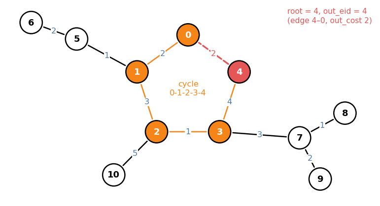
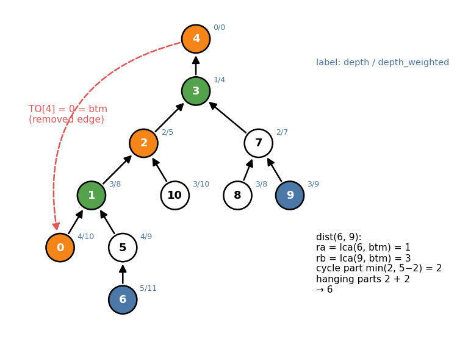

# Unicyclic Graph (`library/graph/cycle/unicyclicgraph.hpp`)

A **unicyclic graph** is a connected undirected graph with `N` vertices and
`N` edges: a tree plus one extra edge, hence exactly one cycle. Every vertex
hangs, through a tree, from exactly one cycle vertex. The cycle may be a
self-loop (length 1) or a pair of parallel edges (length 2).

Example used throughout (edges `a − b` with cost, edge ids in order):

```
id    0    1    2    3    4    5    6    7    8    9   10
edge 0-1  1-2  2-3  3-4  4-0  1-5  5-6  3-7  7-8  7-9  2-10
cost  2    3    1    4    2    1    2    3    1    2    5
```



```cpp
Graph<int, 0> G(N);  /* N edges */  G.build();
UnicyclicGraph X(G);                // G must be connected, undirected, N edges
int d = X.dist(6, 9);               // 6
```

---

## 1. Structure

**Exactly one cycle.** A connected graph with `N` vertices has a spanning
tree with `N − 1` edges; the one remaining edge closes exactly one cycle (the
tree path between its ends, plus itself). Any other cycle would need a second
non-tree edge.

Consequences used everywhere:

* Deleting **any one cycle edge** leaves a spanning tree.
* Every vertex `v` has a unique nearest cycle vertex, the point where `v`'s
  *hanging tree* attaches. Two vertices in the same hanging tree are joined
  by a tree path that avoids the cycle; vertices in different hanging trees
  go *attach point → around the cycle (either way) → attach point*.
* An edge lies on the cycle iff both endpoints are cycle vertices (a chord
  would create a second cycle).

---

## 2. Construction

The constructor runs union-find over the edges in id order; the first edge
that joins two already-connected vertices (or is a self-loop) is the
**removed edge**:

| Member | Meaning |
|---|---|
| `out_eid`, `out_cost` | id and cost of the removed edge |
| `root` | its `frm` endpoint, the root of the spanning tree |
| `TO[v]` | parent of `v` in the spanning tree rooted at `root`; `TO[root]` = the other end of the removed edge (`btm`) |
| `cycle` | `TO[root], TO[TO[root]], …, root`: the cycle, walking from `btm` up to `root` |
| `in_cycle[v]` | `v` is on the cycle |

In the example the first closing edge is `4 − 0` (id 4), so `root = 4`,
`btm = TO[4] = 0`, `cycle = {0, 1, 2, 3, 4}`.

Following `TO` from any vertex is a functional graph (see
[functional_graph.md](functional_graph.md)) whose only cycle is the graph's
cycle: `root → btm → … → root`.

## 3. The rooted tree: `X.G`, `X.tree`

The constructor also builds the spanning tree without the removed edge:

| Member | Meaning |
|---|---|
| `G` | `Graph<T, 1>` **directed parent → child**, original costs; `G[v]` lists the children of `v` |
| `tree` | `Tree` of `G` rooted at `root` (HLD, `depth`, `depth_weighted`, `lca`) |
| `orig_eid[i]` | edge `i` of `G` is edge `orig_eid[i]` of the input graph |

`tree` refers to the member `G`, so a `UnicyclicGraph` cannot be copied.



In this tree the cycle is the root path of `btm`: `btm = 0 → 1 → 2 → 3 →
root = 4`. A vertex `a` hangs from the cycle at

```
ra = lca(a, btm)
```

since `a`'s root path joins `btm`'s root path exactly at that cycle vertex.

## 4. `dist` and `dist_weighted`

```cpp
int dist(a, b);           // number of edges, O(log N)
T dist_weighted(a, b);    // sum of costs (needs non-negative costs), O(log N)
```

With `ra = lca(a, btm)`, `rb = lca(b, btm)`:

* `ra == rb`: same hanging tree, the answer is the tree distance
  (`tree.dist(a, b)` / `tree.dist_weighted(a, b)`).
* Otherwise: `a → ra` and `rb → b` along the tree, plus the shorter way around
  the cycle between `ra` and `rb`. Both are on the root path of `btm`, so one
  way is `d = |depth[ra] − depth[rb]|` and the other is `len(cycle) − d`.
  Weighted: `d = |D[ra] − D[rb]|` (`D = depth_weighted`), other way
  `D[btm] + out_cost − d`, since the whole cycle weighs `D[btm] + out_cost`.

```
dist(6, 9):  ra = 1, rb = 3
  6 → 1: 2 edges,  9 → 3: 2 edges,  cycle: min(|3 − 1|, 5 − 2) = 2      → 6
dist_weighted(6, 9):
  6 → 1: 11 − 8 = 3,  9 → 3: 9 − 4 = 5,
  cycle: min(|8 − 4|, (10 + 2) − 4) = 4                                  → 12
dist(8, 9) = 2      (same hanging tree under 3: 8 − 7 − 9)
```

---

## 5. Reference

| Member | Meaning |
|---|---|
| `UnicyclicGraph<GT> X(G)` | `G` undirected, connected, `G.M == G.N` |
| `root`, `out_eid`, `out_cost` | removed edge: `root − TO[root]` |
| `TO[v]` | parent towards `root`; `TO[root] = btm` |
| `cycle`, `in_cycle[v]` | cycle from `btm` to `root`; membership |
| `G`, `tree`, `orig_eid` | spanning tree rooted at `root`, its `Tree`, edge-id map |
| `dist(a, b)` | edge count |
| `dist_weighted(a, b)` | cost sum |

---

## 6. Usage

**Cycle edges** (yukicoder 1254): an edge is on the cycle iff both ends are.

```cpp
UnicyclicGraph X(G);
For(i, N) {
    auto& e = G.edges[i];
    if (X.in_cycle[e.frm] && X.in_cycle[e.to]) ANS.emplace_back(i + 1);
}
```

**Tree DP + fix the removed edge.** Most DPs on a unicyclic graph are a tree
DP on the spanning tree, run once per state of the removed edge `root − btm`.
Maximum-weight independent set (`A[v] ≥ 0`): an optimal set misses `root` or
misses `btm`, and in either case the removed edge cannot be violated, so
"`root` banned" and "`btm` banned" cover everything.

```cpp
UnicyclicGraph X(G);
int r = X.root, s = X.TO[r];
auto solve = [&](int banned) -> long long {
    vector<array<long long, 2>> dp(N);   // dp[v][v chosen]
    Frr(i, N) {                          // reverse preorder: children first
        int v = X.tree.V[i];
        dp[v] = {0, v == banned ? -linf : A[v]};
        for (auto&& e: X.G[v]) {
            dp[v][0] += max(dp[e.to][0], dp[e.to][1]);
            dp[v][1] += dp[e.to][0];
        }
    }
    return max(dp[r][0], dp[r][1]);
};
long long ans = max(solve(r), solve(s));
```

A self-loop gives `s == r`, so `r` is never chosen, as required.

**Cycle DP over hanging trees.** For problems where the cycle order matters
(e.g. sums of distances, rotating along the cycle), compute a value per
hanging tree with the DP above restricted to `!in_cycle` children, then treat
`cycle` as a circular array of those values (prefix sums, two pointers on the
doubled array).
