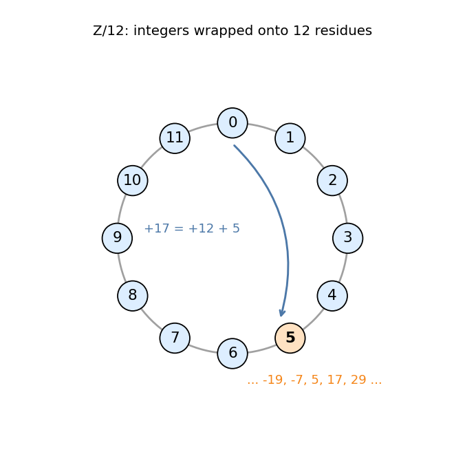
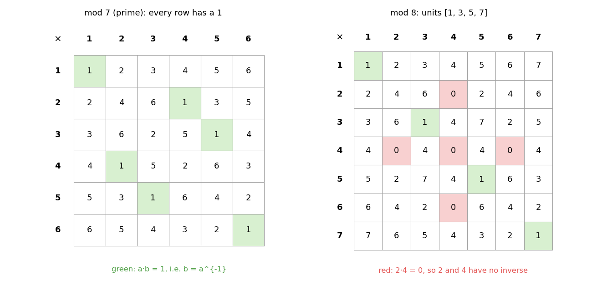
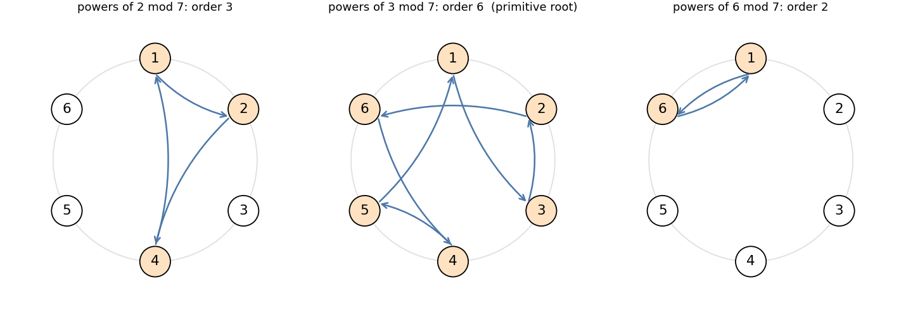
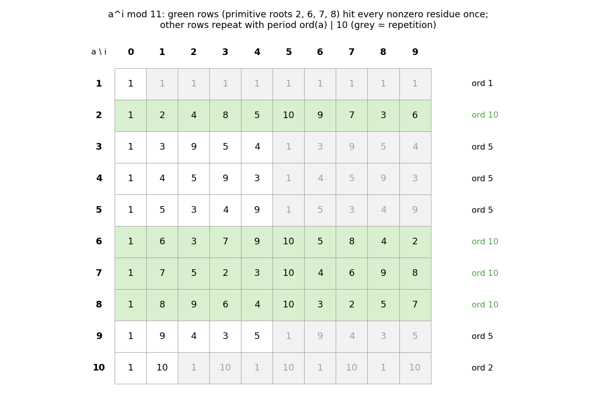
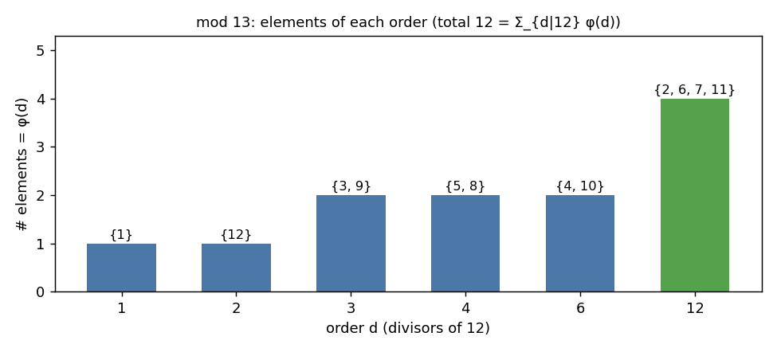
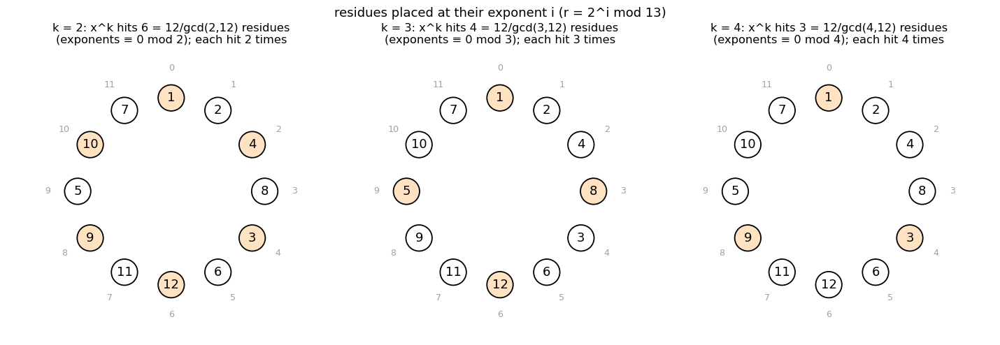
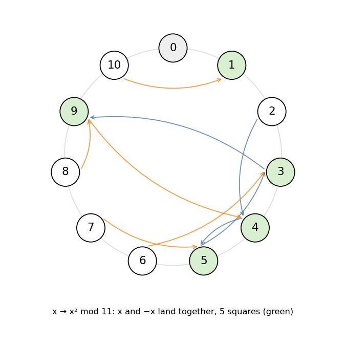
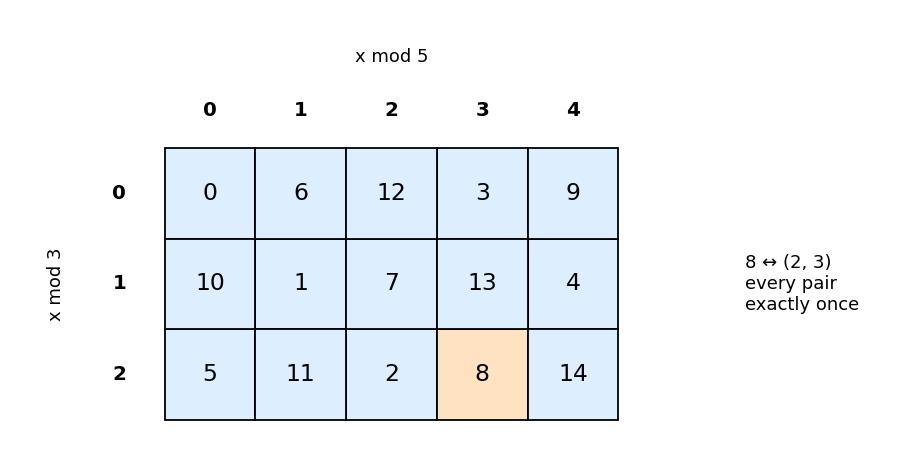
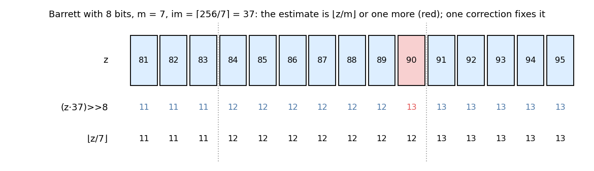

# 0. Modular arithmetic

The concepts behind every header in `library/mod/`. Each section ends with
the templates that use it.

---

## 1. Congruences and residues

`a ≡ b (mod m)` means `m | a − b`. Every integer is congruent to exactly one
**residue** `r ∈ [0, m)`, namely `r = a − m ⌊a/m⌋`. The integers wrap around a
clock of length `m`:



`Z/m` is the set of residues with `+`, `−`, `×` taken mod `m`. These are
well defined: if `a ≡ a'` and `b ≡ b'`, then `a + b ≡ a' + b'` and `ab ≡ a'b'`.
So reducing in the middle of a computation never changes the final residue.
That is why a modint can reduce after every operation.

**Negative numbers.** C++ `%` truncates toward zero: `-7 % 12 == -7`. The
residue is `rem(-7, 12) = 5` (`rem` / `fld` in `template.hpp`), and modint
constructors add `m` when the remainder is negative.

→ every modint type ([chapter 1](01_modint.md)).

---

## 2. Division and inverses

Division is not automatic: `2x ≡ 4 (mod 8)` has the solutions `x = 2` and
`x = 6`, so "`4 / 2`" is not one number mod 8. The **inverse** `a^{-1}` is a
residue `x` with `ax ≡ 1`. When it exists, `b / a` means `b · a^{-1}` and is
unique.

**`a` is invertible mod `m` ⟺ `gcd(a, m) = 1`.**

* If `ax ≡ 1`, then `ax − my = 1`, so every common divisor of `a` and `m`
  divides `1`.
* Conversely, **Bézout's identity** gives integers `x, y` with
  `ax + my = gcd(a, m)`. If the gcd is `1`, then `ax ≡ 1`.

The extended Euclidean algorithm finds `x`. Run Euclid on `(m, a)`, keeping
each remainder as a multiple of `a` mod `m`: `r_i ≡ s_i · a`. Example
`17^{-1} mod 43`:

| `q` | `r` | `s` (so `r ≡ s · 17`) |
|---|---|---|
| | 43 | 0 |
| 2 | 17 | 1 |
| 1 | 9 | `0 − 2·1 = −2` |
| 1 | 8 | `1 − 1·(−2) = 3` |
| 8 | 1 | `−2 − 1·3 = −5` |

So `1 ≡ −5 · 17`, i.e. `17^{-1} ≡ −5 ≡ 38 (mod 43)`. There are
`O(log m)` steps, and `|s| ≤ m` throughout.

→ `modint::inverse`, `mod_inv(val, mod)` ([chapter 2](02_inverses_tables.md) §1).

---

## 3. Prime vs composite moduli



* **`m = p` prime.** Every nonzero residue is coprime to `p`, so every row of
  the multiplication table contains a `1`. `Z/p` is a **field**: you can divide
  by anything nonzero, solve linear equations, interpolate polynomials, and
  run NTT. This is why contest moduli are primes (`998244353`, `10^9 + 7`).
* **Composite `m`.** **Zero divisors** appear: `2 · 4 ≡ 0 (mod 8)`, although
  neither factor is `0`. Zero divisors have no inverse. The invertible
  residues, the **units** `(Z/m)^×`, number `φ(m)` (Euler's totient), e.g.
  `{1, 3, 5, 7}` mod 8.

Practical consequences:

* `n!` and binomials mod a composite cannot be computed by division. Use
  Pascal's triangle (`C<mint, false, true>`), or CRT over prime powers
  (`Binomial`, [chapter 3](03_binomial.md) §3).
* Mod `2^64` (unsigned overflow) only odd numbers are invertible
  (`mod_inv_u64`, `Binomial_u64`).

---

## 4. Fermat, Euler, Wilson

**Fermat.** For prime `p` and `a ≢ 0`: `a^{p−1} ≡ 1 (mod p)`.
Multiplying all units by `a` permutes them, so
`∏ (a·u) = ∏ u` gives `a^{p−1} = 1`.

Consequences:

* `a^{-1} ≡ a^{p−2}`. Example: `3^{-1} mod 7 = 3^5 = 243 ≡ 5`, and `3 · 5 = 15 ≡ 1`.
* Exponents can be reduced mod `p − 1`: `2^{100} ≡ 2^{100 mod 6} = 2^4 ≡ 2 (mod 7)`.

**Euler.** For `gcd(a, m) = 1`: `a^{φ(m)} ≡ 1 (mod m)`, by the same argument
on the `φ(m)` units. Example: `φ(12) = 4`, and `5^4 = 625 ≡ 1 (mod 12)`.

**Not coprime.** Then the exponent can **not** simply be reduced mod `φ(m)`:
`2^5 = 32 ≡ 8`, but `2^{5 mod 4} = 2 (mod 12)`. The generalised form still
holds for large exponents:

```
a^x ≡ a^{(x mod φ(m)) + φ(m)}   (mod m)    whenever x ≥ log₂ m
```

→ `tetration` ([chapter 4](04_roots_logs.md) §6).

**Wilson.** `(p − 1)! ≡ −1 (mod p)`: every unit pairs with its inverse except
`1` and `−1`, which are their own inverses. Example: `6! = 720 ≡ −1 (mod 7)`.
The analogue for prime powers drives `Binomial`'s sign bookkeeping
([chapter 3](03_binomial.md) §3).

---

## 5. Linear congruences

`ax ≡ b (mod m)` with `g = gcd(a, m)`:

* no solution if `g ∤ b`;
* otherwise divide through, `(a/g) x ≡ b/g (mod m/g)`, and invert `a/g`.
  This gives `g` solutions mod `m`.

```
6x ≡ 4 (mod 10):  g = 2  →  3x ≡ 2 (mod 5)  →  x ≡ 4 (mod 5)  →  x ∈ {4, 9} mod 10
```

→ the first step of `mod_kth_root`, the final step of `mod_log_u64`
([chapter 4](04_roots_logs.md)).

---


## 6. Order and primitive roots

### 6.1 Order

The **order** `ord(a)` of a unit `a` is the smallest `k > 0` with `a^k ≡ 1`.
The powers `1, a, a², …` cycle with period `ord(a)`, and:

* `a^n ≡ 1  ⟺  ord(a) | n`. In particular `ord(a) | φ(m)` (Lagrange), and
  `ord(a) | p − 1` mod a prime.
* `a^x ≡ a^y  ⟺  x ≡ y (mod ord(a))`.



**Computing `ord(a)`.** Start with `t = p − 1` (or `φ(m)`). For each prime
`q | t`: while `q | t` and `a^{t/q} ≡ 1`, set `t ← t/q`. The final `t` is the
order: `O(log² p)` multiplications once `p − 1` is factored.

### 6.2 Primitive roots: the powers cover everything

A **primitive root** `g` has order `φ(m)`. Then its powers
`g^0, g^1, …, g^{φ(m)−1}` are **all distinct**, so they list every unit
exactly once. Mod a prime, `i ↦ g^i` is a bijection
`{0, …, p−2} → {1, …, p−1}`:



Primitive roots exist exactly for `m = 1, 2, 4, p^k, 2p^k` (`p` odd prime).
Mod `2^e`, `e ≥ 3`, there is none. Instead every odd residue is `±5^j`, and
`5` has order `2^{e−2}`.

Every unit is `a = g^i` for a unique `i = log_g a` (the **discrete log**).
Working with exponents turns the multiplicative group into the additive group
`Z/(p−1)`, and most facts below follow from that.

```
mod 13, g = 2:   r      1  2  4  8  3  6  12 11  9  5  10  7
                 log r  0  1  2  3  4  5  6  7   8  9  10  11
```

### 6.3 Orders of powers; how many elements of each order

```
ord(g^k) = (p − 1) / gcd(k, p − 1)
```

So `g^k` is again a primitive root iff `gcd(k, p − 1) = 1`, and there are
`φ(p − 1)` primitive roots. Mod 11 with `g = 2`, the exponents coprime to 10
are `1, 3, 7, 9`, giving `2, 8, 7, 6`.

More generally, exactly `φ(d)` elements have order `d`, for each `d | p − 1`.
Summing over `d` gives the identity `Σ_{d | n} φ(d) = n`.



Finding one primitive root: test `g = 2, 3, …` with the criterion
`g^{(p−1)/q} ≠ 1` for all primes `q | p − 1`. The smallest one is small in
practice. A random `g` succeeds with probability `φ(p−1)/(p−1)`.

### 6.4 Roots of unity

The solutions of `x^n ≡ 1 (mod p)` are the `g^{i}` with `n·i ≡ 0 (mod p − 1)`.
There are `gcd(n, p − 1)` of them. **`n` distinct `n`-th roots of unity exist
iff `n | p − 1`**, namely `ω^j` for `ω = g^{(p−1)/n}`.

This is why NTT primes look like `c · 2^k + 1`: `998244353 = 119 · 2^23 + 1`
has `2^k`-th roots of unity for every `k ≤ 23`, so convolutions up to length
`2^23` work. `ntt_info()` stores `(23, ω)` ([chapter 1](01_modint.md) §3).

### 6.5 `k`-th powers and `k`-th roots (discrete root)

With `x = g^y` and `a = g^{log a}`:

```
x^k ≡ a   ⟺   k·y ≡ log a   (mod p − 1)          (a linear congruence, §5)
```

Let `d = gcd(k, p − 1)`.

* The `k`-th powers are exactly the `g^i` with `d | i`. That is
  `(p − 1)/d` residues, each hit `d` times.
* `x^k ≡ a` has a solution iff `d | log a`, i.e. iff `a^{(p−1)/d} ≡ 1`
  (generalised Euler criterion). Then it has exactly `d` solutions:
  `x_0 · ζ` for the `d` roots of unity `ζ^d = 1` (§6.4).



```
x³ ≡ 5 (mod 13):  log 5 = 9,  3y ≡ 9 (mod 12)  →  y ∈ {3, 7, 11}  →  x ∈ {8, 11, 7}
                  = 8 · {1, 3, 9}   (cube roots of unity)
```

`k = 2` is §7. `mod_kth_root` returns one `x_0` without computing a full
discrete log ([chapter 4](04_roots_logs.md) §3).

### 6.6 Power sums

```
Σ_{x=1}^{p−1} x^k ≡  −1   if (p − 1) | k
                      0   otherwise                   (mod p)
```

Substitute `x = g^i`: the sum becomes the geometric series `Σ (g^k)^i`, which
is `0` unless `g^k = 1`. Example mod 7: `Σ x³ ≡ 0`, `Σ x⁶ ≡ 6 ≡ −1`. The same
trick (multiplying by `g` permutes the units) proves Fermat and Wilson.

### 6.7 What exponents buy you

| problem mod `p` | in exponents mod `p − 1` |
|---|---|
| `x^k = a` | `k·y ≡ log a` (§6.5) |
| `a^n = b` | `n · log a ≡ log b` (discrete log) |
| `#{x : x^k = a}` | `gcd(k, p−1)` or `0` |
| multiplicative convolution `Σ_{ij=k}` | cyclic convolution of length `p − 1` |
| `a^{-1}`, `a^e` | `−log a`, `e · log a` (table lookups) |

→ `primitive_root`, `mod_kth_root`, `mod_log`, `mod_log_u64`
([chapter 4](04_roots_logs.md)); `ModFast` ([chapter 2](02_inverses_tables.md) §5);
multiplicative convolutions ([chapter 6](06_multiplicative_convolution.md)).

---

## 7. Quadratic residues

Mod an odd prime `p`, the map `x ↦ x²` is 2-to-1 on units, because `x` and
`−x` have the same square. So exactly `(p − 1)/2` units are squares: the
even powers of `g` (§6.5 with `k = 2`).



**Euler's criterion.** For a unit `a`, `a^{(p−1)/2} ≡ +1` if `a` is a square
and `≡ −1` if not. Example mod 11: `3^5 ≡ 1` (`3 = 5²`), while
`2^5 = 32 ≡ −1`, so 2 is not a square.

Facts used in CP:

* `−1` is a square mod `p` iff `p ≡ 1 (mod 4)`.
* square × square = square, square × non-square = non-square,
  non-square × non-square = square.
* Half of all units are non-squares, so a random one is found in about two
  tries. Cipolla's method needs one.

→ `mod_sqrt` ([chapter 4](04_roots_logs.md) §2).

---

## 8. Chinese remainder theorem

For coprime `m, n`, the map `x ↦ (x mod m, x mod n)` is a bijection
`Z/mn → Z/m × Z/n` that respects `+` and `×`:



So a computation mod a composite `m = ∏ p_i^{e_i}` can be done independently
mod each prime power and recombined. Recombination (Garner): solve for the
digits of `x = a_0 + c_1 m_0 + c_2 m_0 m_1 + …` one modulus at a time.

```
x ≡ 2 (mod 3), x ≡ 3 (mod 5)  →  x = 2 + 3·c,  2 + 3c ≡ 3 (mod 5)  →  c = 2  →  x = 8
```

Non-coprime moduli: `x ≡ a (mod m)`, `x ≡ b (mod n)` is solvable iff
`a ≡ b (mod gcd(m, n))`. The solution is unique mod `lcm(m, n)`.

**Units of a composite modulus.** By CRT, `(Z/m)^×` is the product of the
`(Z/p^e)^×`. Hence `φ` is multiplicative, with `φ(p^e) = p^e − p^{e−1}`.
The **Carmichael function** `λ(m)` is the lcm of the parts' exponents:
`λ(p^e) = φ(p^e)` for odd `p`, `λ(2^e) = 2^{e−2}` for `e ≥ 3`. Then
`a^{λ(m)} ≡ 1` for every unit, a sharper exponent than `φ(m)`. Examples:
`λ(8) = 2` (every odd square is `1 mod 8`), and `λ(15) = 4` while `φ(15) = 8`.

→ `CRT2..CRT5` ([chapter 2](02_inverses_tables.md) §7), convolution with an
arbitrary modulus (three NTT primes), `Binomial(mod)`.

---

## 9. Factorials and binomials mod `p`

**Legendre's formula.** The exponent of `p` in `n!` is

```
v_p(n!) = ⌊n/p⌋ + ⌊n/p²⌋ + ⌊n/p³⌋ + ⋯ = (n − s_p(n)) / (p − 1)
```

where `s_p(n)` is the digit sum of `n` in base `p`. Example:
`v_3(100!) = 33 + 11 + 3 + 1 = 48`.

**`n!` with the `p`'s removed.** Split `1..n` into the multiples of `p`
(`p · 1, …, p · ⌊n/p⌋`) and the rest. The rest is `⌊n/p⌋` full blocks of
`1..p−1`, each `≡ −1` by Wilson, plus a partial block `1..(n mod p)`:

```
n! / p^{v_p(n!)}  ≡  (−1)^{⌊n/p⌋} · (n mod p)! · (⌊n/p⌋! / p^{v_p(⌊n/p⌋!)})     (mod p)
```

This recursion has depth `log_p n`, with a table of factorials below `p`.

**Lucas.** Write `n = Σ n_i p^i` and `k = Σ k_i p^i` in base `p`. Then

```
binom(n, k) ≡ ∏ binom(n_i, k_i)   (mod p).
```

**Kummer.** `v_p(binom(n, k))` equals the number of carries when adding `k`
and `n − k` in base `p`. In particular `binom(n, k)` is odd iff `k & (n − k) = 0`.

Both generalise to prime powers (Granville) → `Binomial`; to `q`-binomials →
`q_Analogue` ([chapter 3](03_binomial.md)).

---

## 10. Fractions mod `p`

Many CP answers are rationals `P/Q` "printed modulo `p`", i.e. as
`P · Q^{-1} mod p`. This is consistent: `x ↦ x mod p` respects `+`, `−`, `×`
and division by anything not divisible by `p`. So probabilities and expected
values can be computed directly in `mint`, divisions included, as long as no
denominator is a multiple of `p`.

```
expected value of a die = 7/2  →  7 · 2^{-1} mod 998244353 = 499122180
```

**Geometric series.**

```
Σ_{i<n} r^i  =  (r^n − 1) / (r − 1)   if r ≢ 1  (mod p)
             =  n mod p               if r ≡ 1
```

The case `r ≡ 1` needs its own branch: `r − 1` has no inverse. Example mod 7:
`1 + 2 + ⋯ + 2^9 = 2^{10} − 1 = 1023 ≡ 1`.

---

## 11. Computing `a mod m` fast

Hardware division is slow (tens of cycles, more for 128-bit). The modint types
avoid it in three ways.

**Fixed modulus.** When `m` is a compile-time constant (`modint<998244353>`),
the compiler replaces `% m` with a multiplication by a precomputed reciprocal.

**Barrett (runtime `m`).** Precompute `im = ⌈2^k / m⌉` once. Then

```
⌊z / m⌋ ≈ (z · im) >> k
```

For `z < 2^k` the estimate is `⌊z/m⌋` or `⌊z/m⌋ + 1`, never anything else.
Write `im = 2^k/m + e` with `0 ≤ e < 1`; then
`z · im / 2^k = z/m + z·e/2^k`, and the error term is `< 1`. One comparison
fixes it:



The library uses `k = 64`, with a 128-bit product → `Barrett`,
`Dynamic_Modint` ([chapter 1](01_modint.md) §5).

**Montgomery (odd `m`).** Store `x · 2^W mod m` instead of `x`. Then
reduction is a multiplication and a shift, with no division at all →
`Montgomery_modint`, used by `mod_pow` ([chapter 1](01_modint.md) §6).

**Special primes.** For `p = 2^61 − 1`, `2^61 ≡ 1`, so reducing is "add the
high bits to the low bits" → `modint61` ([chapter 1](01_modint.md) §4).

**Powers.** Binary exponentiation computes `a^n` in `O(log n)`
multiplications: `a^n = (a^{⌊n/2⌋})² · a^{n mod 2}`.

---

## 12. Common pitfalls

| pitfall | fix |
|---|---|
| `a * b % m` overflows (`int`, or 64-bit with `m > 2^32`) | widen first: `1LL * a * b % m`, `u128` for 64-bit `m` (`modint_64bit`) |
| `(a − b) % m` is negative in C++ | `(a − b + m) % m`, `rem(x, m)`, or a modint |
| reducing an exponent mod `p` | exponents live mod `p − 1` (Fermat), and only for `a ≢ 0`. Composite `m`: mod `φ(m)` only if `gcd(a, m) = 1`, else §4's generalised form |
| `0^0` | `1` (`pow(0, 0) = 1`); `0^n = 0` for `n > 0`, so "`n mod (p−1) = 0`" must not turn `0^{p−1}` into `0^0` |
| dividing by a multiple of `p` (`n!` for `n ≥ p`, `inv(0)`) | Lucas / Legendre (§9), or count the `p`'s separately |
| comparing or maximising residues | a residue says nothing about size: do comparisons in exact arithmetic (or doubles / logs), reduce only at the end |
| "the answer is 0 mod p" taken to mean "impossible" | a count can be a nonzero multiple of `p`: track feasibility separately |
| geometric series with `r ≡ 1` | separate branch (§10) |
| `mod = 1` | every residue is `0`; `mod_pow(·, ·, 1) = 0` |
| hashing with a fixed, known modulus | can be attacked: use `modint61` with a random base |
