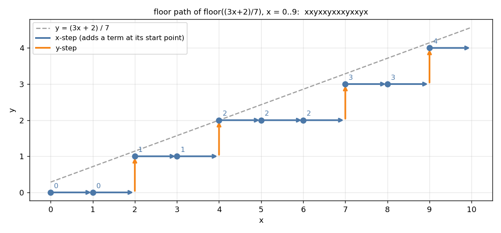
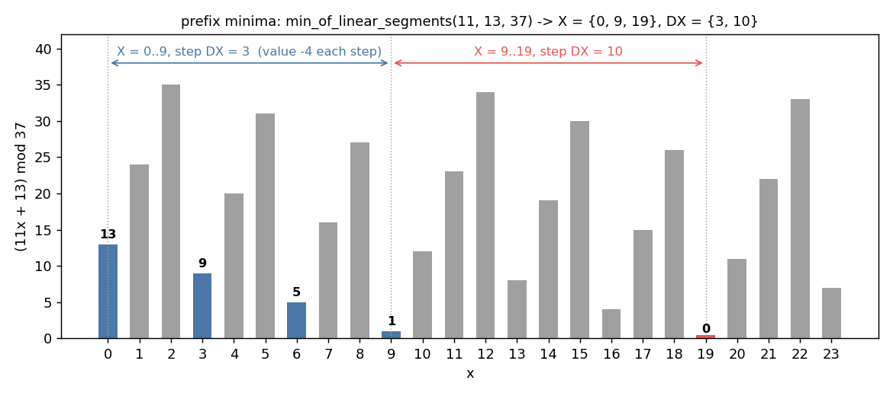

# 5. Floor sums and linear functions mod `m`

Headers: [`floor_sum_of_linear`](../floor_sum_of_linear.hpp),
[`mod_sum_of_linear`](../mod_sum_of_linear.hpp),
[`range_freq_of_linear`](../range_freq_of_linear.hpp),
[`range_freq_mod`](../range_freq_mod.hpp),
[`floor_monoid_product`](../floor_monoid_product.hpp),
[`floor_sum_of_linear_polynomial`](../floor_sum_of_linear_polynomial.hpp),
[`floor_sum_of_linear_polynomial_pq`](../floor_sum_of_linear_polynomial_pq.hpp),
[`min_of_linear_segments`](../min_of_linear_segments.hpp),
[`min_of_linear`](../min_of_linear.hpp),
[`max_of_linear_segments`](../max_of_linear_segments.hpp),
[`first_mod_range_of_linear`](../first_mod_range_of_linear.hpp),
monoids [`monoid_for_floor_sum`](../../monoid/monoid_for_floor_sum.hpp),
[`monoid_for_floor_sum_pq`](../../monoid/monoid_for_floor_sum_pq.hpp).

Everything here is about `f(x) = ax + b` along `x ∈ [L, R)`, through
`⌊f(x) / m⌋` or `f(x) mod m`, in `O(log m)` steps of a Euclid-like recursion.

Running example: `a = 3, b = 2, m = 7`, `x ∈ [0, 10)`.

```
x              0 1 2 3 4 5 6 7 8 9
⌊(3x+2)/7⌋     0 0 1 1 2 2 2 3 3 4      sum 18
(3x+2) mod 7   2 5 1 4 0 3 6 2 5 1      sum 29
```

---

## 1. Floor sum

`floor_sum_of_linear<O, I>(L, R, a, b, m) = Σ_{x∈[L,R)} ⌊(ax+b)/m⌋`.
`I` must hold `ax + b`; the sum is accumulated in `O` (default `i128`).

Shift to `x ∈ [0, N)`, then repeat:

1. `a ≥ m`: write `a = qm + a'`; the `qx` part adds `q · N(N−1)/2`.
2. `b ≥ m`: write `b = qm + b'`; adds `q · N`.
3. Now `a, b < m`. The sum counts lattice points `(x, y)` with
   `1 ≤ y ≤ (ax + b)/m`, `0 ≤ x < N`. Counted by rows instead, it is again a
   floor sum, with `(a, m)` swapped, `N' = ⌊(aN + b)/m⌋` and a new `b`.

`(a, m) → (m mod a, a)` is the Euclidean algorithm, so there are
`O(log m)` rounds. A negative `b` is first raised by a multiple of `m`.

```
floor_sum_of_linear(0, 10, 3, 2, 7) = 18
```

---

## 2. Sums and counts of residues

Since `f mod m = f − m ⌊f/m⌋`:

```
mod_sum_of_linear(L, R, a, b, m) = Σ (ax+b) − m · floor_sum           // 29
```

`(ax + b) mod m ∈ [lo, hi)` holds exactly when
`⌊(ax+b−lo)/m⌋ − ⌊(ax+b−hi)/m⌋ = 1` (otherwise `0`), so

```
range_freq_of_linear(L, R, a, b, m, lo, hi)
    = floor_sum(…, b − lo, …) − floor_sum(…, b − hi, …)                 // [2, 5): 4
```

`range_freq_mod(L, R, lo, hi, m)` is the case `a = 1`, in closed form:
`#{x ∈ [L, R) : x mod m ∈ [lo, hi)}`.

---

## 3. The floor path and `floor_monoid_product`

Walk from `(0, 0)` under the line `y = (ax + b)/m`. Before the `k`-th
x-step (`k = 0, 1, …`), go up to height `⌊(ak + b)/m⌋`. The path is a word
in two letters:



`floor_monoid_product<Monoid>(x, y, N, a, b, m)` returns the monoid product of
this word with `x` and `y` substituted: `N` x-steps, with
`⌊(aN + b)/m⌋` y-steps in total. The recursion is §1's, applied to words:

1. `a ≥ m`: every x is preceded by `⌊a/m⌋` extra y's, so replace `x` by
   `y^{⌊a/m⌋} x`.
2. `b ≥ m`: a prefix `y^{⌊b/m⌋}`.
3. `a, b < m`: swap the roles of `x` and `y`. Between consecutive y's there
   is a block of x's, and the word read by y-steps is again a floor path with
   parameters `(m, a)`. A prefix and a suffix are peeled off.

Powers use `monoid_pow` (or `Monoid::power` when defined), so it takes
`O(log m)` rounds of `O(log N)` multiplications. `U` (unsigned) must hold `aN + b`.

Any statistic that can be updated along x-steps and y-steps becomes a monoid:
sums of `x^i y^j`, products of affine maps, matrices, etc.

---

## 4. Polynomial floor sums

`floor_sum_of_linear_polynomial<T, K1, K2, I>(L, R, a, b, m)` returns all

```
ANS[i][j] = Σ_{x∈[L,R)} x^i ⌊(ax+b)/m⌋^j        i ≤ K1, j ≤ K2.
```

`Monoid_for_floor_sum<T, K1, K2>` describes a piece of the path by its
displacement `(dx, dy)` and `dp[i][j] = Σ x^i y^j` over its x-steps, measured
from the piece's start. Concatenating `A · B` shifts `B` by `(A.dx, A.dy)`
using binomial expansion:

```
Σ (x + dx)^i (y + dy)^j = Σ_{i' ≤ i, j' ≤ j} binom(i,i') binom(j,j') dx^{i−i'} dy^{j−j'} · B.dp[i'][j']
```

That costs `O(K1 K2 (K1 + K2))` per product. Negative `a` is reflected
(`x → −x`, odd `i` change sign), and `L ≠ 0` or negative `b` is handled by a
starting offset.

```
floor_sum_of_linear_polynomial<mint, 1, 1>(0, 10, 3, 2, 7):
    Σ1 = 10,  Σy = 18,  Σx = 45,  Σxy = 116
```

`floor_sum_of_linear_polynomial_pq<T, K1, K2, I>(p, q, L, R, a, b, m)` adds
geometric weights: `Σ p^x q^y x^i y^j`. Its monoid also carries
`prod = p^{dx} q^{dy}`, and `B`'s sums are scaled by `A.prod` before shifting.
`T` needs `inverse()` when `a < 0`.

---

## 5. Prefix minima of `(ax + b) mod m`

`min_of_linear_segments(a, b, m)`, for `0 ≤ a, b < m`, describes every `x ≥ 0`
where `f(x) = (ax + b) mod m` reaches a new prefix minimum. These `x` form a few
arithmetic progressions, returned as boundaries `X = {x_0 = 0, …, x_n}` and
common differences `DX`. Between `x_i` and `x_{i+1}` the updates are
`x_i, x_i + DX_i, …, x_{i+1}`, and `f` drops by the same amount at each step.
`x_n` is where the overall minimum `b mod gcd(a, m)` is reached.



**Why progressions.** A step `x → x + d` changes `f` by `ad mod m`, which is a
decrease if `ad mod m` is close to `m`, i.e. if `d / m` approximates the
fraction `(m − a)/m` from below. The best steps are the denominators of
approximations of `(m − a)/m` found by a Stern–Brocot walk:

* Keep two fractions `p/q ≤ (m − a)/m ≤ r/s`. Their "errors"
  `det_l = (m − a)·q − m·p` and `det_r = m·r − (m − a)·s` shrink like the
  remainders of a continued-fraction expansion.
* `det_l = (aq) mod m` measured downwards: a step of size `q` lowers `f` by
  exactly `det_l`. So the current progression uses `DX = q` while
  `f ≥ det_l`, then the walk refines `p/q` and continues.

There are `O(log m)` progressions.

```
f(x) = (11x + 13) mod 37:  X = {0, 9, 19},  DX = {3, 10}
updates at x = 0, 3, 6, 9 (13, 9, 5, 1) and x = 19 (0)
```

`max_of_linear_segments(a, b, m)` is the same for prefix maxima, applied to
`(m − 1) − f(x) = ((m − a) x + (m − 1 − b)) mod m`.

### `min_of_linear(L, R, a, b, m)`

Returns `(x, f(x))` for the smallest `x ∈ [L, R)` minimising `f(x)`. Shift to
`[0, n)`, with `a·L` reduced mod `m` first. Walk the progressions while the
next boundary is `< n`, then jump inside the current progression as far as
`n − 1` allows.

### `first_mod_range_of_linear(L, R, a, b, m)`

The smallest `x ≥ 0` with `(ax + b) mod m ∈ [L, R)` (taken mod `m`, so `L < 0`
is allowed, e.g. `[−1, 0)` means `m − 1`), or `−1`. After subtracting `L`,
this asks for the first `x` with `f(x) < R`. That `x` is a prefix-minimum
update, so it lies in the first progression whose last value is `< R`. Values
along a progression decrease by a constant `d`, so the position inside it is a
division.

```
first_mod_range_of_linear(0, 3, 5, 7, 17) = 2       ((5·2 + 7) mod 17 = 0)
```
