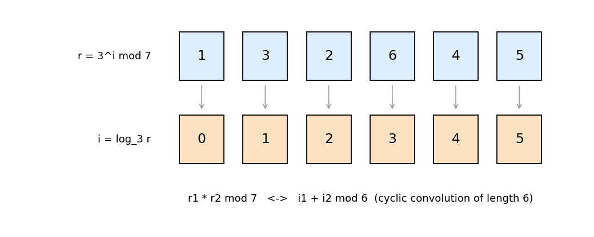

# 6. Multiplicative convolution and modular subset sum

Headers: [`multiplicative_convolution_mod_p`](../multiplicative_convolution_mod_p.hpp),
[`multiplicative_convolution_mod_2n`](../multiplicative_convolution_mod_2n.hpp),
[`modular_subset_sum`](../modular_subset_sum.hpp).

---

## 1. Multiplicative convolution mod a prime

```
C[k] = Σ_{i·j ≡ k (mod p)} A[i] B[j],      len(A) = len(B) = p
```

Index `0` absorbs everything with a zero factor:

```
C[0] = A[0]·ΣB + ΣA·B[0] − A[0]·B[0]
```

Nonzero residues form a cyclic group of order `p − 1` (chapter 0 §6). With a
primitive root `g`, write `r = g^i` and relabel by the exponent. Then
multiplication of residues becomes addition of exponents mod `p − 1`:



```
FA[i] = A[g^i],  FB[i] = B[g^i]      FC = FA * FB   (ordinary convolution, then fold index i ≥ p−1 onto i − (p−1))
C[g^i] = FC[i]
```

Cost: one convolution of length `p − 1`, `O(p log p)`.

```
p = 7:  A = δ1 + 2δ2 + δ6,  B = δ2 + δ3   →   C = (0, 0, 1, 1, 3, 1, 2)
```

---

## 2. Multiplicative convolution mod `2^N`

`multiplicative_convolution_mod_2n(A, B)`, `len = 2^N`. Every `x ∈ [0, 2^N)`
is

```
x = 2^n · u,   u odd,   u ≡ ±5^j  (mod 2^{N−n})
```

with `n = v₂(x)` (`x = 0` gets `n = N`). Group the indices by `n`. Level `n`
is an `H × W` grid of (sign, `j`) with `H = 2`, `W = 2^{N−n−2}` (smaller
for `N − n < 2`). A product of levels `n1`, `n2` lands on level
`n3 = min(N, n1 + n2)`: signs multiply, and exponents add mod `W(n3)`.

So each level pair is a 2D cyclic convolution, but reduced to the smaller
grid of `n3`. Folding an index mod `W'` is the same as evaluating only at the
`W'`-th roots of unity. The library's `ntt` leaves its output in bit-reversed
order, where the first `W'` entries are exactly those evaluations. Hence:

1. `ntt` each level of `A` and `B` along `j`; a sum/difference along the sign
   axis (a length-2 transform).
2. For every `(n1, n2)`, add the pointwise product of the first
   `H(n3) × W(n3)` entries into level `n3`. That is `O(2^N)` work in total,
   since `Σ_{n1,n2} 2^{N−max} = O(2^N)`.
3. Inverse transforms per level, then scatter back to the indices `x`.

Total `O(N 2^N)`.

---

## 3. Modular subset sum

`Modular_Subset_Sum<INT> X(m, vals)`: which `x ∈ [0, m)` are sums of a subset
of `vals` (mod `m`). `X[x]` tests one value; `X.restore(x)` returns the
indices of a subset that achieves it. `O((|vals| + m) log m)`, randomized
(hashing).

The reachable set `S` (initially `{0}`) is updated by `S ← S ∪ (S + v)` for
each value `v`. Only the **new** elements `(S + v) \ S` matter, and there are
at most `m` of them in total. The point is to find them in time proportional
to their number.

* Keep `S` as an indicator array, hashed in a segment tree (polynomial hash
  over `modint61`, chapter 1 §4). Equal hashes on a node mean equal ranges,
  with high probability.
* Build a second tree for `S + v`. The positions where the two trees differ
  are found by descending only into nodes with different hashes:
  `O(log m)` per difference.
* Each new element `d` is marked with `par[d] = index of v`. `restore` walks
  back through `par`.

**`ShiftTree`.** `S + v` is `S` cyclically shifted by `v`. The tree stores a
length-`L` array (`L ≥ 2m`, a power of two) with every `d ∈ S` at both `d` and
`d + L − m`, so a cyclic shift of the length-`L` array realizes the shift
mod `m` on `[0, m)`. A shift by `k` only invalidates the levels below
`lsb(k)`: rebuilding costs `O(2^{n − lsb(k)})`. Processing the distinct values
in **bit-reversed** order makes consecutive shifts have large `lsb`, so the
total shift cost is `O(L log L)`.

```
m = 12, vals = {3, 5, 9}:   reachable {0, 2, 3, 5, 8, 9}
restore(2) = {2, 1}   (9 + 5 = 14 ≡ 2)
```
